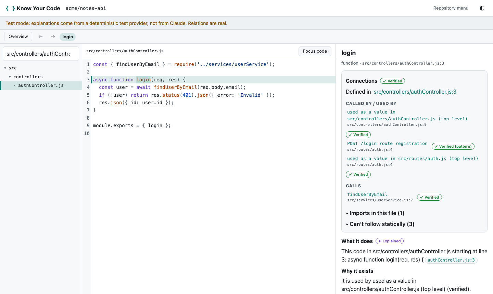
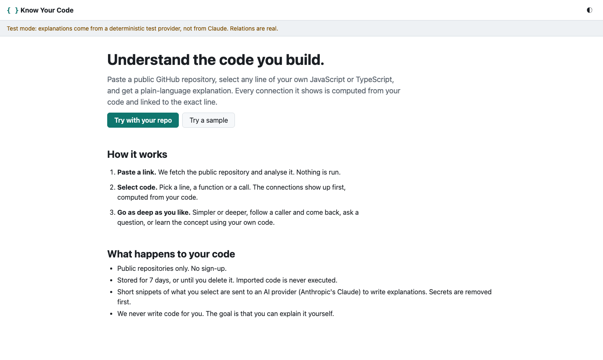
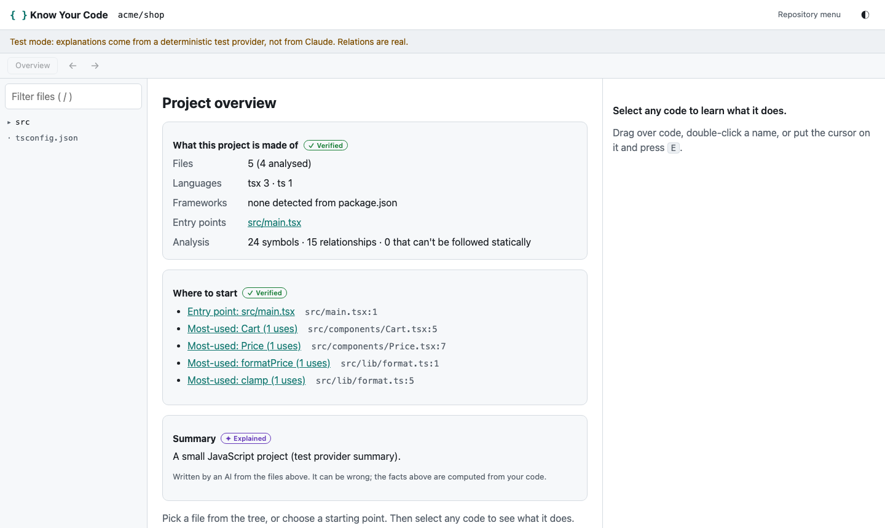
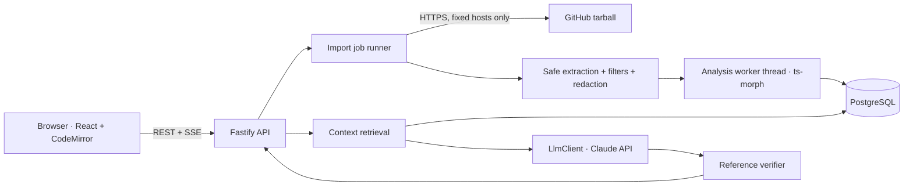

# Know Your Code

> _Understand the code you build._

**Know Your Code (KYC)** is a free browser workspace for CS students. Paste a public GitHub repository, select any
line of your own JavaScript or TypeScript, and get a plain-language explanation. Next to it you see the code's callers,
callees and definitions, **computed by static analysis and linked to the exact line**, so you can check every claim.

Team Destruct · Construct 2.0 · V1



## What you can do

1. **Import** a public GitHub repository (JS/TS) with staged progress.
2. **Browse** a file tree and read real source in a read-only, syntax-highlighted viewer.
3. **Select** a function, a call, an import, a variable, or any block (mouse, double-click, or keyboard + `E`).
4. **Understand**: connections appear first, computed from your code and labelled **Verified**; the AI explanation follows,
   labelled **Explained**, and every line link in it is checked against what the model was actually shown.
5. **Explore**: click a caller or callee, go **Back** (Alt+←), ask follow-up questions, go **Simpler / Deeper**, and open a
   **concept** (for example `async/await`) taught with your own code.
6. **Practise (optional)**: a one-question _Check yourself_, never a gate. Rate any answer 👍/👎.
7. **Delete** your data at any time. Everything is removed automatically after 7 days.

The product never writes code for you. Imported code is never executed.

| Landing                                  | Overview                                      |
| ---------------------------------------- | --------------------------------------------- |
|  |  |

## Status

V1 is implemented and tested end to end. **Read [Known limitations](#known-limitations) before relying on it**, in
particular: the live Claude integration has not been exercised against the real API in this repository's test runs (no API
key was available), only against a wire-level test double and the deterministic test provider.

Full status against the requirements: [`docs/implementation/01_Implementation_Status.md`](docs/implementation/01_Implementation_Status.md).

## Quick start

**Prerequisites:** Node.js ≥ 20.12, npm ≥ 10, PostgreSQL ≥ 14 with the `pg_trgm` and `pgcrypto` extensions (both ship with
the standard contrib package). Optional: an Anthropic API key (explanations) and a GitHub token (higher rate limits).

```bash
git clone https://github.com/divyanshj25604-arch/Know_Your_Code.git && cd Know_Your_Code
git checkout V1_KYC

npm install
createdb kyc_dev                  # any empty database; the app creates its tables on start
cp .env.example .env              # then edit: DATABASE_URL, ANTHROPIC_API_KEY, ...

npm run dev                       # API on :8080, web app on http://localhost:5173
```

No Anthropic key yet? Set `LLM_PROVIDER=fake` in `.env` to try everything except real explanations. The app shows a visible
"Test mode" banner while the test provider is active.

### Production build

```bash
npm run build                     # client -> client/dist, server -> server/dist
NODE_ENV=production COOKIE_SECRET=$(openssl rand -hex 32) \
  DATABASE_URL=... ANTHROPIC_API_KEY=... npm start     # serves the API and the web app on :8080
BASE_URL=http://localhost:8080 npm run smoke           # post-start end-to-end check (real import)
```

Deployment, monitoring and rollback: [`docs/implementation/02_Deployment_and_Operations.md`](docs/implementation/02_Deployment_and_Operations.md).

## Configuration

All configuration is environment variables (a `.env` in the repo root is loaded for you; real environment variables win).
The server validates them at start-up and refuses to run with a clear message if something required is missing.
[`.env.example`](.env.example) has every key with a safe placeholder.

| Variable                                       | Default                                  | Purpose                                                                                      |
| ---------------------------------------------- | ---------------------------------------- | -------------------------------------------------------------------------------------------- |
| `DATABASE_URL`                                 | _(required)_                             | PostgreSQL connection string                                                                 |
| `COOKIE_SECRET`                                | dev-only value                           | ≥ 16 chars. **Required in production.** Signs the anonymous owner cookie                     |
| `LLM_PROVIDER`                                 | `anthropic`                              | `anthropic` (real) or `fake` (deterministic test provider; tests/offline demos only)         |
| `ANTHROPIC_API_KEY`                            | –                                        | Required in production when `LLM_PROVIDER=anthropic`. Never sent to the browser              |
| `MODEL_FAST` / `MODEL_STRONG`                  | `claude-haiku-5-5` / `claude-sonnet-5-5` | Fast tier (explanations, follow-ups) and strong tier (project summary, fallback)             |
| `MODEL_*_USD_PER_MTOK`                         | list prices                              | Used for cost accounting and the spend cap; check the provider's pricing page                |
| `DAILY_SPEND_CAP_USD`                          | `5`                                      | Hard daily cap on model spend; navigation keeps working when it is reached                   |
| `GITHUB_TOKEN`                                 | –                                        | Optional fine-grained read-only token. Without it imports use `codeload.github.com` directly |
| `RETENTION_DAYS`                               | `7`                                      | How long imported code is kept                                                               |
| `MAX_ANALYSABLE_FILES`, `MAX_TARBALL_BYTES`, … | 1500, 50 MB                              | Import limits (see `.env.example`)                                                           |
| `RATE_*_PER_HOUR`                              | 5 / 60 / 120                             | Per-owner limits: imports / explanations / follow-ups                                        |
| `TRUST_PROXY`                                  | `false`                                  | Set `true` only behind a reverse proxy you control                                           |
| `COOKIE_SECURE`                                | `true` in production                     | Set `false` only for plain-http deployments                                                  |
| `ANALYSIS_MODE`                                | `auto`                                   | `auto` (worker thread when the build is present), `worker`, or `inline`                      |

### Configuring the AI

1. Create an API key in the Anthropic console and put it in `ANTHROPIC_API_KEY`.
2. Keep the default models or change `MODEL_FAST` / `MODEL_STRONG`. Update the `*_USD_PER_MTOK` values so the spend cap is accurate.
3. Start the app: `GET /api/v1/health` reports `"ai": "configured"`.
4. Verify the real integration (this spends a few cents): `BASE_URL=http://localhost:8080 node scripts/smoke.mjs --ai` and `ANTHROPIC_API_KEY=... npm run test:live`.

## Testing

| Command             | What it runs                                                                                                                                                                                                               | Needs                                         |
| ------------------- | -------------------------------------------------------------------------------------------------------------------------------------------------------------------------------------------------------------------------- | --------------------------------------------- |
| `npm run check`     | typecheck + lint + format check + all unit/integration tests (the pre-commit gate)                                                                                                                                         | PostgreSQL (`createdb kyc_test`)              |
| `npm test`          | server (Vitest, real Postgres, real HTTP download from a local stand-in, real analysis) and client (Vitest + Testing Library)                                                                                              | PostgreSQL                                    |
| `npm run test:e2e`  | Playwright in a real browser, **deterministic mode**: real server and database, local GitHub stand-in, test AI provider; includes axe accessibility checks in both themes, keyboard-only, responsive and error-state tests | PostgreSQL, `npx playwright install chromium` |
| `npm run test:live` | Playwright **live mode**: real `codeload.github.com` imports through the production build; a real-Claude test runs **only if** `ANTHROPIC_API_KEY` is set, otherwise it is skipped                                         | network (+ key for the AI test)               |
| `npm run smoke`     | Post-deploy check of a running instance (`BASE_URL=...`)                                                                                                                                                                   | a running server                              |

Set `TEST_DATABASE_URL` if your test database is not `postgres://localhost/kyc_test`. Details and measured results:
[`docs/implementation/04_Testing_and_Measurements.md`](docs/implementation/04_Testing_and_Measurements.md).

## How it works



- **Structure is computed; meaning is explained.** ts-morph (the TypeScript compiler API, `allowJs`) extracts symbols and
  `imports` / `calls` / `references` / route edges. Anything it cannot follow is stored with a reason (dynamic import,
  external package, …) and shown honestly. The model only explains relationships already established.
- **Grounded prompts.** For each request a priority-ordered context pack (selection, enclosing symbol, verified relations,
  definitions, call sites, imports, project facts, lexical hits for follow-ups) is built under a token budget, redacted, and
  placed inside an untrusted-content block, separate from the system rules.
- **Verified references.** File/line links returned by the model are kept only if they fall inside the code it was shown.
- **Safety by construction.** Only `github.com/{owner}/{repo}` is accepted; archives are extracted with path, size, entry
  and decompression limits; secrets are never stored or shown; repository text is never executed or treated as instructions.

Layout: `packages/contracts` (shared Zod schemas), `server/` (Fastify API, ingestion, analysis, AI, jobs), `client/`
(React app), `e2e/` (Playwright), `scripts/` (measurement and smoke tools), `docs/` (product and implementation docs).

## Known limitations

- **Live AI unverified here.** The Claude integration is implemented with the official SDK and covered by wire-level tests,
  but no test run in this repository used a real API key. Run `npm run test:live` and the smoke test with `--ai` first.
- **Explanations are not token-streamed.** Connections arrive immediately; the explanation sections appear once the model
  call completes (typically a few seconds).
- **JavaScript/TypeScript only**, public repositories only, no accounts (by design for the MVP).
- **Static analysis has honest blind spots**: dynamic `require`/`import`, `obj[name]()`, callbacks passed as values,
  dependency injection, prototype-assignment patterns (`Foo.prototype.bar = function`), and framework conventions such as
  Next.js file-based routing. These are reported as "can't follow statically", not guessed.
- **Not implemented from the "Should/Could" list:** _Trace this value_, the local call diagram, graph-derived "Explore
  next" symbols, free-text "explain it back" checks, and the Express heuristic beyond route registration.
- **Anonymous GitHub mode** (no token) cannot resolve a commit SHA or pre-check repository size, so same-commit snapshot
  reuse and the early size rejection only work with `GITHUB_TOKEN`; the streamed size caps still apply.
- **Single instance.** The job queue and rate limiter are in-process (documented design decision ADR-06).
- No Dockerfile is provided: it could not be built or tested in the development environment.

## Documentation

Product and design documents live in [`docs/`](docs/); start with [`docs/00_Master_Product_Blueprint.md`](docs/00_Master_Product_Blueprint.md)
(index in [`docs/README.md`](docs/README.md)). Implementation documents, written against the code as built:

| Doc                                                                                                          | Contents                                                 |
| ------------------------------------------------------------------------------------------------------------ | -------------------------------------------------------- |
| [`docs/implementation/00_Execution_Plan.md`](docs/implementation/00_Execution_Plan.md)                       | Plan, starting point, decisions and deviations (ADR-11…) |
| [`docs/implementation/01_Implementation_Status.md`](docs/implementation/01_Implementation_Status.md)         | Requirement-by-requirement status, API/data as built     |
| [`docs/implementation/02_Deployment_and_Operations.md`](docs/implementation/02_Deployment_and_Operations.md) | Deploy, health, logging, backups, rollback, runbook      |
| [`docs/implementation/03_Security_and_Privacy.md`](docs/implementation/03_Security_and_Privacy.md)           | Threat model, safeguards, residual risks                 |
| [`docs/implementation/04_Testing_and_Measurements.md`](docs/implementation/04_Testing_and_Measurements.md)   | Test inventory and measured performance                  |

Requirements change in `docs/01` first; the other documents implement it and must not redefine the product.
