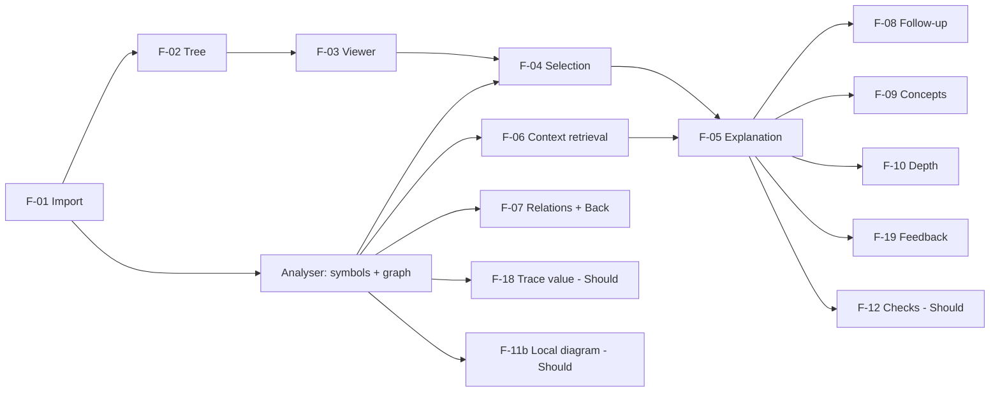

# 04 · MVP Scope and Prioritisation

| Version | 1.0 | Status | Draft; must agree with `01` §10 |
|---|---|---|---|

**Purpose.** Define the smallest product that can test the thesis: *grounded, verifiable, learner-paced explanations of a student's own code improve independent comprehension more than their current tools do* (A3 + A4 in `01`).

**Rule.** A feature is **Must** only if removing it would stop us from testing A3 or A4 end-to-end with a real student's repository.

---

## 1. Smallest end-to-end workflow (the "thin slice")
```
Paste public GitHub URL → index JS/TS → file tree + viewer → select code
→ explanation (streamed) + verified relations → click a caller → Back
→ follow-up question / Simpler / Deeper / concept chip → 👍/👎 → delete
```
If only this works reliably on 10 corpus repos plus participants' repos, the MVP is demonstrable and testable.

## 2. Feature evaluation (MoSCoW)
Complexity: S ≤ 1 day, M 2–3 days, L 4+ days (for one developer).

| ID | Feature | Needed to prove thesis? | Priority | Complexity | User value | Main risk | Validation |
|---|---|---|---|---|---|---|---|
| F-01 | Public GitHub repo import | Yes, entry point | **Must** | M | Zero-setup start | Rate limits, archive edge cases | Corpus import test |
| F-02 | File-tree exploration | Yes, navigation | **Must** | S | Find code | Large trees | Usability T1 |
| F-03 | Syntax-highlighted viewer | Yes, reading in place | **Must** | S | Read real code | Big files | Render test |
| F-04 | Function-level and arbitrary selection | Yes, core interaction | **Must** | M | Ask about exactly what confuses you | Mapping ranges to symbols | Selection test cases |
| F-05 | Contextual explanations | Yes, core value | **Must** | M | Understand | Hallucination | AI eval set |
| F-06 | Cross-file context retrieval | Yes, differentiator A3 | **Must** | M | Explanations reflect the whole project | Missed edges | Edge accuracy benchmark |
| F-07 | Dependency navigation (relations + Back) | Yes, "verifiable" claim | **Must** | M | Trace without losing place | State bugs | Usability T3 |
| F-08 | Follow-up questions | Yes, learning loop | **Must** | S | Clarify | Off-topic drift | Eval follow-up cases |
| F-09 | Concept explanations (chips) | Yes, learning-first | **Must** | S | Fill knowledge gaps | Generic answers | Rubric "uses user's code" |
| F-10 | Depth control (Simpler/Deeper) | Yes, adaptive learning | **Must** | S | Fits skill level | — | Usability observation |
| F-11 | Project architecture diagram (whole repo) | No | **Won't (MVP)** | L | Nice orientation | Messy graphs mislead | — |
| F-11b | Local call-neighbourhood diagram (1 hop) | Helpful, not required | **Should** | M | See connections | Clutter | Usability preference |
| F-12 | Optional understanding checks | Helps measure A4 in product, not required (tests are run in sessions) | **Should** | M | Self-verification | Feels like a quiz | Uptake rate (unprompted) |
| F-13 | User accounts | No | **Won't** | M | Cross-device history | Time sink | — |
| F-14 | Saved learning sessions | No (threads persist per snapshot for 7 days) | **Won't** | M | Resume later | — | Revisit if M-07 blocked |
| F-15 | Multiple languages | No | **Won't** | L per language | Broader reach | Doubles analyser work | A5 result |
| F-16 | Private repository support | No | **Won't** | L (GitHub App, token security) | Real projects often private | Security | A2/A5 results |
| F-17 | AI project summary | Orientation aid | **Should** | S | Mental map | Plausible but wrong | Link verification |
| F-18 | Trace a value (call sites + args) | Strong "aha" for trace pain | **Should** | M | Answers "where from?" | Destructuring complexity | Corpus cases |
| F-19 | Feedback 👍/👎 | Yes, measures M-04/M-05 | **Must** | S | Voice | — | — |
| F-20 | Delete repo and retention | Yes, ethics and adoption | **Must** | S | Control | — | Deletion test |
| F-21 | Express route mapping heuristic | Improves relations in the most common student stack | **Could** | M | Links route string → handler | Fragile | Spike (D-09) |
| F-23 | Suggested starting points (graph-derived) | Helps "where do I begin?" | **Should** | S | Orientation | — | Usability T1 |
| F-22 | "Explain it back" feedback | No | **Could** | M | Practise explaining | Grading accuracy | — |

## 3. Dependency-aware build order

**Critical path:** F-01 → Analyser → F-04 → F-06 → F-05. The analyser is the riskiest component, so it is spiked on Day 1–3 (`12`).

## 4. Acceptance criteria for Must features
Defined per requirement in `01` §6. The MVP exit test is:
1. 10/10 corpus repos import; ≥ 9/10 within NFR-PERF-01.
2. AI eval set passes the release gates in `11` §8.
3. Three external students complete the thin slice unassisted.
4. Delete removes all derived data (verified via DB query).

## 5. Explicitly excluded (and why)
| Excluded | Reason |
|---|---|
| Accounts, dashboards, streaks, gamification | Don't test A3/A4; risk turning KYC into a quiz app (PP1, PP7) |
| Code generation or "fix it for me" | Conflicts with PP8; commoditised (`03` §4.5) |
| Whole-repo architecture diagrams | High effort; inaccurate diagrams damage trust |
| Embeddings or vector DB | Graph + lexical retrieval suffices at student-repo scale (ADR-05) |
| Private repos | OAuth and token security cost; revisit with evidence |
| Python/Java | One language done well beats three done badly; CodeSee's lesson (`03` §1) |

## Assumptions · Risks · Open questions
- Assumes 3 weeks with 5 part-time members (D-01 open).
- Risk: Should features crowd out Must quality. Rule: no Should work until the Must exit test items 1–2 pass.
- Open: is F-18 (Trace value) a stronger demo moment than F-12 (Checks)? Decide on Week-2 test results.

**Related:** `01` §6, §10 · `07` §15 · `12`
