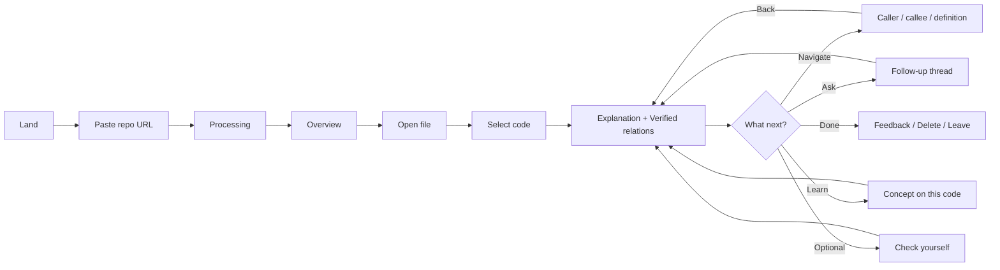
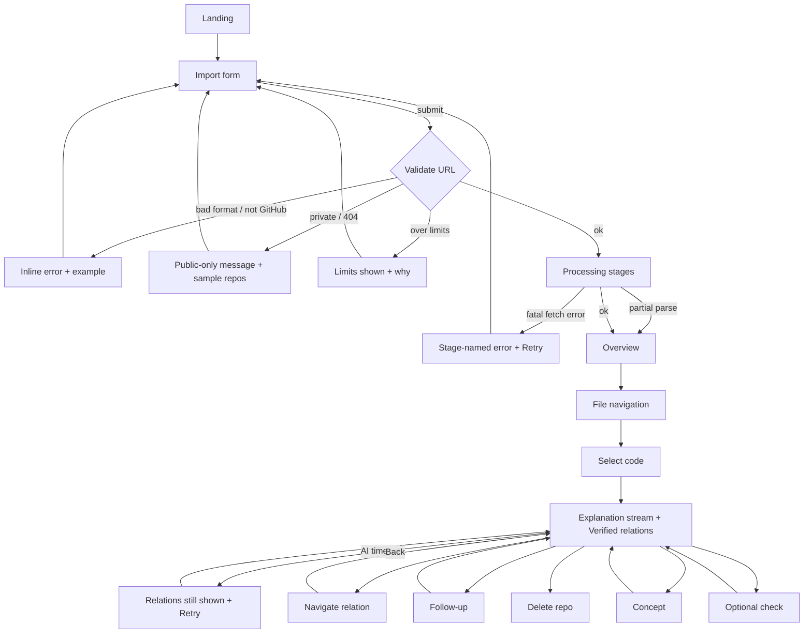

# 05 · End-to-End User Flow

| Version | 1.0 | Status | Draft; implements `01` §9; screens specified in `06` §D |
|---|---|---|---|

**Purpose.** Define every step of the journey with its states, so design, engineering, and testing share one script.
**Invariant:** no step requires answering a question before showing an explanation (PP1).

---

## Simplified journey (for product and engineering discussions)

## Primary journey with failure paths

---

## Step specifications
Format: **Goal · Action · System response · Data · AI · Loading · Error · Success · Next**

### 1. Landing page
- **Goal:** decide whether KYC is worth trying. **Action:** read the headline, watch a 20-s demo loop, click "Try with your repo" or "Try a sample".
- **System:** static page. **Data:** none. **AI:** none.
- **Loading:** n/a. **Error:** n/a. **Success:** CTA click (event `landing_cta`). **Next:** Step 3.

### 2. Initial product explanation
- **Goal:** know what will happen to my code. **Action:** read the 3-step "How it works" and privacy notes (public repos only, deleted after 7 days or on request, AI provider named).
- **System:** inline on the import screen, not a modal. **AI:** none. **Next:** Step 3.

### 3. Repository import
- **Goal:** start with my project. **Action:** paste a URL, or choose one of 3 sample repos.
- **System:** client-side format check as the user types. **Data:** URL string.
- **Error:** malformed URL → "Paste a link like `https://github.com/user/project`". **Success:** POST accepted (202). **Next:** Step 4.

### 4. Repository validation (server)
- **System:** parse owner, repo, and ref; GitHub metadata call (exists, public, default branch, size); check against limits.
- **Data:** repo metadata, commit SHA. **AI:** none.
- **Errors:** `REPO_NOT_FOUND_OR_PRIVATE` → public-only explanation plus "Try a sample". `REPO_TOO_LARGE` → shows the limit and the repo's size. `GITHUB_RATE_LIMITED` → "Busy, retry in ~N min".
- **Success:** snapshot created (or the existing one reused if the SHA was already indexed). **Next:** Step 5.

### 5. Repository processing
- **Goal:** know it's working. **System:** background job: Fetch archive → Filter → Analyse (symbols, graph) → Summarise (Should). Status polled every 1.5 s.
- **Data:** snapshot status and stage progress (files analysed / total). **AI:** only in Summarise (optional, non-blocking).
- **Loading:** stage checklist with counts; never a bare spinner. **Next:** Step 7 automatically.

### 6. Processing progress and failure states
- **Partial failure:** files that fail to parse are listed under "Skipped (N)" with reasons; the workspace opens anyway.
- **Fatal failure:** the error names the stage plus an action (Retry, Try another repo). **Timeout:** at 120 s → "Taking longer than expected"; the job keeps running and the page updates when done.

### 7. Project overview
- **Goal:** get a mental map. **System:** verified facts (stack from `package.json`, file counts, entry points); suggested starting points (graph-derived, Should); AI summary (Should; labelled *Explained*; streams in; failure is silent with a "Couldn't summarise" note).
- **Success:** user clicks a starting point or a file. **Next:** Step 8.

### 8. File navigation
- **Goal:** find the code I care about. **Action:** tree, filename filter, or starting-point click.
- **System:** loads file content (cached in the client). **AI:** none. **Loading:** skeleton lines < 500 ms target.
- **Error:** file too large to display → "Too large to show (X KB). Showing first 2,000 lines." **Next:** Step 9.

### 9. Code selection
- **Goal:** ask about exactly this. **Action:** select text, double-click an identifier, or put the cursor on a symbol and press `E`.
- **System:** "Explain" button appears near the selection; server resolves the selection kind and enclosing symbol (`08` §6).
- **Error:** selection spans multiple top-level declarations → explain as a "block" and say so. Whitespace or comment only → "Select some code to explain". **Next:** Step 10.

### 10. Contextual explanation
- **Goal:** understand. **System:** (a) **Verified relations** render immediately from the graph; (b) the explanation streams in sections suited to the kind (`06` §F); (c) depth control, concept chips, Explore next, 👍/👎, and "Check yourself" (Should) appear at the end.
- **Data:** selection, enclosing symbol, relations, retrieved snippets. **AI:** yes.
- **Loading:** relations first, then streamed text with a "Writing explanation…" label. **Error:** model error or timeout → keep relations visible, show "Explanation failed. Retry"; cached results return instantly.
- **Success:** explanation complete (event `explanation_complete`). **Next:** 11, 12, 13, 14, or 16.

### 11. Dependency exploration
- **Action:** click a caller, callee, definition, or import (or a diagram node, Should). **System:** opens the target file at the line; pushes a breadcrumb; the panel shows that symbol's relations and offers "Explain this".
- **Back:** restores file, scroll, selection, and explanation from history (client state). **AI:** none unless the user clicks Explain. **Unresolved edges:** shown greyed with a reason ("dynamic import", "external package: express").

### 12. Follow-up questions
- **Action:** type a question in the thread under the explanation, or tap a suggested question.
- **System:** answers with the selection context plus lexical search for identifiers in the question. Answers carry verified links. **AI:** yes.
- **Error:** question unrelated to the code → brief answer plus a nudge back to the selection. Can't answer from code → "The code doesn't show this. Here's what would tell us: …".

### 13. Conceptual learning
- **Action:** click a concept chip (e.g. "await").
- **System:** short explanation of the concept → the same concept pointed out in the selected lines → one "spot it" prompt (optional) → "Back to your code". **AI:** yes.

### 14. Optional understanding check (Should)
- **Entry:** only via the "Check yourself" button. **System:** one question (predict, trace, or why) with options or free text; feedback cites lines; "Skip" is always available; no scores are stored beyond the attempt.
- **Error:** generation fails → hide the button for that explanation.

### 15. Return to the repository
- Returning within 7 days on the same browser → "Continue with *repo-name*" on the landing page; threads restored. Different browser → re-import (cached snapshot makes it fast).

### 16. Repository deletion
- **Action:** "Delete my data" in the repo menu → confirm. **System:** hard-deletes snapshot data; confirms. **Error:** failure → retry; deletion is also guaranteed by the 7-day job.

### 17. Error recovery (catalogue)
| Code (see `10`) | User message | Action offered |
|---|---|---|
| INVALID_URL | "That isn't a GitHub repository link." | Example format |
| REPO_NOT_FOUND_OR_PRIVATE | "We can only open public repositories right now." | Try sample · How to make a public copy |
| REPO_TOO_LARGE | "This repo has N analysable files; the limit is 1,500." | Try another |
| UNSUPPORTED_LANGUAGE | "No JavaScript/TypeScript files found." | Try another; tell us your language (feedback) |
| GITHUB_RATE_LIMITED | "GitHub is limiting requests. Try again in ~N min." | Retry timer |
| INDEX_FAILED | "Analysis failed at stage X." | Retry |
| AI_TIMEOUT / AI_ERROR | "The explanation didn't finish." | Retry (relations stay) |
| BUDGET_EXCEEDED | "We've hit today's free limit. Navigation still works." | Come back tomorrow |
| SNAPSHOT_EXPIRED | "This repo's data was deleted after 7 days." | Re-import |
| INVALID_SELECTION | "Select some code to explain." | — |
| FILE_NOT_FOUND | "That file isn't in this version of the repo." | Back to tree |
| NOT_OWNER | "Only the browser that imported this repo can delete it." | — |
| RATE_LIMITED | "You're going fast! Try again in a minute." | Retry timer |
| AI_BUSY | "Our AI is busy. Retrying…" | Auto-retry once, then Retry |
| SERVICE_UNAVAILABLE | "Know Your Code is temporarily unavailable." | Retry |

## Related
`01` §6, §9 · `06` §D–G · `10` error codes · `11` E2E tests
