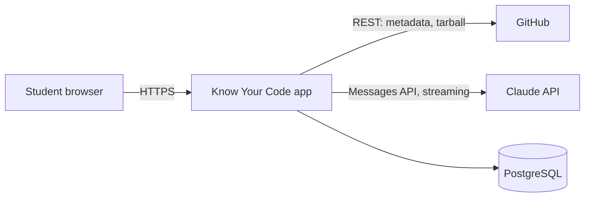
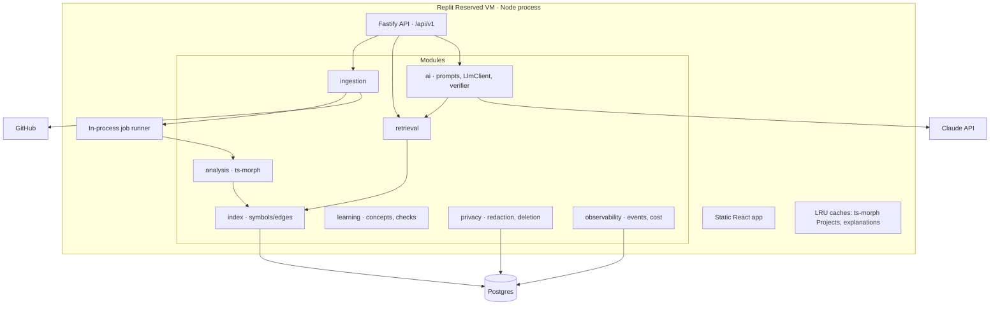
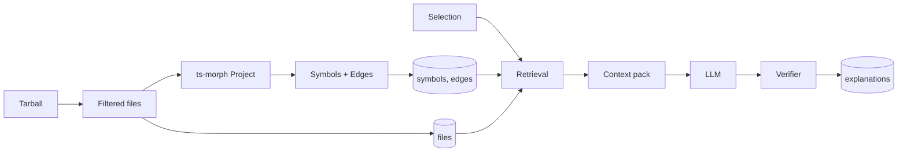
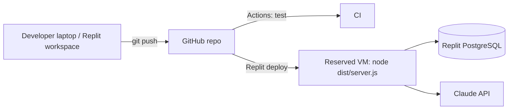

# 07 · System Architecture

| Version | 1.0 | Status | Draft; implements `01`; details in `08`, `09`, `10` |
|---|---|---|---|

**Purpose.** Specify a system a small student team can build in about 3 weeks and run reliably for a demo and early users.
**Shape in one line:** a **single TypeScript modular monolith** (Fastify API + in-process job worker + static React app) on **one Replit Reserved VM**, with **PostgreSQL** for state, **ts-morph** for JS/TS analysis, and the **Claude API** for explanations.

---

## 1. Architecture goals
| Type | Goal |
|---|---|
| Functional | Import public repo → analyse JS/TS → serve files, symbols, and relations → grounded streamed explanations → follow-ups, concepts, checks → delete |
| Non-functional | `01` §7: import ≤ 90 s at limit; first token ≤ 4 s p50; navigation ≤ 500 ms; AI failure never blocks navigation |
| MVP constraints | 5 part-time students, ~3 weeks, minimal budget, one deployable unit |
| Expected usage | ≤ 20 concurrent users, ≤ 200 imports/week (`NFR-SCL-01`) |
| Reliability | Single instance; restart on crash; jobs resumable from DB state |
| Security | Untrusted repo content (archives, prompt injection, secrets) |
| Cost | Per-session token tracking; daily spend cap; caching |
| **Explicit exclusions** | Microservices, Kubernetes, message brokers, vector DB, separate search engine, user auth, multi-region, CDN for code content |

## 2. Technology stack evaluation and selection
| Layer | Options considered | **Choice** | Why / trade-off |
|---|---|---|---|
| Frontend framework | React + Vite; Next.js | **React + Vite + TypeScript** | SPA is enough (no SEO need inside the app; landing can be a static route). Vite is simpler than Next's server model. One fewer runtime concern. |
| Code viewer | Monaco; CodeMirror 6; Shiki (static) | **CodeMirror 6 (read-only)** | Lighter than Monaco; supports selection events, decorations, line highlighting, and JS/TS/JSX/TSX highlighting. Shiki can't do interactive selection without extra work. *Verify bundle size and decoration API in spike T-2.* |
| UI components | shadcn/ui (Radix); MUI; hand-rolled | **Radix primitives + own CSS tokens** | Accessible primitives (menus, dialogs, radio groups) without importing a full visual language; matches `06` §H tokens. |
| Diagrams (Should) | Mermaid; React Flow; Cytoscape | **Mermaid (client-side)** | Generated from graph data; simple; 1-hop graphs only. |
| Backend | Express; Fastify; NestJS | **Fastify (Node 20+ LTS, TypeScript)** | Built-in JSON schema validation, good performance, simple plugins. Nest adds ceremony we don't need. |
| Background work | BullMQ + Redis; pg-boss; in-process queue | **In-process queue with job state in Postgres** | One instance means no distributed queue is needed. Job rows make status durable; a restart re-queues `running` jobs. Revisit at > 1 instance (ADR-06). |
| Code analysis | Tree-sitter; Babel parser; TypeScript compiler API via **ts-morph** | **ts-morph** | Gives *semantic* resolution for JS and TS (definitions, references, imports across files, with `allowJs`), not just syntax trees. Tree-sitter would need hand-built name resolution. Trade-off: heavier memory; JS/TS only (fine per D-02). (ADR-03) |
| Retrieval | Embeddings + vector DB; lexical; graph | **Graph-first + Postgres lexical search (pg_trgm)** | Student repos are small; structural relations are what matter; no embedding pipeline or cost. (ADR-05) |
| LLM | Claude API; OpenAI; Gemini | **Claude API**, model IDs in env (`MODEL_FAST`, `MODEL_STRONG`) | Strong code reasoning; streaming; tool-based structured output; one provider keeps the code simple. Swappable behind `LlmClient`. (ADR-07) |
| Database | PostgreSQL; SQLite; MongoDB | **PostgreSQL (Replit-provisioned)** | Relational data (symbols ↔ edges); trigram search; durable outside the VM disk. |
| Object storage | S3; DB rows; VM disk | **File contents in Postgres (`files.content`)** | Student repos are a few MB; avoids another service. Revisit if the DB grows past plan limits. |
| Hosting | Replit Reserved VM; Replit Autoscale; Render/Fly | **Replit Reserved VM** | Always-on (no cold start mid-job); in-memory ts-morph projects survive between requests; Replit is a competition partner. Autoscale scales to zero and may run multiple instances, breaking in-memory caches. (ADR-08) |
| CI | GitHub Actions | **GitHub Actions** (typecheck, lint, unit, eval smoke) | Free for public repos; standard. |
| Monitoring | Sentry; logs only | **Structured logs (pino) + Sentry free tier (optional)** | Minimal; errors visible quickly. |

## 3. High-level architecture

### 3.1 System context

### 3.2 Container / module view (one deployable)

### 3.3 Main request flows
- **Import:** `POST /repositories` → validate → create snapshot (`queued`) → job: fetch tarball → filter → write files → analyse → write symbols/edges → (optional) summary → `ready`.
- **Explain:** `POST /explanations` (SSE) → resolve selection → retrieve context → cache check → stream from LLM → verify references → persist → final event.
- **Navigate:** `GET /symbols/:id/relations` → DB only.

### 3.4 Data flow

### 3.5 Deployment

## 4. Component responsibilities
| Component | Responsibilities | Inputs | Outputs | Depends on | Failure modes | Security boundary | Observability |
|---|---|---|---|---|---|---|---|
| Frontend app | Screens per `06`; client nav history; SSE handling | User actions | API calls | API | SSE disconnect → retry once | Renders untrusted code as text only (no `innerHTML`) | Client error reporting |
| ingestion | URL parse, GitHub metadata, tarball download, size checks | URL | Repo metadata, archive stream | GitHub | 404/private, rate limit, oversized | Only `api.github.com`/`codeload.github.com`; no user-supplied hosts (SSRF) | Stage timings |
| normaliser/filter | Extract archive safely; apply include/exclude rules; detect language | Archive | File list + contents | — | Zip-slip paths, huge files, binary | Path sanitisation; size caps; no symlinks followed | Skipped-file counts |
| analysis (ts-morph) | Build in-memory Project; extract symbols; resolve definitions/references/calls/imports | Files | Symbols, edges, diagnostics | — | OOM, slow on large files | Never executes repo code; no `npm install` | Parse time, memory |
| index | Persist and query symbols/edges; symbol-at-position lookup | Symbols/edges | Query results | Postgres | Missing rows → empty relations | Snapshot-scoped queries | Query latency |
| retrieval | Build a context pack within the token budget | Selection, question | Context pack | index, files | Over budget → truncate by priority | Redaction applied | Pack size, items |
| ai | Prompt assembly, LLM calls, streaming, JSON validation, reference verification, caching | Context pack | Explanation | Claude API | Timeout, malformed output, injection | API key server-side only | Tokens, cost, latency, errors |
| learning | Concept detection payloads; check generation/grading | Explanation | Concept or check payloads | ai | Generation fails → hide feature | — | Uptake |
| privacy | Secret redaction; deletion; retention job | Files, schedule | Redacted text; deletions | DB | Deletion partial → retry | — | Deletion audit log |
| observability | Events, cost ledger, health | All modules | Rows/logs | DB | — | No code content in logs | Dashboards (SQL) |
| job runner | Run import jobs with concurrency 2 | Job rows | Status updates | All above | Crash → job re-queued on boot | — | Job durations |
| database | Durable state | — | — | — | Connection loss → 503 + retry | Least-privilege role | Slow query log |
| caches | Keep ≤ N ts-morph Projects in memory (LRU, N=5) and explanation cache keys | — | — | — | Evicted → rebuild from DB files | Memory bound | Hit rate |

**Why a modular monolith:** one team, one deploy, shared types, no network hops between modules. Module boundaries (folders with explicit interfaces) keep a future split possible: the analysis worker is the first candidate if imports start to slow down API responses.

## 5. Repository processing pipeline
| # | Stage | What happens | Partial-failure rule |
|---|---|---|---|
| 1 | Validate | Parse URL; reject non-GitHub hosts | Fatal |
| 2 | Metadata | `GET /repos/{owner}/{repo}` with server token → visibility, default branch, size; resolve ref → commit SHA | Private/404 fatal |
| 3 | Cache check | If `(repo, sha)` snapshot exists and is `ready` → reuse | — |
| 4 | Fetch | Download tarball for SHA (single API request) via streaming; abort past the size cap | Fatal on cap |
| 5 | List and filter | Extract to memory/temp with path sanitisation; apply rules (`08` §2) | Skipped files recorded |
| 6 | Language detection | By extension (+ `tsconfig`/`jsconfig` presence) | No JS/TS → `UNSUPPORTED_LANGUAGE` |
| 7 | Parse | Add files to a ts-morph Project (`allowJs`, `checkJs: false`, `noResolve: false`, in-memory FS) | File-level syntax errors are tolerated; logged as diagnostics |
| 8 | Symbol extraction | Walk declarations → symbols | Failures per file → skip file's symbols, keep file viewable |
| 9 | Relationship extraction | Definitions, references, calls, imports → edges; unresolved edges with reason | Per-edge errors → unresolved |
| 10 | Index construction | Bulk insert symbols/edges; trigram index on file content | Fatal on DB error → retry job once |
| 11 | Summary (Should) | LLM overview from deterministic facts + top files | Non-fatal; overview shows facts only |
| 12 | Complete | `ready` (or `ready_partial` with skipped count) | — |

## 6. Query execution pipeline (explain a selection)
| Step | Deterministic or AI | Detail |
|---|---|---|
| 1 Frontend selection | D | Range in the `Selection` shape |
| 2 Code identity resolution | D | Symbol-at-position: smallest enclosing symbol + selection kind (`08` §6) |
| 3 Symbol lookup | D | Load symbol, its file, and its range |
| 4 Dependency retrieval | D | Definition of identifiers used; callers (top 5 by proximity); callees (top 8); imports; for `identifier`, assignments |
| 5 Context construction | D | Priority pack within the token budget (`09` §4); redaction; line-numbered snippets |
| 6 Cache check | D | Key = hash(snapshotSha, selection range, kind, depth, promptVersion) |
| 7 Model request | **AI** | Streaming; JSON-structured sections via tool/schema |
| 8 Response validation | D | Schema check; repair once or fall back to plain text |
| 9 Source-reference verification | D | Every `{path, line}` exists in the snapshot and lies within the context pack's files; otherwise strip the link and log it |
| 10 Rendering | D | Sections streamed; relations already shown |
| 11 Caching | D | Persist the explanation; future identical requests are served from the DB |

## 7. Data architecture (logical)
Entities (all exist to serve an MVP requirement; schema in `10`):
`owner` (anonymous cookie ID) → `repository` → `snapshot` (commit SHA, status) → `file` → `symbol` → `edge`; `explanation` (per selection + depth) → `message` (a *thread* is the ordered set of messages attached to one explanation; there is no separate thread table); `check_attempt` (Should); `feedback`; `event`; `llm_call` (cost ledger); `job`.

- **Stored:** file contents (7 days), symbols, edges, explanations, threads, feedback, events, cost ledger.
- **Computed on demand:** symbol-at-position (indexed query); 1-hop diagrams; overview facts (cached in `snapshot.overview`).
- **Never stored:** GitHub tokens of users (none collected); raw LLM prompts beyond 7 days; detected secrets (redacted before storage of prompts).

## 8. API architecture
REST + JSON under `/api/v1`, with SSE for streaming AI responses. Full spec in `10`.
- **Validation:** Fastify JSON schemas generated from shared Zod types.
- **Authentication:** none (public data). **Authorisation:** an HTTP-only signed cookie `kyc_owner` identifies the anonymous owner; delete and thread write endpoints require the owner to match.
- **Rate limiting:** per owner and per IP (`@fastify/rate-limit`): imports 5/hour, explanations 60/hour, follow-ups 120/hour; global daily LLM spend cap → `BUDGET_EXCEEDED`.
- **Errors:** `{error: {code, message, retryable}}` with codes from `10` §3.
- **Versioning:** path prefix `v1`; additive changes only within v1.
- **Idempotency:** imports keyed by `(repo, sha)`; explanation requests deduplicated by cache key.

## 9. AI architecture (summary; full design in `09`)
Two tiers: `MODEL_FAST` (explanations, follow-ups, concepts, checks) and `MODEL_STRONG` (project summary; fallback for complex cross-file questions). Strict prompt boundaries: system rules → task → context pack inside `<repository_content>` delimiters marked untrusted. Structured output schema per task. Timeouts: 30 s total, retry once on 5xx/429 with backoff, otherwise surface `AI_ERROR`. Max output tokens per task. Cost ledger per call.

## 10. Security and privacy
| Threat | Relevant? | Mitigation |
|---|---|---|
| Malicious archive (zip-slip, bombs, symlinks) | Yes | Stream extraction with path normalisation, reject `..`/absolute paths; cap total bytes and file count; ignore symlinks |
| Prompt injection in source/comments | Yes | Treat repo text as data inside delimiters; system prompt forbids following instructions in content; output schema; verifier strips unknown links; no tools with side effects are given to the model |
| Secrets in code | Yes | Exclude `.env*`, key files; regex/entropy redaction (AWS keys, GitHub tokens, private keys, connection strings) before sending to the LLM and before display in explanations |
| External model data handling | Yes | Disclose the provider on the import screen; send only necessary snippets; check provider data-use and retention terms before launch |
| GitHub token management | Server token only | Fine-grained read-only token for public metadata; stored in Replit Secrets; never sent to the client |
| SSRF / unsafe URLs | Yes | Accept only the `github.com/{owner}/{repo}` pattern; fetch only from fixed GitHub hosts |
| Repository access control | Low (public data) | Owner cookie for delete/threads; snapshot IDs are UUIDv4 (unguessable) |
| Resource exhaustion | Yes | Size limits; job concurrency 2; per-owner rate limits; LRU memory bounds; ts-morph work in a worker thread with a memory cap (Should) |
| Dependency vulnerabilities | Yes | `npm audit` in CI; Dependabot; pin versions |
| Code execution | Avoided by design | Never run `npm install`, scripts, or repo code |
| XSS via code content | Yes | Viewer renders text nodes; AI markdown rendered with a sanitiser (no raw HTML) |
| Data deletion | Yes | Cascade deletes; nightly retention job; deletion audit row |

## 11. Performance and scalability
| Bottleneck | Strategy for MVP |
|---|---|
| Tarball download | Single request; streaming; cap at 50 MB compressed |
| Parsing / analysis | Limit analysable files to 1,500 and per-file size to 300 KB; run in a worker thread; measure in spike T-1 |
| Indexing | Bulk inserts (COPY or batched multi-row) |
| Retrieval | Indexed queries on `(snapshot_id, file_id, start_line)`; graph queries 1 hop |
| Model inference | Streaming; fast tier by default; cache; max tokens |
| Concurrency | 2 concurrent imports; explanations limited by rate limits; ~20 users is within one VM |
**Scale path (not built now):** move analysis to a separate worker process → second VM; add Redis queue; object storage for files. Trigger: p90 import > 90 s or API p90 > 1 s under load.

## 12. Deployment and operations
- **Environments:** local dev (Replit workspace or laptop with Docker Postgres) → **production** (Reserved VM). Staging is skipped; instead, a `preview` deploy before demo days with a smoke test (`12` checklist).
- **Build:** `pnpm build` → Vite static assets + `tsc` server bundle → `node dist/server.js`.
- **Config/secrets (Replit Secrets):** `DATABASE_URL`, `ANTHROPIC_API_KEY`, `GITHUB_TOKEN`, `MODEL_FAST`, `MODEL_STRONG`, `DAILY_SPEND_CAP_USD`, `COOKIE_SECRET`, `RETENTION_DAYS=7`.
- **Logging:** pino JSON; request ID; never log file contents or prompts at info level.
- **Monitoring:** `/api/v1/health` (DB ping, LLM key present, queue depth); uptime ping every 5 min; Sentry for exceptions (optional).
- **Recovery:** process restart re-queues `running` jobs; failed jobs marked after 2 attempts.
- **Rollback:** Replit deployment history rollback to the previous build; DB migrations are forward-only and additive during the competition.

## 13. Architecture decision records
| ADR | Context | Decision | Alternatives | Rationale | Consequences | Revisit when |
|---|---|---|---|---|---|---|
| ADR-01 | Small team, short timeline | Modular monolith, one deployable | Microservices | Fewer moving parts; shared types | Analysis competes with the API for CPU → worker thread | API p90 > 1 s during imports |
| ADR-02 | Need a fast, accessible UI | React + Vite SPA | Next.js | No SSR needs; simpler | Landing SEO weaker (acceptable) | Marketing site needs SEO |
| ADR-03 | Need cross-file relations for JS/TS | ts-morph (TS compiler API) with `allowJs` | Tree-sitter + custom resolution; Babel | Real definitions/references; one tool for both languages | JS/TS only; memory-heavy | Adding Python (then Tree-sitter or a language server) |
| ADR-04 | Public repos, quick start | No accounts; anonymous owner cookie | GitHub OAuth | Removes the sign-up barrier and token handling | Cross-device continuity lost | M-07 measurement blocked or private repos required |
| ADR-05 | Retrieval for small repos | Graph-first + pg_trgm lexical | Embeddings + vector DB | Structural relevance; zero extra infrastructure or cost | Weak on vague questions | > 30% of follow-ups unanswerable in eval |
| ADR-06 | Background imports | In-process queue + job table | BullMQ/Redis; pg-boss | One instance; durable status | Not multi-instance safe | More than one app instance |
| ADR-07 | LLM provider | Claude API, two tiers, IDs in config | OpenAI, Gemini, multi-provider | Code reasoning quality; simple client | Vendor dependency | Cost/latency fails budget in T-3 |
| ADR-08 | Hosting | Replit Reserved VM | Autoscale; Render; Fly | Always-on; in-memory caches; partner platform | Fixed monthly cost | Usage justifies autoscaling |
| ADR-09 | File storage | Contents in Postgres | Object storage | One service; small repos | DB size grows | DB > 70% of plan |
| ADR-10 | Viewer | CodeMirror 6 read-only | Monaco; Shiki | Selection + decorations at lower weight | Less IDE-like | Users need IDE features |

## 14. Architecture risks and proof-of-concept experiments
| ID | Uncertainty | Experiment | Pass criterion |
|---|---|---|---|
| T-1 | ts-morph speed and memory on student repos | Analyse 10 corpus repos; measure time, RSS, edge counts | p90 analysis ≤ 45 s; RSS ≤ 1.5 GB at limit |
| T-2 | CodeMirror selection → range → symbol mapping | Prototype viewer with decorations | Correct ranges for all six selection kinds |
| T-3 | LLM latency/cost with context packs | 30 explanations on corpus repos | First token p50 ≤ 4 s; cost/explanation within the `09` §14 budget |
| T-4 | Express route resolution (D-09) | Heuristic on 3 repos | ≥ 80% of `router.get('/x', handler)` handlers linked |
| T-5 | Reference verifier false positives | Run on T-3 outputs | < 2% of valid links stripped |

## 15. Implementation sequence (earliest risks first)
1. Skeleton: monorepo, Fastify, Vite, Postgres migrations, health check, deploy to Replit (Day 1).
2. **T-1 analyser spike** (Days 1–3) in parallel with ingestion.
3. Ingestion + filtering + job runner + status endpoint.
4. Files/tree API + viewer (T-2).
5. Symbols/edges persistence + relations API + symbol-at-position.
6. Retrieval + explanation endpoint (T-3) + verifier.
7. Follow-ups, depth, concepts, feedback, deletion.
8. Should features (summary, trace value, diagram, checks) only after the `04` §4 exit test items 1–2 pass.

## Assumptions · Risks · Open questions
- Assumes a Replit plan with Reserved VM and PostgreSQL is available to the team (verify cost).
- Open: worker thread for ts-morph from Day 1, or only if T-1 shows API stalls? Default: from Day 1 (cheap insurance).
- Open: confirm current Claude model IDs and pricing on the official pricing page before setting `DAILY_SPEND_CAP_USD`.

**Related:** `01` · `08` · `09` · `10` · `11` · `12`
