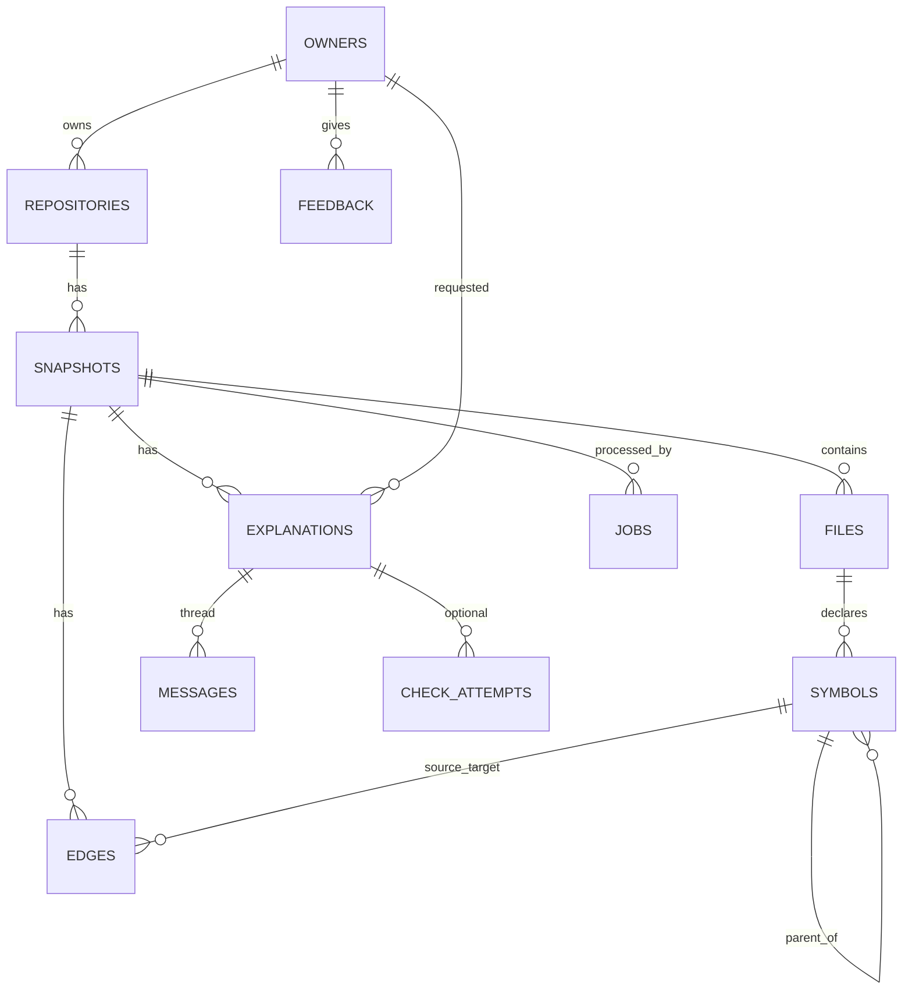

# 10 · API and Database Specification

| Version | 1.0 | Status | Draft; terminology matches `01` glossary and `07` §7 |
|---|---|---|---|

**Purpose.** An implementation-ready contract for the MVP workflow, and nothing beyond it.

**Glossary (used identically everywhere):** *Owner* = anonymous browser identity · *Repository* = GitHub owner/name · *Snapshot* = one indexed commit · *File* · *Symbol* · *Edge* = relation between symbols/files · *Selection* = a code range · *Explanation* = AI output for a selection at a depth · *Thread* / *Message* = follow-up conversation · *Check attempt* = optional understanding check · *Feedback* · *Event* · *LLM call*.

---

## 1. Conventions
- Base path `/api/v1`. JSON request and response bodies. Times in ISO 8601 UTC. IDs are UUIDv4.
- **Owner cookie:** `kyc_owner` (HTTP-only, Secure, SameSite=Lax, signed, 30-day expiry). Issued on first request if absent.
- **Streaming:** Server-Sent Events (`text/event-stream`) with events `relations`, `section`, `delta`, `done`, `error`.
- Shared TypeScript types live in `packages/contracts` (Zod schemas → Fastify JSON schemas + client types).

```ts
type Selection = { path: string; startLine: number; startCol: number; endLine: number; endCol: number }; // lines 1-based, cols 0-based
type Depth = 'simpler' | 'default' | 'deeper';
type Provenance = 'verified' | 'pattern' | 'explained';
type ErrorBody = { error: { code: ErrorCode; message: string; retryable: boolean; details?: object } };
```

## 2. Endpoints

| ID | Method & path | Purpose | Auth | Rate limit |
|---|---|---|---|---|
| API-01 | `POST /repositories` | Start import | owner cookie | 5/h/owner, 20/h/IP |
| API-02 | `GET /snapshots/{id}` | Status + stages | — | 120/min |
| API-03 | `GET /snapshots/{id}/overview` | Facts, starting points, summary | — | 60/min |
| API-04 | `GET /snapshots/{id}/tree` | File tree | — | 60/min |
| API-05 | `GET /snapshots/{id}/file?path=` | File content | — | 300/min |
| API-06 | `POST /snapshots/{id}/resolve` | Selection → kind + enclosing symbol | — | 300/min |
| API-07 | `GET /symbols/{id}/relations` | Verified relations | — | 300/min |
| API-08 | `GET /symbols/{id}/trace-params` (Should) | Call sites + argument text | — | 120/min |
| API-09 | `POST /explanations` (SSE) | Explain selection | owner | 60/h/owner |
| API-10 | `POST /explanations/{id}/messages` (SSE) | Follow-up / simpler / deeper / concept | owner | 120/h/owner |
| API-11 | `POST /explanations/{id}/checks` (Should) | Generate a check | owner | 30/h/owner |
| API-12 | `POST /checks/{id}/answer` (Should) | Submit an answer | owner | 60/h/owner |
| API-13 | `POST /feedback` | Rate an explanation or message | owner | 300/h |
| API-14 | `DELETE /repositories/{id}` | Delete all data for the owner's repository | owner (must match) | 20/h |
| API-15 | `POST /events` | Client analytics events (batch) | owner | 600/h |
| API-16 | `GET /health` | Health check | — | — |

### API-01 `POST /repositories`
Request: `{ "url": "https://github.com/acme/notes-app", "ref": "main" }` (`ref` optional)
Response `202`: `{ "repositoryId": "…", "snapshotId": "…", "status": "queued" | "ready", "reused": false }`
Validation: URL regex (`08` §1); `ref` ≤ 200 chars, no whitespace.
Errors: `400 INVALID_URL`, `404 REPO_NOT_FOUND_OR_PRIVATE`, `413 REPO_TOO_LARGE`, `429 GITHUB_RATE_LIMITED | RATE_LIMITED`, `503 SERVICE_UNAVAILABLE`.

### API-02 `GET /snapshots/{id}`
```json
{ "id": "…", "repository": {"owner":"acme","name":"notes-app"}, "commitSha": "a1b2…",
  "status": "queued|fetching|filtering|analysing|summarising|ready|ready_partial|failed|expired",
  "stages": [{"name":"fetching","state":"done","ms":2100}, {"name":"analysing","state":"running","progress":{"done":84,"total":132}}],
  "skippedCount": 2, "error": null, "expiresAt": "2026-10-29T10:00:00Z" }
```

### API-03 `GET /snapshots/{id}/overview`
```json
{ "facts": {"languages":{"ts":61,"tsx":40,"js":3},"frameworks":["express","react","prisma"],
            "entryPoints":["server/src/index.ts","client/src/main.tsx"],"fileCount":148,"analysedCount":104},
  "startingPoints": [{"label":"Most-used function: authenticate","path":"server/src/middleware/auth.ts","line":7,"provenance":"verified"}],
  "summary": {"status":"ready|pending|failed","text":"…","refs":[{"path":"…","line":1}],"provenance":"explained"},
  "skipped": [{"path":"server/legacy/big.js","reason":"file_too_large"}] }
```

### API-04 `GET /snapshots/{id}/tree`
`{ "root": {"name":"/","type":"dir","children":[{"name":"src","type":"dir","children":[{"name":"index.ts","type":"file","path":"src/index.ts","analysable":true}]}]} }`

### API-05 `GET /snapshots/{id}/file?path=src/index.ts`
`{ "path":"src/index.ts", "language":"ts", "lines": 120, "content":"…", "truncated": false, "generated": false, "analysable": true }`
Errors: `404 FILE_NOT_FOUND`, `410 SNAPSHOT_EXPIRED`.

### API-06 `POST /snapshots/{id}/resolve`
Request: `{ "selection": Selection }` → `{ "kind":"function", "symbol": {"id":"…","name":"login","path":"…","startLine":2,"endLine":6} | null, "spansMultiple": false }`

### API-07 `GET /symbols/{id}/relations`
```json
{ "symbol": {"id":"…","name":"login","kind":"function","signature":"async function login(req, res)"},
  "definedIn": {"path":"src/controllers/authController.js","line":2},
  "calledBy": [{"symbolId":"…","label":"router.post('/login')","path":"src/routes/auth.js","line":3,"provenance":"pattern"}],
  "calls": [{"symbolId":"…","label":"findUserByEmail","path":"src/services/userService.js","line":3,"provenance":"verified"}],
  "imports": [{"label":"../services/userService","path":"src/services/userService.js"}],
  "unresolved": [{"label":"res.status(...).json","line":4,"reason":"external_package"}] }
```

### API-09 `POST /explanations` (SSE)
Request: `{ "snapshotId":"…", "selection": Selection, "depth":"default" }`
Stream:
```
event: relations   data: { …API-07 shape… }
event: meta        data: {"explanationId":"…","kind":"function","cached":false}
event: section     data: {"name":"what","text":"…","refs":[{"path":"…","line":3}]}
event: section     data: {"name":"inputs", …}
event: done        data: {"concepts":[…],"exploreNext":[…],"tryIt":{…},"uncertainty":[…],"refsStripped":0}
event: error       data: {"code":"AI_TIMEOUT","retryable":true}
```
Errors before the stream starts: `400 INVALID_SELECTION`, `404`, `410`, `429 RATE_LIMITED`, `402 BUDGET_EXCEEDED` (used as a semantic code; the HTTP status is documented here for clarity).

### API-10 `POST /explanations/{id}/messages` (SSE)
Request: `{ "intent":"followup|simpler|deeper|concept", "text":"What if the user doesn't exist?", "conceptId":"async-await" }` (`text` required for followup; `conceptId` for concept)
Stream: `delta` events, then `done {messageId, refs, uncertainty}`. Simpler/deeper returns a new explanation (`meta.explanationId` is a new ID linked via `parent_id`).

### API-11/12 Checks (Should)
`POST /explanations/{id}/checks` → `{ "checkId":"…","type":"predict","question":"…","options":["…","…","…","…"] }`
`POST /checks/{id}/answer` `{ "answerIndex": 2 }` or `{ "text":"…" }` → `{ "correct": true|null, "feedback":"…", "refs":[…] }` (`correct` is null for free text).

### API-13 `POST /feedback`
`{ "targetType":"explanation|message|check", "targetId":"…", "rating":"up|down", "reason":"incorrect|too_complex|too_basic|not_what_i_asked|other", "comment":"≤ 500 chars" }` → `204`.

### API-14 `DELETE /repositories/{id}`
→ `202 {"deletedSnapshots":1}`. Errors: `403 NOT_OWNER`, `404`.

### API-15 `POST /events`
`{ "events":[{"name":"landing_cta","ts":"…","props":{"variant":"A"}}] }` → `204`. Allowed names are whitelisted (`14` §11). Props never contain code.

### API-16 `GET /health`
`{ "status":"ok","db":"ok","queueDepth":0,"version":"1.0.3" }`

## 3. Error codes
| Code | HTTP | Retryable | Meaning |
|---|---|---|---|
| INVALID_URL | 400 | no | Not a GitHub repo URL |
| INVALID_SELECTION | 400 | no | Out-of-range or empty selection |
| REPO_NOT_FOUND_OR_PRIVATE | 404 | no | Missing or not public |
| FILE_NOT_FOUND | 404 | no | Path not in snapshot |
| NOT_OWNER | 403 | no | Cookie doesn't own the resource |
| SNAPSHOT_EXPIRED | 410 | no | Retention passed |
| REPO_TOO_LARGE | 413 | no | Over limits (`08` §3) |
| UNSUPPORTED_LANGUAGE | 422 | no | No JS/TS files |
| RATE_LIMITED | 429 | yes | Our limiter |
| GITHUB_RATE_LIMITED | 429 | yes | GitHub limiter |
| BUDGET_EXCEEDED | 402 | yes (tomorrow) | Daily LLM cap reached |
| INDEX_FAILED | 500 | yes | Pipeline failure |
| AI_TIMEOUT / AI_ERROR / AI_BUSY | 504/502/503 | yes | Model issues |
| SERVICE_UNAVAILABLE | 503 | yes | DB or system down |

## 4. Database schema (PostgreSQL)
```sql
CREATE EXTENSION IF NOT EXISTS pg_trgm;
CREATE EXTENSION IF NOT EXISTS pgcrypto;

CREATE TABLE owners (
  id uuid PRIMARY KEY DEFAULT gen_random_uuid(),
  created_at timestamptz NOT NULL DEFAULT now(),
  last_seen_at timestamptz NOT NULL DEFAULT now()
);

CREATE TABLE repositories (
  id uuid PRIMARY KEY DEFAULT gen_random_uuid(),
  owner_id uuid NOT NULL REFERENCES owners(id) ON DELETE CASCADE,
  gh_owner text NOT NULL, gh_name text NOT NULL,
  created_at timestamptz NOT NULL DEFAULT now(),
  UNIQUE (owner_id, gh_owner, gh_name)
);

CREATE TABLE snapshots (
  id uuid PRIMARY KEY DEFAULT gen_random_uuid(),
  repository_id uuid NOT NULL REFERENCES repositories(id) ON DELETE CASCADE,
  commit_sha char(40) NOT NULL,
  status text NOT NULL CHECK (status IN ('queued','fetching','filtering','analysing','summarising','ready','ready_partial','failed','expired')),
  stages jsonb NOT NULL DEFAULT '[]',
  overview jsonb,
  skipped jsonb NOT NULL DEFAULT '[]',
  error_code text,
  created_at timestamptz NOT NULL DEFAULT now(),
  expires_at timestamptz NOT NULL,
  UNIQUE (repository_id, commit_sha)
);

CREATE TABLE files (
  id uuid PRIMARY KEY DEFAULT gen_random_uuid(),
  snapshot_id uuid NOT NULL REFERENCES snapshots(id) ON DELETE CASCADE,
  path text NOT NULL,
  language text,                       -- 'js','jsx','ts','tsx', or null for view-only
  analysable boolean NOT NULL,
  generated boolean NOT NULL DEFAULT false,
  size_bytes int NOT NULL,
  line_count int NOT NULL,
  content text NOT NULL,               -- redacted for secrets
  UNIQUE (snapshot_id, path)
);
CREATE INDEX files_content_trgm ON files USING gin (content gin_trgm_ops);

CREATE TABLE symbols (
  id uuid PRIMARY KEY DEFAULT gen_random_uuid(),
  snapshot_id uuid NOT NULL REFERENCES snapshots(id) ON DELETE CASCADE,
  file_id uuid NOT NULL REFERENCES files(id) ON DELETE CASCADE,
  parent_symbol_id uuid REFERENCES symbols(id) ON DELETE CASCADE,
  name text NOT NULL, qualified_name text NOT NULL,
  kind text NOT NULL CHECK (kind IN ('function','method','class','variable','parameter','import','export')),
  tags text[] NOT NULL DEFAULT '{}',
  exported boolean NOT NULL DEFAULT false,
  signature text,
  start_line int NOT NULL, start_col int NOT NULL, end_line int NOT NULL, end_col int NOT NULL
);
CREATE INDEX symbols_pos ON symbols (snapshot_id, file_id, start_line, end_line);
CREATE INDEX symbols_name ON symbols (snapshot_id, name);

CREATE TABLE edges (
  id bigserial PRIMARY KEY,
  snapshot_id uuid NOT NULL REFERENCES snapshots(id) ON DELETE CASCADE,
  type text NOT NULL CHECK (type IN ('imports','calls','route_handler')),
  source_symbol_id uuid REFERENCES symbols(id) ON DELETE CASCADE,
  source_file_id uuid NOT NULL REFERENCES files(id) ON DELETE CASCADE,
  target_symbol_id uuid REFERENCES symbols(id) ON DELETE CASCADE,
  target_file_id uuid REFERENCES files(id) ON DELETE CASCADE,
  target_external text,                -- e.g. 'express'
  line int NOT NULL,
  provenance text NOT NULL CHECK (provenance IN ('verified','pattern')),
  reason text,                         -- set when unresolved
  meta jsonb NOT NULL DEFAULT '{}'
);
CREATE INDEX edges_src ON edges (snapshot_id, source_symbol_id);
CREATE INDEX edges_tgt ON edges (snapshot_id, target_symbol_id);

CREATE TABLE explanations (
  id uuid PRIMARY KEY DEFAULT gen_random_uuid(),
  snapshot_id uuid NOT NULL REFERENCES snapshots(id) ON DELETE CASCADE,
  owner_id uuid NOT NULL REFERENCES owners(id) ON DELETE CASCADE,
  parent_id uuid REFERENCES explanations(id) ON DELETE SET NULL,
  cache_key char(64) NOT NULL,
  selection jsonb NOT NULL, kind text NOT NULL, depth text NOT NULL,
  symbol_id uuid REFERENCES symbols(id) ON DELETE SET NULL,
  body jsonb NOT NULL,                 -- schema in 09 §6
  prompt_version text NOT NULL, model text NOT NULL,
  refs_stripped int NOT NULL DEFAULT 0,
  created_at timestamptz NOT NULL DEFAULT now()
);
CREATE INDEX explanations_cache ON explanations (snapshot_id, cache_key);

CREATE TABLE messages (
  id uuid PRIMARY KEY DEFAULT gen_random_uuid(),
  explanation_id uuid NOT NULL REFERENCES explanations(id) ON DELETE CASCADE,
  role text NOT NULL CHECK (role IN ('user','assistant')),
  intent text NOT NULL CHECK (intent IN ('followup','concept')),
  body jsonb NOT NULL,
  created_at timestamptz NOT NULL DEFAULT now()
);

CREATE TABLE check_attempts (            -- Should
  id uuid PRIMARY KEY DEFAULT gen_random_uuid(),
  explanation_id uuid NOT NULL REFERENCES explanations(id) ON DELETE CASCADE,
  question jsonb NOT NULL, answer jsonb, result jsonb,
  created_at timestamptz NOT NULL DEFAULT now()
);

CREATE TABLE feedback (
  id uuid PRIMARY KEY DEFAULT gen_random_uuid(),
  owner_id uuid NOT NULL REFERENCES owners(id) ON DELETE CASCADE,
  target_type text NOT NULL, target_id uuid NOT NULL,
  rating text NOT NULL CHECK (rating IN ('up','down')),
  reason text, comment text CHECK (char_length(comment) <= 500),
  created_at timestamptz NOT NULL DEFAULT now(),
  UNIQUE (owner_id, target_type, target_id)
);

CREATE TABLE events (
  id bigserial PRIMARY KEY,
  owner_id uuid REFERENCES owners(id) ON DELETE SET NULL,
  name text NOT NULL, props jsonb NOT NULL DEFAULT '{}',
  created_at timestamptz NOT NULL DEFAULT now()
);
CREATE INDEX events_name_time ON events (name, created_at);

CREATE TABLE llm_calls (
  id bigserial PRIMARY KEY,
  owner_id uuid, snapshot_id uuid,
  task text NOT NULL, model text NOT NULL, prompt_version text NOT NULL,
  input_tokens int, output_tokens int, cost_usd numeric(10,6),
  first_token_ms int, total_ms int, status text NOT NULL, cache_hit boolean NOT NULL DEFAULT false,
  created_at timestamptz NOT NULL DEFAULT now()
);
CREATE INDEX llm_calls_day ON llm_calls (created_at);

CREATE TABLE jobs (
  id uuid PRIMARY KEY DEFAULT gen_random_uuid(),
  snapshot_id uuid NOT NULL REFERENCES snapshots(id) ON DELETE CASCADE,
  state text NOT NULL CHECK (state IN ('queued','running','done','failed')),
  attempts int NOT NULL DEFAULT 0, last_error text,
  updated_at timestamptz NOT NULL DEFAULT now()
);

CREATE TABLE deletion_log (
  id bigserial PRIMARY KEY, repository_ref text NOT NULL, reason text NOT NULL CHECK (reason IN ('user','retention')),
  deleted_at timestamptz NOT NULL DEFAULT now()
);
```

### Retention rules
- `snapshots.expires_at = created_at + RETENTION_DAYS (7)`. A nightly job deletes expired snapshots (cascades to files, symbols, edges, explanations, messages, checks) and logs to `deletion_log` with only `owner/name`, no content.
- `llm_calls` and `events`: keep 90 days (no code content). `feedback.comment` deleted with its owner's data on request.
- Owner delete (API-14) removes repositories → cascades.

## 5. ER diagram


## 6. Migrations and validation practices
- Tool: **drizzle-kit** (or node-pg-migrate) with SQL migrations committed under `server/db/migrations`. Forward-only during the competition; each migration is additive.
- Validate all inputs with Zod at the API edge; never interpolate SQL (parameterised queries only).
- A seed script loads the 3 sample repos for demos.

## 7. Integration contracts
| Boundary | Contract |
|---|---|
| Frontend ↔ backend | `packages/contracts` Zod types; SSE event names fixed as §2 API-09; error body `ErrorBody` |
| Backend ↔ GitHub | `GET /repos/{o}/{r}` (metadata), `GET /repos/{o}/{r}/commits/{ref}` (SHA), `GET /repos/{o}/{r}/tarball/{sha}` (archive). Headers: `Authorization: Bearer $GITHUB_TOKEN`, `X-GitHub-Api-Version: 2022-11-28`. Handle 404, 403/429 with `x-ratelimit-reset`. |
| Backend ↔ analysis | `analyse(files: {path, content}[], config) → {symbols: SymbolRow[], edges: EdgeRow[], diagnostics[]}`; `resolve(snapshotId, selection) → {kind, symbolId?, definitions[]}` |
| Backend ↔ AI provider | `LlmClient.stream({model, system, messages, tool: {name, input_schema}, max_tokens}) → AsyncIterable<Delta>`; final `{toolInput, usage:{input_tokens, output_tokens}}` |
| Backend ↔ database | Repository-pattern functions per module (`snapshotsRepo`, `symbolsRepo`, …); all snapshot-scoped queries require `snapshot_id` |

**Example (backend → GitHub):**
```http
GET /repos/acme/notes-app/tarball/a1b2c3… HTTP/1.1
Host: api.github.com
Authorization: Bearer ghp_***
X-GitHub-Api-Version: 2022-11-28
→ 302 Location: https://codeload.github.com/acme/notes-app/legacy.tar.gz/a1b2c3…
```

## Assumptions · Risks · Open questions
- Storing redacted content in `files.content` means the viewer also shows `[REDACTED]`. This is intended.
- Open: whether to store `references` edges. Currently on demand (`08` §7).

**Related:** `05` §17 · `07` §7–8 · `08` · `09` §6–9
