# 12 · Three-Week Sprint and Deployment Plan

| Version | 1.0 | Status | **Planning assumption: 21 days from Day 1.** Confirm the real deadline (D-01) and re-map days to dates. |
|---|---|---|---|

**Purpose.** A realistic, dependency-ordered plan for a team of five part-time students.
**Roles (assign people yourselves; one person may hold two roles):**
- **PL** Product & research lead
- **FE** Frontend engineer
- **BE** Backend & analysis engineer
- **AI** AI engineer
- **DQ** Design & QA

**Effort** in person-days (pd). One pd is roughly 5 focused hours.

---

## Week 1 · Foundation (Days 1–7)
**Goal:** a deployed skeleton that imports a repo, shows files, and resolves a selection to a symbol. Problem interviews done.

| ID | Task | P | Effort | Depends | Deliverable | Acceptance | Risk | Role |
|---|---|---|---|---|---|---|---|---|
| W1-01 | Confirm deadline, checkpoints, and submission format | M | 0.25 | — | Dates in this doc | D-01 closed | Wrong plan | PL |
| W1-02 | Finalise MVP scope sign-off (`04`) | M | 0.5 | — | Signed scope | Team agrees; Should list frozen | Scope creep | PL |
| W1-03 | Run screener and 12 problem interviews (`02` §16) | M | 3 | — | Evidence update #1 | A1/A2/A5 assessed | Recruitment slow | PL, DQ |
| W1-04 | Monorepo, Fastify, Vite, contracts package, Postgres migrations, health, deploy to Replit | M | 1.5 | — | Live URL with `/health` | Deploy from main works | Replit config | BE |
| W1-05 | **Spike T-1:** ts-morph on 5 corpus repos (time, memory, edges) | M | 2 | — | Spike report | Pass criteria in `07` §14, or adjust limits | Analyser too slow | BE |
| W1-06 | Ingestion: URL parse, metadata, tarball stream, safe extract, filters, limits | M | 2 | W1-04 | Import job to `filtering` | Corpus C1–C3, C8, C9 behave correctly | Archive edge cases | BE |
| W1-07 | Job runner + snapshot status API + processing screen | M | 1.5 | W1-04 | Stage progress UI | Stages update live; restart re-queues | — | BE, FE |
| W1-08 | File tree + file API + CodeMirror viewer (**spike T-2**) | M | 2 | W1-06 | Browsable repo | Opens any file; highlighting OK | Viewer API learning | FE |
| W1-09 | Symbols + edges persistence; `resolve` endpoint | M | 2 | W1-05 | Selection → symbol | Correct kind on test cases | Range mapping | BE |
| W1-10 | Design tokens, layout grid, core components (tree, viewer shell, panel shell) | M | 2 | — | Component kit | Matches `06` §H; both themes | — | DQ, FE |
| W1-11 | Corpus list + licences + hand labels for C1, C3 | M | 1 | — | `tests/corpus.json` | 10 repos recorded | — | DQ |
| W1-12 | **Spike T-3:** first explanation prompt on 10 selections; latency/cost | M | 1.5 | W1-09 (or mocked context) | Spike report | First token and cost measured | Model choice | AI |

**Week-1 exit:** live deploy imports corpus repos and resolves selections; interviews synthesised; go/change/stop on the problem recorded in `01` §13.

## Week 2 · Core learning experience (Days 8–14)
**Goal:** the thin slice works end to end with grounded explanations; first real users test it.

| ID | Task | P | Effort | Depends | Deliverable | Acceptance | Risk | Role |
|---|---|---|---|---|---|---|---|---|
| W2-01 | Relations API + Verified relations panel + Back/Forward breadcrumbs | M | 2 | W1-09 | Navigation | FR-EXP-02, FR-DEP-01 | State bugs | FE, BE |
| W2-02 | Retrieval: context pack + redaction | M | 1.5 | W1-09 | `buildContext()` | Within budget; secrets redacted (C8) | Over-budget packs | AI |
| W2-03 | Explanation endpoint (SSE) + schema + verifier + cache + cost ledger | M | 2.5 | W2-02 | Streaming explanations | FR-EXP-01, FR-EXP-04; refs verified | Schema adherence | AI, BE |
| W2-04 | Explanation panel UI: sections, provenance tags, line chips, depth control | M | 2 | W2-03 | Panel | Renders per `06` §F | — | FE |
| W2-05 | Follow-ups, simpler/deeper, concept chips (P-FUP, P-CON) | M | 2 | W2-03 | Thread + concepts | FR-FUP-01, FR-CON-01 | Generic answers | AI, FE |
| W2-06 | Feedback, deletion, retention job, rate limits, spend cap | M | 1.5 | W2-03 | Safety rails | FR-FBK-01, FR-DEL-01; cap enforced | — | BE |
| W2-07 | Overview facts (deterministic) + error states catalogue | M | 1 | W1-06 | Overview + errors | FR-OVR-01, FR-ERR-01 | — | FE, BE |
| W2-08 | Write 60-item AI eval set + run first full evaluation | M | 2 | W2-03 | Eval report #1 | Scores recorded; top failure modes listed | Reviewer time | DQ, AI, PL |
| W2-09 | Usability + comparison sessions (8–10) (`02` §10–11) | M | 2.5 | W2-05 | Evidence update #2 | A3/A4 assessed | No-shows | PL, DQ |
| W2-10 | (If T-4 passes) Express route heuristic | C | 1 | W1-09 | `route_handler` edges | ≥ 80% on 3 repos | Fragile | BE |

**Week-2 exit:** release criteria items 1–3 in `11` §8 are met or have a fix list; participants complete the thin slice; decision on which Should features to build (D-07).

## Week 3 · Validation and launch (Days 15–21)
**Goal:** fix what users and evals found, add the highest-value Should feature, launch, and prepare the demo.

| ID | Task | P | Effort | Depends | Deliverable | Acceptance | Risk | Role |
|---|---|---|---|---|---|---|---|---|
| W3-01 | Fix top explanation errors (prompt, context, verifier tweaks); re-run eval | M | 2 | W2-08 | Eval report #2 | Release criterion 2 met | Regression | AI |
| W3-02 | UX fixes from sessions (top 5 issues) | M | 2 | W2-09 | Updated UI | Issues closed; re-tested with 2 users | — | FE, DQ |
| W3-03 | Build 1–2 Should features chosen at Week-2 exit (e.g. Trace value, Check yourself, AI summary, local diagram) | S | 3 | D-07 | Features | Each meets its `01` acceptance criteria | Crowds out fixes | FE, AI, BE |
| W3-04 | Performance + cost measurement (`11` §5); update `09` §14 and NFRs | M | 1 | W3-01 | Measured table | Numbers published internally | — | AI, BE |
| W3-05 | Landing page + privacy notes + FAQ (`14` §5) | M | 1.5 | — | Live landing | Copy matches `13` messaging | — | DQ, PL |
| W3-06 | Private beta → public launch to NST + clubs (`14` §12) | M | 2 | W3-05 | Users | Funnel events recorded | Low turnout | PL |
| W3-07 | Accessibility + security pass; deployment checklist (below) | M | 1 | W3-02 | Checklist signed | All items ticked | — | DQ, BE |
| W3-08 | Demo script, pre-imported demo repo, warmed cache, fallback video; known-limitations doc | M | 1.5 | W3-07 | Demo kit | Two full rehearsals under 5 min | Live failure | PL, all |
| W3-09 | Update pitch deck to match the docs (tagline, ts-morph, JS/TS only) | M | 0.5 | — | Deck v2 | Consistent with `99` | Inconsistency | PL |

**Capacity check:** ≈ 19 pd (W1) + 18 pd (W2) + 14.5 pd (W3) ≈ 52 pd planned. A team of 5 at ~4 pd/person/week gives ≈ 60 pd, so the buffer is about 8 pd (~13%) for bugs, integration, and coursework clashes. That is thin. Should features are the release valve: if the deadline is shorter or the buffer is consumed, cut W3-03 first, then W2-10.

## Dependencies (critical path)

```mermaid
gantt
  dateFormat  X
  axisFormat Day %s
  section Foundation
  Skeleton+deploy        :a1, 1, 2
  T-1 analyser spike     :a2, 1, 3
  Ingestion              :a3, 2, 4
  Symbols/edges+resolve  :a4, 4, 6
  Viewer (T-2)           :a5, 3, 6
  section Core
  Relations+Back         :b1, 7, 9
  Context+Explain+Verify :b2, 8, 11
  Follow-ups/Concepts    :b3, 10, 12
  Eval #1 + User tests   :b4, 12, 14
  section Ship
  Fixes + Eval #2        :c1, 15, 17
  Should features        :c2, 16, 19
  Launch + Demo prep     :c3, 18, 21
```

## Deployment checklist
| Area | Check |
|---|---|
| Environment | Reserved VM sized per T-1 memory; Node LTS pinned; `NODE_ENV=production` |
| Secrets | `DATABASE_URL`, `ANTHROPIC_API_KEY`, `GITHUB_TOKEN` (read-only, fine-grained), `COOKIE_SECRET`, `MODEL_FAST`, `MODEL_STRONG`, `DAILY_SPEND_CAP_USD`, `RETENTION_DAYS` in Replit Secrets; none in the repo |
| Build | `pnpm build` passes; source maps uploaded to Sentry only (not public) |
| Database | Migrations applied; `pg_trgm` enabled; backups or snapshot plan confirmed; retention job scheduled |
| API | CORS restricted to the app origin; rate limits on; request size limits; security headers (CSP disallowing inline scripts, HSTS) |
| AI provider | Model IDs verified; spend cap tested; timeouts set; provider data-use terms reviewed and disclosed |
| Repository access | URL whitelist (github.com only); tarball size caps; zip-slip tests pass |
| Error handling | All `05` §17 messages verified in UI |
| Monitoring | `/health` uptime ping; error alerts to team channel; daily cost query |
| Smoke tests | Import sample → explain → follow-up → concept → back → delete, on production |
| Security | `npm audit` no high/critical; secrets scan of repo; `.env` fixture excluded |
| Rollback | Previous deployment identified; procedure rehearsed once |
| Demo readiness | Demo repo pre-imported; caches warm; offline video; Wi-Fi backup (hotspot) |

## Final deliverables by milestone
| Milestone | Must be ready |
|---|---|
| Internal testing (end of W1) | Import, tree, viewer, selection resolve on corpus |
| First external users (mid W2) | Thin slice with grounded explanations, feedback, delete, rate limits, spend cap |
| Competition demo (end of W3) | Release criteria met; landing; metrics dashboard (SQL); evidence updates #1–2; known limitations |
| Post-competition iteration | Eval set and corpus in repo; decision log updated; backlog ranked by evidence (`14` §13) |

**Related:** `04` · `07` §15 · `11` §8 · `14` §12
