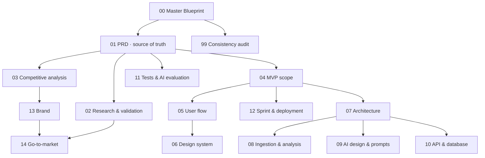

# Know Your Code: Product Documentation

Team Destruct · Construct 2.0 · v1.0 · 22 Oct 2026

**Start with `00_Master_Product_Blueprint.md`.** It summarises everything and links to each source of truth.

## How the documents relate

## Rules for editing
1. **Requirements change in `01` first.** Other documents implement it and must not redefine the product.
2. Use the IDs (FR-, NFR-, F-, API-, ADR-, D-, R-, M-, E-) when referring across documents.
3. If a decision changes, update every affected document and re-run `99`.
4. Never add research findings, interview quotes, or metrics that didn't actually happen. Mark unverified items clearly.

## Who reads what first
| Role | Read |
|---|---|
| Product / research lead | 00 → 01 → 02 → 14 |
| Frontend engineer | 00 → 05 → 06 → 10 |
| Backend / analysis engineer | 00 → 07 → 08 → 10 |
| AI engineer | 00 → 09 → 11 → 08 |
| Design / QA | 00 → 06 → 05 → 11 |

## Implementation documents (V1, as built)
The documents above are the design. What was actually built, how it differs, and how to run and operate it is in
[`implementation/`](implementation/): `00_Execution_Plan`, `01_Implementation_Status`, `02_Deployment_and_Operations`,
`03_Security_and_Privacy`, `04_Testing_and_Measurements`. The repository root `README.md` has the quick start.
