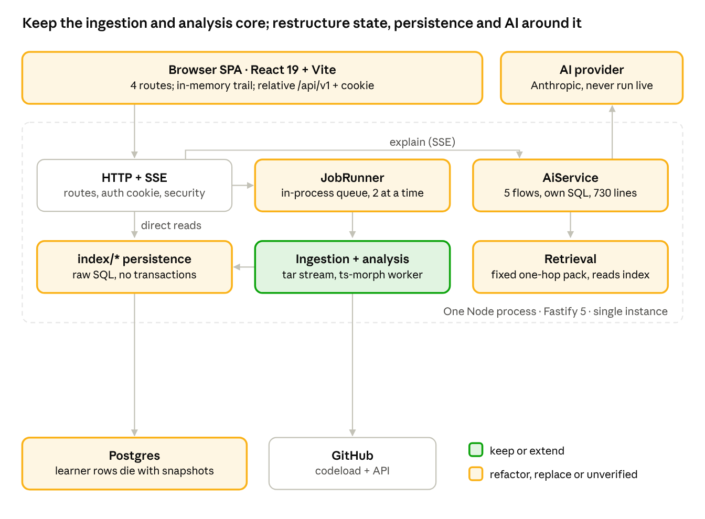
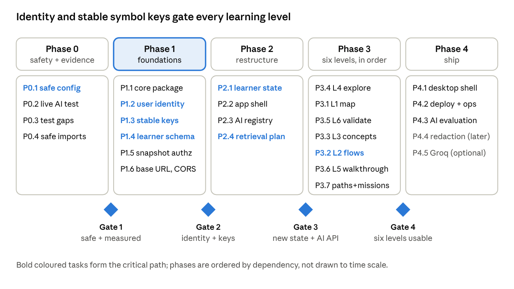

# Know Your Code — Engineering Decision Document

*As of 2026-11-11 · branch `V1_KYC`, HEAD `b10a2f5`*

**Decision: keep this repository and reshape it.** Keep ingestion, the compiler-backed analyser, the worker host, the reference verifier and the UI primitives. Refactor persistence, retrieval, the AI service, the job pipeline, the workspace state and the API client around a shared core package. Build the learning layer (flows, paths, lessons, missions, progress, assessment) on top. The shortest MVP path starts with three things: security defaults, a stable code identity, and a durable learner identity that is not tied to 7-day snapshots.

**Sources.** This document synthesises seven audits run against branch `V1_KYC` (HEAD `b10a2f5`). Nothing new was measured, and no billable or external calls were made.

| # | Audit | Doc |
| --- | --- | --- |
| 1 | Repository reconnaissance | [01_Repository_Reconnaissance_Audit.md](01_Repository_Reconnaissance_Audit.md) |
| 2 | Ingestion and static analysis | [02_Ingestion_and_Static_Analysis_Audit.md](02_Ingestion_and_Static_Analysis_Audit.md) |
| 3 | Database and data model | [03_Database_and_Data_Model_Audit.md](03_Database_and_Data_Model_Audit.md) |
| 4 | Context retrieval | [04_Context_Retrieval_Audit.md](04_Context_Retrieval_Audit.md) |
| 5 | AI layer | [05_AI_Layer_Audit.md](05_AI_Layer_Audit.md) |
| 6 | Frontend and product experience | [06_Frontend_and_Product_Experience_Audit.md](06_Frontend_and_Product_Experience_Audit.md) |
| 7 | Architecture, security and cloud readiness | [07_Architecture_Security_and_Cloud_Readiness_Audit.md](07_Architecture_Security_and_Cloud_Readiness_Audit.md) |

**Evidence labels used throughout:**

- **Verified:** read in source and covered by a named test (`server/tests/*`, `client/src/**/*.test.*`, `e2e/*`). AI behaviour verified with the fake model only counts here for plumbing, not quality.
- **Partially verified:** read in source, but no test, or tested only with a double or mock.
- **Inference:** reasoned from code paths or API rules, not reproduced.
- **Unverified:** no evidence in the repository, including everything about real-model output, latency and cost.

Citations use `file:line` relative to `server/src/` or `client/src/` unless a fuller path is given. Audit references appear as [A1]–[A7] in the table order above.

## 1. Executive technical assessment

We have a working, well-tested **single-function code explainer for public JS/TS GitHub repositories**, delivered as a browser app over one Fastify server and Postgres. Its foundations (safe ingestion, a compiler-backed symbol graph, grounded AI with reference checking) are sound and worth keeping. It is not yet a learning platform: no learner identity, no durable progress, no flows, no lessons or missions, no desktop client, and it has never run against a real AI model.

**What we have** [A1]: an npm-workspaces monorepo with `client/` (React 19 + Vite SPA, 4 routes), `server/` (Fastify 5, 46 source files), `packages/contracts` (shared types and Zod schemas), 14 Postgres tables in 3 SQL migrations (no Prisma), 17 server test suites, 4 client test files and 5 Playwright specs, plus a CI job that runs them against Postgres 16.

**What genuinely works** (Verified):

| Capability | Evidence |
| --- | --- |
| Safe public-repo ingestion: strict GitHub URL grammar, host-allowlisted downloads, redirect re-checks, zip-slip, symlink and bomb protection, size caps | `ingestion/url.ts:38` `parseRepoUrl`; `ingestion/github.ts:62` `request`; `ingestion/extract.ts:50`, `:74`; `ingestion-url.test.ts`, `github.test.ts`, `extract.test.ts` [A2] |
| Imported code is never executed | No `child_process`, `eval`, `vm` or dynamic `require` of repo code; ts-morph in-memory only (`analysis/project.ts:42`) [A7] |
| Symbol and edge extraction with compiler resolution: functions, methods, classes, variables, parameters, imports; `imports`, `calls`, `references`, `route_handler` edges with unresolved reasons | `analysis/analyse.ts:896` `analyse`, `handleCalls` `:679`; `analyse.test.ts` (23 cases) [A2] |
| Off-thread analysis with memory cap and timeout | `analysis/runner.ts:31` `runAnalysis`; `runner.test.ts` [A2] |
| Import pipeline with progress stages, partial success, retention and cascade delete | `jobs/importJob.ts:79` `runImport`; `jobs/retention.ts`; `api.test.ts` [A1, A3] |
| One-hop relations (callers, callees, imports, unresolved) | `index/symbols.ts:218` `getRelations`; `api.test.ts` [A4] |
| Bounded context packs with real line numbers and reference verification | `retrieval/context.ts:204` `buildContextPack`; `ai/verify.ts:21` `verifyRefs`; `ai.test.ts` [A4, A5] |
| Explanation, follow-up, concept, check and summary flows with schema validation, retry, cache and daily budget | `ai/service.ts` `AiService`; `ai.test.ts` (21 cases, fake model) [A5] |
| Accessible UI: tree, read-only code viewer, explanation panel, breadcrumbs, provenance labels | `client/src/components/*`; `e2e/journey.spec.ts`, `a11y.spec.ts` [A6] |

**What is incomplete** (Partially verified or Inference):

- **Real AI.** The Anthropic adapter's request shape matches the API reference, but it has only been tested against a mocked `fetch`. The live test was skipped (`docs/implementation/04_Testing_and_Measurements.md:51`). Strong-tier thinking may truncate JSON output (Inference) [A5].
- **Framework awareness.** Only Express route registration, as a `pattern` edge; no mount prefixes, middleware order, React props or data-access edges [A2].
- **Retrieval.** One hop only; arbitrary callee order (no `ORDER BY` on the outbound query, `index/symbols.ts:226`); lexical search only for follow-ups [A4].
- **Groq provider.** Real-API adapter, undocumented, mispriced, not schema-enforced [A5].
- **Writes.** No multi-statement write is transactional (`withTx` in `db/pool.ts:17` has no callers) [A3].

**What is missing** (no code exists): learner accounts and durable progress; stable symbol identity across runs; flows and flow steps; architecture or application maps; learning paths, lessons and missions; multi-question assessment and attempt history; interactive simulation; desktop shell and configurable API base URL; ZIP or local-folder import; deployment manifest and monitoring [A1, A3, A6, A7].

**Is the repository worth retaining? Yes.** Roughly half of the server (ingestion, analysis, worker host, verifier, migrations, HTTP security) is classified *reuse* or *extend* across the audits. The rest needs restructuring rather than rewriting. Nothing found requires a different language, framework, database or service topology.

## 2. Current architecture

Today the product is a browser SPA talking same-origin to one Fastify process. That process serves the API, runs imports in an in-process queue with analysis in worker threads, and talks to Postgres, GitHub and an AI provider. Boxes are coloured by the decision in section 3; the diagram follows the import graph and wiring verified in [A7].

Wiring evidence:

- `server.ts` → `app.ts` `buildApp` → `services.ts` `createServices` (`GitHubClient`, `RateLimiter`, `AiService`, `JobRunner`).
- Routes in `http/routes.ts` and `http/aiRoutes.ts`.
- Jobs `jobs/runner.ts:48` → `jobs/importJob.ts:79` → `analysis/runner.ts:31` (worker).
- Persistence `index/*` over `db/pool.ts`.
- Client `client/src/api/client.ts` with relative `/api/v1` URLs.

Not shown: `@kyc/contracts`, imported by every layer and by the client, and `AppError` (`http/errors.ts`), which every server layer imports [A7].

## 3. Component-level decision matrix

Of 39 modules, 7 are reused as-is, 13 extended, 10 refactored and 4 replaced, and 5 areas are built from scratch (one row covers several new learning features). Where the seven audits disagreed (for example `ai/groq.ts`, "refactor or remove"), this table makes the single final call. Risk is the risk of making the change, not of the current code.

**Server: ingestion, analysis and persistence**

| Module | Current implementation | Evidence | Decision | Reason | Dependencies | Risk |
| --- | --- | --- | --- | --- | --- | --- |
| URL and GitHub client | `ingestion/url.ts` `parseRepoUrl`, `isSafeRef`; `ingestion/github.ts` `GitHubClient` | Verified: `ingestion-url.test.ts`, `github.test.ts` [A2, A7] | **Reuse as-is** | SSRF-safe, tested | None | Low |
| Archive extraction and filters | `ingestion/extract.ts:74` `extractTarball`; `filter.ts` `classifyPath` | Verified: `extract.test.ts` incl. bomb, zip-slip [A2] | **Reuse as-is** | Strong limits; a local-folder reader can reuse `filter.ts` later | None | Low |
| Secret redaction | `privacy/redact.ts:39` `redact` (11 regex rules) | Verified patterns; gaps by Inference [A7] | **Extend** | Gates storage and AI transfer; add entropy-based detection | Before private repos | Medium |
| Analyser | `analysis/analyse.ts` `analyse`, `visit`, `handleImports`, `handleCalls`, `handleReferences`; `project.ts` `buildProject` | Verified: `analyse.test.ts`; gaps by code reading [A2] | **Extend** | Sound checker core; add interfaces, types, enums, `extends`, `renders`, framework adapters, stable keys; fix class-expression and object-method naming (`:222`, `:257`) | `@kyc/core` package | Medium |
| Worker host | `analysis/runner.ts:31` `runAnalysis`; `worker.ts` | Verified: `runner.test.ts` [A2] | **Reuse as-is** | Isolation and timeout work; enforce worker mode in production | None | Low |
| Selection classifier | `analysis/resolve.ts:78` `classifySelection` | Verified: `resolve.test.ts` [A4] | **Reuse as-is** | Pure, tested | None | Low |
| Overview facts | `analysis/overview.ts:66` `buildOverview` | Partially verified (indirect) [A2] | **Extend** | Root-only `package.json`; add monorepo support and module grouping for the architecture map | Analyser | Low |
| Persistence functions | `index/snapshots.ts`, `files.ts`, `symbols.ts`, `resolve.ts` | Verified behaviour; non-transactional by code reading [A3] | **Refactor** | Put behind `GraphStore` and `FileStore` interfaces; wrap per-snapshot writes in `withTx` | Core package, symbol keys | Medium |
| Migrations and pool | `db/migrate.ts`, `db/pool.ts` | Verified (CI runs migrations) [A3] | **Reuse as-is** | Simple, advisory-locked, forward-only | None | Low |
| Code tables | `snapshots`, `files`, `symbols`, `edges`, `jobs` (`001_init.sql`) | Verified schema [A3] | **Extend** | Add `symbols.symbol_key`, an analysis-run record, `UNIQUE(jobs.snapshot_id)`, job leases | Analyser keys | Medium |
| Identity | `owners` table; `http/owner.ts` `getOwner` (signed cookie) | Verified (code + `security.test.ts`) [A3, A7] | **Replace** | Anonymous cookie cannot carry desktop clients, durable progress or private repos | Blocks desktop and progress | High |
| Learner-owned tables | `explanations`, `messages`, `check_attempts`, `feedback` | Verified schema; cascade from `snapshots` [A3] | **Refactor** | Move off the 7-day snapshot cascade; anchor to stable keys; unique cache key; typed feedback FKs | Identity, symbol keys | Medium |
| Job pipeline | `jobs/runner.ts` `JobRunner`, `importJob.ts` `runImport`, `retention.ts` | Verified paths; `recover()` untested [A1, A7] | **Refactor** | Split pipeline from orchestration; idempotent, transactional re-runs; keep in-process | Persistence refactor | Medium |

**Server: retrieval, AI and HTTP**

| Module | Current implementation | Evidence | Decision | Reason | Dependencies | Risk |
| --- | --- | --- | --- | --- | --- | --- |
| Context pack renderer | `retrieval/context.ts:71` `Pack` (numbered lines, ranges, budgets) | Partially verified (via `ai.test.ts`) [A4] | **Extend** | Keep the evidence format; add range merging, real token counts, manifest | None | Low |
| Retrieval recipe | `buildContextPack` nine fixed slots; `keywords` + `ILIKE` lexical search (`context.ts:194`, `:321`) | Partially verified [A4] | **Replace** | A fixed one-hop recipe cannot serve component, flow or concept goals; replace with intent-specific plans over a traversal API | `GraphStore`, graph extensions | High |
| Provider interface and Anthropic adapter | `ai/llm.ts:33` `LlmClient`; `:45` `AnthropicLlm` | Partially verified: wire-level mocks; live run skipped [A5] | **Extend** | Shape matches the reference; add streaming, thinking-aware `max_tokens`, refusal fallback | None | Medium |
| Groq adapter | `ai/groq.ts` `GroqLlm` | Partially verified (mocked) [A5] | **Refactor** | Keep only behind `LLM_PROVIDER=groq`; fix pricing (`ai/cost.ts:7`) and privacy copy, or delete. Not on the MVP path | None | Low |
| Fake provider | `ai/fake.ts` `FakeLlm` | Verified (drives `ai.test.ts`, E2E) [A5] | **Reuse as-is** | Essential deterministic test double | None | Low |
| Prompts | `ai/prompts.ts` `SYSTEM_RULES`, task builders, `PROMPT_VERSION` | Partially verified [A5] | **Refactor** | Grounding rules are good; move to per-capability templates and versions | Capability registry | Low |
| Output schemas | `ai/schemas.ts` (5 JSON schemas + normalisers) | Verified: `ai-units.test.ts` [A5] | **Replace** | Five unrelated shapes without per-claim evidence; replace with one evidence-carrying envelope | `@kyc/contracts` | Medium |
| Reference verifier | `ai/verify.ts` `verifyRefs`, `verifyLines` | Verified [A5] | **Extend** | Add symbol and edge evidence checks and provenance downgrade | Envelope | Low |
| AI service | `ai/service.ts` `AiService` (730 lines) | Verified with fake model [A5] | **Refactor** | Split into an executor plus capability modules; remove direct SQL | Stores, envelope | High |
| Cost and budget | `ai/cost.ts` `assertBudget`, `logLlmCall` | Verified [A5] | **Extend** | Per-user budget, atomic reservation, explanation linkage | Identity | Low |
| HTTP routes and SSE | `http/routes.ts`, `aiRoutes.ts`, `sse.ts`, `limiter.ts`, `errors.ts` | Verified: `api.test.ts`, `ai.test.ts` [A1] | **Extend** | Add owner checks on snapshot reads, token auth, capability routes; move `AppError` to core | Identity | Medium |
| HTTP security | `http/security.ts` `registerSecurity` | Verified: `security.test.ts` [A7] | **Extend** | Allow the desktop origin; add a CORS allowlist | Desktop client | Low |
| Configuration | `config/env.ts` `loadConfig`, `config/dotenv.ts` | Verified: `config.test.ts` [A7] | **Refactor** | Production-safe `NODE_ENV` handling (`:8`, `:112`); complete `.env.example`; per-service options | None | Low |
| Shared contracts | `packages/contracts` | Verified (compiled into both sides) [A1] | **Extend** | Add the AI envelope, learning types, SSE event types | None | Low |

**Client**

| Module | Current implementation | Evidence | Decision | Reason | Dependencies | Risk |
| --- | --- | --- | --- | --- | --- | --- |
| API client | `client/src/api/client.ts` (`request`, `streamSse`, `ApiError`) | Partially verified (E2E) [A6] | **Refactor** | Relative URLs and same-origin cookie; add base URL, auth strategy, typed events | Identity, CORS | Medium |
| Workspace state | `client/src/hooks/useWorkspace.ts` (541 lines, trail reducer) | Partially verified (E2E only) [A6] | **Replace** | In-memory trail that truncates forward history (`:31`) contradicts "exploration must not reset progress" | Learner state API | High |
| UI primitives and small components | `components/ui.tsx`, `StageProgress`, `FeedbackBar`, `RepoMenu` | Verified: `components.test.tsx` [A6] | **Reuse as-is** | Prop-driven, accessible | None | Low |
| Code viewer | `components/CodeViewer.tsx` (CodeMirror 6) | Verified via E2E [A6] | **Extend** | Multiple marks, gutter annotations, step markers | None | Low |
| Tree, relations, breadcrumbs, checks | `FileTree.tsx`, `RelationList.tsx`, `Breadcrumbs.tsx`, `CheckCard.tsx` | Verified: `components.test.tsx` [A6] | **Extend** | Progress badges, branching trail, more question types | Learner state | Low |
| Explanation panel | `components/ExplanationPanel.tsx` (452 lines, takes the whole `ws`) | Partially verified (E2E) [A6] | **Refactor** | Split into presentational pieces reusable in lessons and missions | Envelope | Medium |
| Pages, routing and shell | `App.tsx` (`BrowserRouter`), `pages/*`, `components/Shell.tsx`, `components/Overview.tsx` | Verified via E2E [A6] | **Refactor** | Mode-based shell (Project, Learn, Explore, Validate); desktop-safe router | Learner state | Medium |

**New**

| Module | Current implementation | Evidence | Decision | Reason | Dependencies | Risk |
| --- | --- | --- | --- | --- | --- | --- |
| `@kyc/core` package | None | Missing [A7] | **Build from scratch** | Runtime-free home for analysis, retrieval planning, AI contracts, learning logic | None | Medium |
| Learning layer: flows, paths, lessons, missions, progress, assessment | None | Missing [A3, A6] | **Build from scratch** | Core of the product direction | Identity, symbol keys, graph | High |
| Desktop shell | None | Missing [A6] | **Build from scratch** | Product requirement | API client refactor, token auth, CORS | Medium |
| AI evaluation harness | None | Missing [A5] | **Build from scratch** | No real-model evidence exists | Approved spend | Medium |
| Deployment and operations | None (no Dockerfile or manifest; Replit steps "not exercised") | Missing [A7] | **Build from scratch** | Needed to run the cloud MVP | Config refactor | Low |

## 4. Six-level product-to-code gap analysis

Level 4 (guided code exploration) is the only level substantially implemented today. Levels 1, 3 and 6 have partial seeds. Levels 2 and 5 are missing and depend on new graph capabilities. Every level depends on two cross-cutting prerequisites: a durable learner identity (replacing `owners`) and stable symbol keys.

**Level 1 — Project understanding**

| Aspect | Finding |
| --- | --- |
| Existing | Deterministic facts, frameworks from root `package.json`, entry points and starting points (`analysis/overview.ts:66` `buildOverview`, `index/symbols.ts:324` `topSymbols`); AI project summary with path-checked modules (`ai/service.ts:668` `summarise`); `components/Overview.tsx` (Verified) [A1, A2] |
| Missing | Architecture or module map; module boundaries; monorepo awareness; summary quality on real models (Unverified) |
| Backend | Module detection from directories and import clusters in the analyser; nested `package.json` and tsconfig support (`analysis/project.ts:10` reads the root only) [A2] |
| Database | Persist modules and module-to-file membership per analysis run |
| AI | Architecture-summary capability using the evidence envelope, referencing module and file IDs |
| Frontend | Architecture-map view with a graph library; `Overview` becomes one panel |
| Depends on | Analyser extension, stable keys |

**Level 2 — Application understanding (flows)**

| Aspect | Finding |
| --- | --- |
| Existing | One-hop `calls` and `references`; Express `route_handler` pattern edges (`analysis/analyse.ts:156`, `:694`); `getRelations` (Verified) [A2] |
| Missing | Flow model; multi-hop traversal; client→endpoint links (`fetch` dropped as built-in at `analyse.ts:784`); router mount prefixes; middleware order; data-access edges; non-Express frameworks [A2] |
| Backend | Framework adapters emitting `pattern` edges with evidence; traversal API over `GraphStore`; flow discovery seeded by routes and entry points |
| Database | `flows` and `flow_steps` (ordered, provenance, confidence) per analysis run, referencing symbol keys and edge IDs |
| AI | Flow-explanation capability; per-step evidence must cite edges; unknown hops shown as unknown |
| Frontend | Flow explorer (step list plus `CodeViewer` per step) and an application map |
| Depends on | Level 1 module data, analyser extension, retrieval planner |

**Level 3 — Concept understanding**

| Aspect | Finding |
| --- | --- |
| Existing | Concept chips with a fixed vocabulary (`packages/contracts/src/schemas.ts:141` `CONCEPT_VOCAB`); concept capability citing lines from the current pack (`ai/service.ts:533`–`602`) (Verified with fake model) [A4, A5] |
| Missing | Repo-wide search for concept instances; concept pages independent of one selection; concept progress |
| Backend | Concept detectors in the analyser (async functions, closures, hooks, promises) as symbol tags |
| Database | Concept-to-symbol index per run; concept mastery per learner |
| AI | Concept-teaching capability fed by multiple detected instances |
| Frontend | Concept view listing examples across files; reuse `ConceptChip` and `CodeViewer` |
| Depends on | Analyser extension, learner state |

**Level 4 — Guided code exploration**

| Aspect | Finding |
| --- | --- |
| Existing | File tree, viewer, selection → explanation, relations, breadcrumbs, follow-ups, depth control (Verified: `e2e/journey.spec.ts`) [A6] |
| Missing | Durable trail and "return to learning"; restored threads (`api.explanation` defined at `client/src/api/client.ts:177` but never called); guided tours |
| Backend | Trail and bookmark endpoints; explanation lookup by stable key |
| Database | `explanations` and `messages` moved off the snapshot cascade; bookmarks and exploration records |
| AI | None beyond the envelope migration |
| Frontend | Replace `useWorkspace` with a branching trail plus a persisted learner position; split `ExplanationPanel` |
| Depends on | Identity, learner state |

**Level 5 — Interactive understanding (simulation)**

| Aspect | Finding |
| --- | --- |
| Existing | Only the viewer's line flash and mark range (`CodeViewer.tsx`) [A6] |
| Missing | Any execution or step-through model; repository code is never executed by design (`analysis/project.ts:38`) [A7] |
| Backend | A static, evidence-based "walkthrough" over flow steps (no code execution) for the MVP |
| Database | Reuse `flow_steps` |
| AI | Step narration capability per flow step |
| Frontend | Playback controls over flow steps with viewer highlighting |
| Depends on | Level 2 flows |

**Level 6 — Knowledge validation**

| Aspect | Finding |
| --- | --- |
| Existing | One AI multiple-choice check per explanation, graded by index; discarded unless its answer cites shown lines (`ai/service.ts:607`–`664`, `components/CheckCard.tsx`) (Verified with fake model) [A5] |
| Missing | Question types beyond multiple choice; free-text grading (refused in `http/aiRoutes.ts`); attempt history (answer overwritten at `ai/service.ts:658`); results and mastery views |
| Backend | Assessment capability decoupled from explanations; rubric grading for free text |
| Database | `check_attempts` extended to attempt history with learner and item IDs; results per learning item |
| AI | Question-generation and grading capabilities in the envelope, with evidence |
| Frontend | Validation module built on `CheckCard`; progress views |
| Depends on | Identity, learning items (paths, lessons, missions) |

## 5. Technical debt and risk register

The single most likely MVP failure is shipping AI that has never met a real model, and the single most damaging one is a deploy without `NODE_ENV=production`. The structural risks that block the learning product are the snapshot-scoped learner data, random symbol IDs and the in-memory frontend trail. Rows are ranked by criticality, then MVP impact. Effort is S, M or L.

**Security blockers**

| # | Issue | Evidence | Criticality | MVP impact | Probability | Effort | Blocks |
| --- | --- | --- | --- | --- | --- | --- | --- |
| S1 | `NODE_ENV` defaults to `development`; an unset value means a public fallback cookie secret (forgeable owners), no `Secure` cookie, no HSTS, no AI-key check | `config/env.ts:8`, `:112`; `http/owner.ts:28` (Verified) [A7] | **High** | High | Medium | S | Any public deploy |
| S2 | Stored code readable by anyone holding a snapshot UUID; read routes skip owner checks | `http/routes.ts` (only delete, my-snapshots, feedback and events call `getOwner`) (Verified) [A1, A7] | Medium | Low for public repos; **blocking** for private repos or classes | Medium | S | Private repos, sharing |
| S3 | Anonymous 30-day cookie is the only credential | `http/owner.ts` `getOwner` (Verified) [A7] | Medium | **High**: no durable progress, no desktop auth | High | L | Desktop, progress |
| S4 | Regex-only secret redaction before storage and AI transfer | `privacy/redact.ts:14`; `retrieval/context.ts:349` (Verified patterns; gaps by Inference) [A7] | Medium | Medium | Medium | M | Private repos |
| S5 | Privacy copy names only Anthropic, but Groq can receive code | `client/src/pages/Landing.tsx:78`; `ai/groq.ts` (Verified) [A5, A7] | Medium | Low if Groq stays off | Low | S | None |
| S6 | Inline analysis fallback has no memory isolation | `analysis/runner.ts:34` (Verified) [A7] | Low | Low | Low | S | None |
| S7 | `.env` also loaded from the parent directory | `config/dotenv.ts:9` (Verified) [A7] | Low | Low | Low | S | None |
| S8 | Public health endpoint reveals provider mode, token presence, queue depth | `app.ts:90` (Verified) [A7] | Low | Low | Medium | S | None |

**Product gaps and technical debt**

| # | Issue | Evidence | Criticality | MVP impact | Probability | Effort | Blocks |
| --- | --- | --- | --- | --- | --- | --- | --- |
| T1 | Real AI never exercised; all AI evidence from `FakeLlm` | `e2e/live.spec.ts:56` skipped; `docs/implementation/04_Testing_and_Measurements.md:51` (Unverified) [A5] | **Critical** | High | High that issues exist | M | Every AI claim |
| T2 | Learner data (explanations, threads, checks) cascades from snapshots deleted after 7 days | `001_init.sql` FKs; `jobs/retention.ts` (Verified) [A3] | **Critical** | High | Certain | M | Progress, resume |
| T3 | Symbol IDs are random per run; no stable code identity | `index/symbols.ts:15` `randomUUID` (Verified) [A3] | High | High | Certain | M | Flows, missions, bookmarks, progress |
| T4 | Frontend trail is in memory and truncates forward history | `client/src/hooks/useWorkspace.ts:31` (Verified) [A6] | High | High | Certain | M | Free exploration with return |
| T5 | Strong tier (Sonnet 5.5) runs adaptive thinking under 900–1,400 `max_tokens`; truncation only logged | `ai/llm.ts:41`; `ai/service.ts:63`, `:162` (Inference) [A5] | High | Medium | Medium | S | Summaries, regeneration |
| T6 | API client hard-codes relative URLs and same-origin cookie; server has no CORS | `client/src/api/client.ts:55`, `:154`; `http/security.ts:25` (Verified) [A6, A7] | High | High for desktop | Certain | M | Desktop |
| T7 | No flow model, framework adapters, mount prefixes, client→endpoint or data-access edges | `analysis/analyse.ts:156`, `:694`, `:784` (Verified) [A2] | High | High for levels 2 and 5 | Certain | L | Levels 2 and 5 |
| T8 | Retrieval is a fixed one-hop recipe with arbitrary callee order | `retrieval/context.ts:204`; `index/symbols.ts:226` (Verified) [A4] | High | Medium | Certain | L | Levels 2 and 3 |
| T9 | No multi-statement write is transactional; `recover()` re-run can hit `UNIQUE (snapshot_id, path)` | `db/pool.ts:17` unused; `jobs/runner.ts:32` (Verified; re-run failure Inference) [A3, A7] | Medium | Medium | Low | M | Reliable re-analysis |
| T10 | `AiService` is a 730-line monolith with direct SQL | `ai/service.ts` (Verified) [A5] | Medium | Medium | Certain | M | New capabilities |
| T11 | No deployment manifest, monitoring, backups; never deployed | No Dockerfile; Replit steps "not exercised" (Verified) [A7] | Medium | High at launch | Certain | M | Launch |
| T12 | Global $5/day AI cap shared by all users; read-then-act budget check | `ai/cost.ts:33` (Verified) [A5] | Medium | Medium | Medium | S | Fair usage |
| T13 | Untested: `JobRunner.recover`, `POST /events`, `buildContextPack` directly, plain-text AI fallback | Test inventory [A1, A4, A5] (Verified absence) | Medium | Low | n/a | S | Safe refactors |
| T14 | Snapshot reuse can return a failed or expired row without clearing `error_code` or extending expiry | `index/snapshots.ts:93`, `:158` (Inference) [A1, A3] | Low | Low | Low | S | None |
| T15 | Object-method `qualifiedName` doubled; anonymous class expressions named `default` | `analysis/analyse.ts:222`, `:257` (Inference from code) [A2] | Low | Low | Certain | S | Clean labels |
| T16 | In-process queue and rate limiter: single instance only | `jobs/runner.ts`; `http/limiter.ts` (Verified; documented) [A7] | Low | Low for MVP | n/a | M (later) | Horizontal scale |

## 6. Target architecture

Target one deployable modular monolith with one Postgres, re-cut into three workspace packages with one-way dependencies, plus a desktop client over HTTPS. There is no queue service, cache, vector store or microservice. The concrete trigger for revisiting is a second server instance, and the first step then is Postgres job claiming, not Redis [A7].

| Area | Target | Built from | Rationale (audit evidence) |
| --- | --- | --- | --- |
| **Shared core** (`@kyc/core`, new workspace package) | Analyser, selection classifier, overview facts, file classification and redaction, retrieval planner over `GraphStore` / `FileStore` interfaces, AI capability contracts (prompts, schemas, verifier), learning-state logic | `analysis/*` (no Fastify or `pg` today), `privacy/redact.ts`, `ingestion/filter.ts`, `ai/prompts.ts`, `ai/verify.ts` | Analysis is already runtime-free; only `AppError` ties it to HTTP [A7]. A core package is also the local-runtime seam (deferred) |
| **Cloud runtime** (`server`) | Fastify routes, token auth, `PgGraphStore`, GitHub ingestion, in-process job runner with worker threads, AI providers, budget, retention, config | Existing `server/src`, refactored | The monolith fits MVP scale (about 20 concurrent users, documented) [A7] |
| **Desktop frontend** | The existing React client in a desktop shell (Tauri preferred, Electron acceptable); configurable API base URL; token auth; mode-based shell (Project, Learn, Explore, Validate); `HashRouter` or `MemoryRouter` | `client/src`; reuse `CodeViewer`, `FileTree`, `ui.tsx` | Static Vite build with only standard browser APIs [A6] |
| **Database** | Postgres. A code layer (repositories, commit snapshots, analysis runs, files, symbols with `symbol_key`, edges, modules, flows, flow steps) that may expire or be recomputed, and a learning layer (users, progress, learning items, attempts, bookmarks, sessions) that references code by stable keys, not cascading FKs | `001_init.sql`–`003_fk_indexes.sql` plus new forward-only migrations | Learner data must outlive 7-day snapshots [A3] |
| **Job processing** | Keep `JobRunner` in process; make `runImport` a pure core pipeline plus a transactional orchestrator; idempotent re-runs; `last_error`; worker mode enforced in production | `jobs/runner.ts`, `jobs/importJob.ts`, `analysis/runner.ts` | Sufficient for one instance; hardening, not replacement [A7] |
| **AI integration** | `LlmClient` boundary kept; a capability registry (explain selection, explain flow, teach concept, follow-up, assess, grade) with one evidence-carrying response envelope; per-capability versions; streaming; strong-tier settings sized for adaptive thinking; refusal fallback; an evaluation harness before launch | `ai/llm.ts`, `ai/verify.ts`, `ai/cost.ts` | Today's five flows are unrelated prompt strings in one 730-line class [A5] |

**Dependency rules:**

- `contracts` ← `core` ← `server`; the client depends only on `contracts`.
- `core` never imports Fastify, `pg`, `process.env` or HTTP errors.
- All SQL lives behind store interfaces in `server`.

**Explicit non-goals for this architecture:** horizontal scaling, local runtime, embeddings or vector search, real code execution for simulation.

## 7. Implementation roadmap

Five phases, ordered by technical dependency: make it safe and measurable, lay the identity and code-identity foundations, restructure the experience and AI around them, deliver the six levels, then ship the desktop build. "Unlocks" lists the tasks that cannot start until this one is done. Effort is relative (S, M, L).

Phase 1 is the bottleneck: identity, stable keys and the learner schema must land before any learning level can persist progress. The task tables below give modules, prerequisites and acceptance criteria.

**Phase 0 — Safety and evidence baseline**

| ID | Task | Why | Modules | Prerequisites | Unlocks | Acceptance criteria | Effort | Blocks MVP |
| --- | --- | --- | --- | --- | --- | --- | --- | --- |
| P0.1 | Production-safe configuration: refuse to start a deployed build without explicit `NODE_ENV=production` and `COOKIE_SECRET`; force worker mode in production; stop loading the parent `.env`; complete `.env.example` | S1, S6, S7 | `config/env.ts`, `config/dotenv.ts`, `analysis/runner.ts`, `.env.example` | None | P4.2 | Startup fails with a clear message when misconfigured; `config.test.ts` covers each case | S | Yes |
| P0.2 | Real-model baseline: run `npm run test:live` and `scripts/smoke.mjs --ai` with an approved key and budget; size strong-tier `max_tokens` for adaptive thinking and handle `max_tokens` stops | T1, T5 | `e2e/live.spec.ts`, `scripts/smoke.mjs`, `ai/llm.ts`, `ai/service.ts:63` | Approved spend | P2.3, P4.3 | Live spec passes; schema-failure and refs-stripped rates recorded; no truncated summaries on 3 sample repos | M | Yes |
| P0.3 | Close test gaps before refactoring | T13 | `server/tests/*` for `JobRunner.recover`, `POST /events`, `buildContextPack`, plain-text fallback | None | P0.4, P1.1, P2.4 | New tests pass in CI | S | No (de-risks) |
| P0.4 | Transactional, idempotent snapshot writes and re-runs; clear `error_code` and refresh expiry on reuse; write `jobs.last_error` | T9, T14 | `index/files.ts`, `index/symbols.ts`, `index/snapshots.ts`, `jobs/importJob.ts`, `jobs/runner.ts`, `db/pool.ts` `withTx` | P0.3 | P1.3 | A killed import re-runs cleanly; a failed SHA re-import succeeds; tests prove it | M | Yes |

**Phase 1 — Foundations: identity, code identity, core**

| ID | Task | Why | Modules | Prerequisites | Unlocks | Acceptance criteria | Effort | Blocks MVP |
| --- | --- | --- | --- | --- | --- | --- | --- | --- |
| P1.1 | Create `@kyc/core`; move the analyser, classifier, overview, filters and redaction; replace `AppError` imports with a core error | Shared core; T10 groundwork | `packages/core` (new), `analysis/*`, `privacy/redact.ts`, `ingestion/filter.ts`, `http/errors.ts` | P0.3 | P1.3, P2.3, P2.4 | `core` builds with no Fastify, `pg` or `process.env` imports; all existing tests pass | M | Yes (enabler) |
| P1.2 | User identity with token auth and an upgrade path from anonymous owners | S3 | `owners` → users (migration), `http/owner.ts`, new auth routes, `client/src/api/client.ts` | P0.1 | P1.4, P1.5, P1.6 | A learner signs in on two devices and sees the same repos; anonymous data can be claimed | L | Yes |
| P1.3 | Stable symbol keys plus an analysis-run record | T3 | `analysis/analyse.ts` `addSymbol`, `symbols` migration, `index/symbols.ts` `persistAnalysis` | P0.4, P1.1 | P1.4, P2.4, P3.1, P3.2 | Re-importing an unchanged commit yields identical keys; one commit can be analysed twice | M | Yes |
| P1.4 | Learning-layer schema: move explanations, messages and attempts off the snapshot cascade; typed feedback FKs; tables for progress, bookmarks, learner position | T2 | Migrations; `ai/service.ts` inserts; `jobs/retention.ts` | P1.2, P1.3 | P2.1, P3.5, P3.7 | Retention deletes code but keeps learning history; feedback has no orphans | M | Yes |
| P1.5 | Authorise snapshot reads (owner or signed share token) | S2 | `http/routes.ts` `loadUsableSnapshot` and read routes | P1.2 | P4.1 | Another user's snapshot ID returns 403 or 404; tests added | S | Yes |
| P1.6 | Configurable API base URL and auth strategy in the client; CORS allowlist and desktop origin in the server | T6 | `client/src/api/client.ts`, `http/security.ts`, `app.ts` | P1.2 | P2.1, P4.1 | The web build works unchanged; a desktop-origin request authenticates with a token | M | Yes |

**Phase 2 — Experience and AI restructuring**

| ID | Task | Why | Modules | Prerequisites | Unlocks | Acceptance criteria | Effort | Blocks MVP |
| --- | --- | --- | --- | --- | --- | --- | --- | --- |
| P2.1 | Replace `useWorkspace`: query cache, explanation store, branching trail, server-persisted learner position | T4 | `client/src/hooks/useWorkspace.ts`, `components/Breadcrumbs.tsx` | P1.4, P1.6 | P2.2, P3.4 | Explore then Return to learning restores the exact prior step after reload; no forward-trail loss | L | Yes |
| P2.2 | Mode-based app shell and desktop-safe router; split `ExplanationPanel` into presentational parts | Level navigation | `client/src/App.tsx`, `components/Shell.tsx`, `components/ExplanationPanel.tsx`, `pages/*` | P2.1 | P3.1–P3.7, P4.1 | Project, Learn, Explore and Validate modes reachable; panel parts reused in two places | M | Yes |
| P2.3 | AI capability registry with one evidence envelope; split `AiService`; per-capability versions; streaming | T10 | `ai/service.ts`, `ai/schemas.ts`, `ai/prompts.ts`, `ai/verify.ts`, `packages/contracts` | P0.2, P1.1 | P3.1–P3.6, P4.3 | Existing five flows run through the registry; claims marked `verified` must cite an edge; `ai.test.ts` passes | L | Yes |
| P2.4 | Retrieval planner over `GraphStore`: deterministic ordering, range dedupe, multi-hop traversal, intent-specific plans | T8 | `retrieval/context.ts`, `index/symbols.ts` `getRelations` (`ORDER BY`), new store interface | P1.1, P1.3 | P3.2, P3.3 | Same selection gives the same pack; a 3-hop plan stays within budget; a retrieval fixture suite passes | L | Yes |

**Phase 3 — The six learning levels**

| ID | Task | Why | Modules | Prerequisites | Unlocks | Acceptance criteria | Effort | Blocks MVP |
| --- | --- | --- | --- | --- | --- | --- | --- | --- |
| P3.1 | Level 1: module detection (including monorepos) and an architecture map | Level 1 | `analysis/overview.ts`, `analysis/project.ts:10`, new modules table, new client view | P1.3, P2.2 | P3.2 | Modules shown for both fixtures; each node links to files | M | Yes |
| P3.2 | Level 2: Express adapter (mount prefixes, middleware order), literal `fetch` and `axios` endpoint matching, flow discovery, `flows` and `flow_steps`, flow explorer | Level 2, T7 | `analysis/analyse.ts` (`routeInfo`, `handleCalls`), new adapters, migrations, client | P2.4, P3.1 | P3.6 | `express-cjs` fixture shows `POST /auth/login` → `login` → `findUserByEmail`; unknown hops labelled | L | Yes |
| P3.3 | Level 3: concept detectors as symbol tags; repo-wide concept view | Level 3 | `analysis/analyse.ts`, concept index, concept capability | P2.3, P2.4 | None | A concept shows at least two real examples from different files | M | Yes |
| P3.4 | Level 4: bookmarks, thread restore (`api.explanation`), guided tours | Level 4 | `client/src/api/client.ts:177`, P2.1 store | P2.1 | None | A thread is restored after reload | M | Yes |
| P3.5 | Level 6: attempt history, more question types, rubric-graded free text, results view | Level 6 | `check_attempts`, `components/CheckCard.tsx`, assessment capability | P1.4, P2.3 | P3.7 | Attempts are kept; free text is graded with cited evidence | M | Yes |
| P3.6 | Level 5: step-through walkthrough over flow steps (no code execution) | Level 5 | Client playback, narration capability | P3.2 | None | A user steps through a flow with synced code highlighting | M | Yes (can ship last) |
| P3.7 | Learning paths, lessons and missions: content model, renderer, progress | Guided learning | New tables and client module | P1.4, P2.2, P3.5 | None | A path of lessons with one mission and one check completes and records progress | L | Yes |

**Phase 4 — Ship**

| ID | Task | Why | Modules | Prerequisites | Unlocks | Acceptance criteria | Effort | Blocks MVP |
| --- | --- | --- | --- | --- | --- | --- | --- | --- |
| P4.1 | Desktop shell (Tauri) with CSP, API URL setting and secure token storage | Product direction | New `desktop/` package; `client/` build | P1.5, P1.6, P2.2 | None | Signed builds for target OSes complete the main journey against the cloud API | M | Yes |
| P4.2 | Deployment manifest, error tracking, Postgres backups, single-instance guard | T11 | New deploy files; `server.ts` | P0.1 | None | A staging deploy passes `npm run smoke`; an alert fires on 5xx | M | Yes |
| P4.3 | Real-model evaluation per capability; per-user AI budget | T1, T12 | Eval harness; `ai/cost.ts` | P0.2, P2.3 | None | Agreed thresholds met for grounding and schema failures; one user cannot exhaust the global cap | M | Yes |
| P4.4 | Entropy-based secret detection | S4 | `privacy/redact.ts` | P1.1 | Private repos | Known secret corpus redacted; false-positive rate measured | M | No (until private repos) |
| P4.5 | Groq: fix pricing and privacy copy, or remove | S5 | `ai/groq.ts`, `ai/cost.ts:7`, `client/src/pages/Landing.tsx:78` | None | None | Either removed, or priced and disclosed | S | No |

## 8. What not to build

Protecting the tested parts, and refusing infrastructure the MVP does not need, is the cheapest way to keep the schedule.

**Do not rewrite** (all Verified by tests):

- Ingestion: `ingestion/url.ts`, `github.ts`, `extract.ts`, `filter.ts`. Their SSRF and archive defences are tested and hard to re-achieve [A2, A7].
- The analyser core in `analysis/analyse.ts`: extend it with adapters and keys; do not swap ts-morph for another parser [A2].
- The worker host `analysis/runner.ts` and the migration runner `db/migrate.ts` [A2, A3].
- HTTP security headers and cross-site checks in `http/security.ts`; extend them for the desktop origin only [A7].
- `ai/verify.ts`, `ai/fake.ts`, `ApiError` and `streamSse` in `client/src/api/client.ts`, and the `ui.tsx` primitives [A5, A6].

**Defer:**

- Local runtime, offline mode and file watching (product decision; the core package keeps the door open) [A7].
- Private repositories, GitLab and Bitbucket, until S2 and S4 are closed.
- Languages beyond JS/TS; `.vue`, `.svelte` and `.astro` parsing [A2].
- Real code execution for simulation. Level 5 ships as a static walkthrough over flow steps [A7].
- Frameworks beyond Express and React in the first flow release (Fastify, Next.js, NestJS later) [A2].
- Groq as a production provider [A5].
- Embeddings and semantic search. Improve symbol-aware lexical search first [A4].

**Infrastructure we do not need yet:**

- Redis, BullMQ or any external queue: the in-process runner is sufficient for one instance [A7].
- Microservices or a separate analysis service.
- A vector database or an ORM migration. Raw SQL with forward-only migrations works; adopting Prisma would be churn without MVP value [A3].
- Kubernetes or autoscaling. One always-on instance is the documented design [A7].

**Refactors with little MVP value:**

- Moving `index/*` to an ORM.
- Rewriting the CSS into a framework. Tokens plus `base.css` work; split the file only when touched [A6].
- Replacing CodeMirror.
- Generalising the rate limiter to a distributed store.
- Incremental (diff-based) analysis. Full re-analysis takes 2–7 s on measured repos (Documented) [A2].
- Cosmetic module renames (the two `resolve.ts` files, the duplicate `parse()` helpers), unless a file is already being changed [A1].

## 9. Final recommendation

**1. Should we continue with this repository?** **Yes.** Its tested foundations (safe ingestion, a compiler-backed analyser, worker isolation, grounded AI with reference checking, accessible UI primitives) are exactly what the learning product needs underneath. No audit found a reason to change language, framework, database or topology [A1–A7].

**2. Which components should be retained?** Ingestion (`ingestion/*`), the analyser core and selection classifier (`analysis/analyse.ts`, `analysis/resolve.ts`), the worker host (`analysis/runner.ts`), migrations (`db/migrate.ts`), HTTP security (`http/security.ts`), the provider boundary and the fake provider (`ai/llm.ts`, `ai/fake.ts`), the reference verifier (`ai/verify.ts`), the pack format (`retrieval/context.ts` `Pack`), and on the client `CodeViewer`, `FileTree`, `RelationList`, `ui.tsx`, `ApiError` and `streamSse`.

**3. Which components must be refactored?**

- Persistence behind store interfaces, with transactions (`index/*`).
- The job pipeline (`jobs/importJob.ts`, `jobs/runner.ts`).
- `AiService`, prompts and schemas into a capability registry.
- The client API layer (`client/src/api/client.ts`).
- `ExplanationPanel` and the app shell.
- Configuration (`config/env.ts`).

Replace outright: anonymous identity (`owners`, `http/owner.ts`), the fixed retrieval recipe (`buildContextPack` slots), the five AI output schemas, and `useWorkspace`.

**4. What should be built first?** In this order:

1. Production-safe config (P0.1).
2. A real-model baseline (P0.2).
3. Transactional, idempotent imports (P0.4).
4. User identity (P1.2) and stable symbol keys (P1.3), which can run in parallel.
5. The learning-layer schema off the snapshot cascade (P1.4).

Every learning feature depends on items 4 and 5.

**5. What are the biggest technical risks?**

- **Unverified AI:** no real-model run has ever passed, and strong-tier truncation is possible (T1, T5).
- **Data model:** learner data is deleted with 7-day snapshots, and symbol identity is unstable (T2, T3).
- **Level 2 effort:** flow discovery needs framework adapters and multi-hop retrieval that do not exist (T7, T8).
- **Desktop auth:** it requires coordinated client and server changes (S3, T6).
- **Deployment default:** a deploy without `NODE_ENV=production` makes owner cookies forgeable (S1).

**6. What is the shortest realistic path to a working MVP?** Keep the web build working throughout and add the desktop shell last, as a wrapper.

1. Phase 0 (about 4 tasks, mostly S and M).
2. Phase 1, with P1.2 and P1.3 in parallel.
3. P2.1 + P2.2 (experience) in parallel with P2.3 + P2.4 (AI and retrieval).
4. The levels in this order: Level 4 (P3.4, mostly existing UI) → Level 1 (P3.1) → Level 6 (P3.5) → Level 3 (P3.3) → Level 2 for Express only (P3.2) → Level 5 as a walkthrough of those flows (P3.6). Lessons and missions (P3.7) build on the levels already shipped.
5. Phase 4: desktop shell, deployment and a real-model evaluation.

The critical path runs through identity → learner schema → workspace-state replacement, and through stable keys → retrieval planner → flows. Effort estimates are relative only; no calendar estimate is supported by the audits (Unverified).
