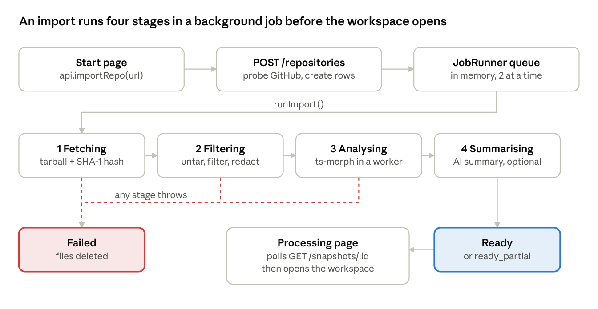

# Know Your Code — Repository Reconnaissance Audit

*As of 2026-11-11 · branch `V1_KYC`, HEAD `b10a2f5`*

## Scope and headline

The repository is a browser web app with one Fastify server, not the desktop-plus-cloud product the vision describes. There is no desktop shell (no Electron or Tauri), the "shared core" is a types-only package, and there are no missions, multi-step assessments or simulation modules.

- **Repository:** Know Your Code, branch `V1_KYC`, HEAD `b10a2f5`, 179 tracked files.
- **Method:** read-only. Files were read with `git`, `grep` and `cat`. Nothing was modified or installed, no tests were run, and no database was contacted. `.env` key names were listed, never values.
- **Confidence labels:** implemented, partial, mocked, untested, missing. Items marked *plausible* were found by reading code and were not reproduced.

## A. Repository directory map

The repo is an npm workspaces monorepo with three packages (`packages/contracts`, `server`, `client`) plus root-level E2E tests, scripts and docs.

| Path | Contents |
| --- | --- |
| `package.json` | Root workspace scripts: `dev`, `build`, `test`, `test:e2e`, `test:live`, `smoke`, `check` |
| `packages/contracts/` | `@kyc/contracts`: shared TS types (`api.ts`), Zod schemas (`schemas.ts`), error table (`errors.ts`). No business logic |
| `server/src/http/` | Routes, SSE, cookie owner, rate limiter, CSRF and security headers |
| `server/src/ingestion/` | GitHub URL parsing, tarball download, extraction, file filtering |
| `server/src/analysis/` | ts-morph analyser, worker thread, selection classifier, overview |
| `server/src/index/` | Postgres read/write layer for snapshots, files, symbols, edges |
| `server/src/ai/` | LLM providers (Anthropic, Groq, Fake), prompts, schemas, verifier, cost, `AiService` |
| `server/src/retrieval/` | Context pack builder for prompts |
| `server/src/jobs/` | In-process job queue, import pipeline, retention |
| `server/src/db/` | pg pool, migration runner, 3 SQL migrations |
| `server/src/privacy/` | Secret redaction |
| `server/tests/` | 17 Vitest suites, fixtures, fakes, E2E server bootstrap |
| `client/src/` | React 19 + Vite SPA: 4 pages, 13 components, 2 hooks, API client |
| `e2e/` | 5 Playwright specs |
| `scripts/` | `smoke.mjs`, `measure-import.ts`, `measure-nav.mjs`, `measure-blocking.mjs` |
| `docs/` | 16 design docs (00–14, 99), `implementation/` (5 docs), `images/`, `archive/know-your-code-docs.zip` (removed on 2026-11-12; see `CLAUDE.md`) |
| `.github/workflows/ci.yml` | One CI job: Postgres 16 → typecheck, lint, format, unit/integration, build, deterministic E2E |

Untracked and gitignored on disk: `node_modules/`, `playwright-report/`, `test-results/`, `server/tests/.build/worker.mjs`, `.env`.

## B. Technology stack

The stack is TypeScript end to end: React + Vite in the browser, Fastify + raw SQL on Postgres on the server, and ts-morph for code analysis.

| Layer | Technology | Evidence |
| --- | --- | --- |
| Runtime | Node ≥ 20.12 (CI uses 22), ESM | root `engines`, `"type":"module"`, `ci.yml` |
| Frontend | React 19, react-router-dom 7, Vite 8, CodeMirror 6 | `client/package.json`, `App.tsx` |
| Backend | Fastify 5, @fastify/cookie, rate-limit, static | `server/package.json`, `app.ts` |
| Database | PostgreSQL via `pg`, raw SQL, no ORM; `pg_trgm`, `pgcrypto` | `db/pool.ts`, `001_init.sql` |
| Analysis | `ts-morph` (TypeScript compiler API), worker_threads | `analysis/analyse.ts`, `analysis/runner.ts` |
| Ingestion | `fetch` to GitHub API and codeload, `tar-stream`, zlib | `ingestion/github.ts`, `ingestion/extract.ts` |
| AI | `@anthropic-ai/sdk` ^1.1.0; Groq via hand-written OpenAI-compatible `fetch`; deterministic fake | `ai/llm.ts`, `ai/groq.ts`, `ai/fake.ts` |
| Validation | Zod 3 (server ^3.25.76, contracts ^3.23.8) | manifests |
| Build | tsup (server, 3 entries), Vite (client) | `server/tsup.config.ts` |
| Tests | Vitest 5 (server: node + real Postgres; client: jsdom + Testing Library), Playwright + `@axe-core/playwright` | configs |
| Lint and format | ESLint 10 + typescript-eslint, Prettier | root manifest |

Not present, though the vision implies them: a desktop shell, Redis or any external queue, object storage, and user accounts. Identity is an anonymous signed cookie.

## C. Main execution architecture

One Node process serves the API, runs import jobs in an in-memory queue, and serves the built SPA. The client polls snapshot status until an import is ready.

The route and the job each download from GitHub, and a failure at any stage deletes the stored files and marks the snapshot failed.

**Server startup** (`server/src/server.ts`, `main()`):

1. `loadDotEnv()` → `loadConfig()` (`config/env.ts`, Zod `EnvSchema`).
2. `createPool()` → `migrate(db)` (`db/migrate.ts`: advisory lock, `schema_migrations`, files in order, each in a transaction).
3. `buildApp()` (`app.ts`) → `createServices()` (`services.ts`) wires `GitHubClient`, `RateLimiter`, `AiService(createLlm())` and `JobRunner`.
4. `registerSecurity`, cookie and rate-limit plugins, error handler, `/api/v1/health`, `registerApiRoutes`, `registerAiRoutes`, then static `client/dist` with SPA fallback.
5. `runner.recover()` re-queues interrupted jobs → `scheduleRetention()` (hourly) → `listen`.

**Client startup:** `client/src/main.tsx` → `App.tsx` routes: `/` Landing, `/start` Start, `/r/:id/processing` Processing, `/r/:id` Workspace (lazy-loaded).

**Import path:**

1. The Start page calls `api.importRepo(url)` (`client/src/api/client.ts`) → `POST /api/v1/repositories`.
2. The route (`http/routes.ts`) validates `ImportRequestSchema`, runs `parseRepoUrl()` (github.com only), `getOwner()` (signed cookie) and two `limiter.check` calls.
3. `github.probe()` opens the tarball and aborts it at once. In token mode it also calls `getMeta` and `resolveSha`.
4. `upsertRepository` → `findReusable(repo, sha)` → `createSnapshot()` inserts the `snapshots` and `jobs` rows → `runner.enqueue()` → HTTP 202.
5. `JobRunner.pump()` (`jobs/runner.ts`) sets `jobs.state='running'` and calls `runImport()` (`jobs/importJob.ts`):
    1. **fetching:** `github.openTarball()` again, piped through a SHA-1 hashing `Transform`.
    2. **filtering:** `extractTarball()` (caps, decompression-bomb guard, `classifyPath`, binary and generated detection, `redact()`), `UNSUPPORTED_LANGUAGE` if no JS/TS, then `insertFiles()`.
    3. **analysing:** `loadAnalysableFiles` → `readPathAliases` → `runAnalysis()` (worker thread when `dist/analysis/worker.js` exists, else inline) → `persistAnalysis()`.
    4. **overview:** `buildOverview()` → `markReady()`.
    5. **summarising** (only with an LLM configured): `AiService.summarise()` → a second `markReady()`. Failure here is non-fatal.
    6. **on any error:** `DELETE FROM files` → `markFailed()`.
6. The Processing page polls `GET /snapshots/:id` (the docs say every 1.5 s), then navigates to `/r/:id`.

## D. Important modules and responsibilities

Ingestion, analysis and the data layer are implemented and tested on fixtures. The AI layer is implemented, but only the deterministic fake model has been exercised.

| Module | Key symbols | Responsibility | Status |
| --- | --- | --- | --- |
| `ingestion/url.ts` | `parseRepoUrl`, `isSafeRef` | Strict GitHub URL grammar; main SSRF control | Implemented, tested |
| `ingestion/github.ts` | `GitHubClient.probe`, `openTarball`, `getMeta`, `resolveSha` | Host-allowlisted fetch, manual redirects, size caps | Implemented, tested against a fake GitHub |
| `ingestion/extract.ts`, `filter.ts` | `extractTarball`, `safeRelativePath`, `classifyPath` | Streaming untar, limits, skip reasons | Implemented, tested |
| `privacy/redact.ts` | `redact`, `isSecretFile` | Masks secrets before storage | Implemented, tested |
| `analysis/analyse.ts` (994 lines) | `analyse`, `handleImports`, `handleCalls`, `handleReferences`, `visit` | Symbols plus `imports`, `calls`, `references`, `route_handler` edges; unresolved reasons | Implemented, fixture-tested, JS/TS only |
| `analysis/resolve.ts` | `classifySelection` | Classifies a text selection into a kind (AST level) | Implemented, tested |
| `analysis/overview.ts` | `buildOverview` | Deterministic facts, entry points, frameworks | Implemented, indirect coverage only |
| `index/*.ts` | `persistAnalysis`, `getRelations`, `resolveSelection`, snapshot CRUD | Data access layer, raw SQL | Implemented |
| `retrieval/context.ts` | `buildContextPack`, `Pack` | Token-budgeted prompt context, lexical keyword hits | Implemented; tested only through `ai.test.ts` with the fake model |
| `ai/service.ts` (730 lines) | `AiService.prepareExplain`, `streamExplain`, `streamMessage`, `createCheck`, `answerCheck`, `summarise`, `generate` | Explanations, follow-ups, concepts, multiple-choice checks, project summary, cache, budget | Implemented; real-model quality not verified |
| `ai/verify.ts` | `verifyRefs`, `verifyLines` | Removes model citations outside allowed line ranges | Implemented, unit-tested |
| `ai/llm.ts`, `groq.ts`, `fake.ts` | `AnthropicLlm`, `GroqLlm`, `FakeLlm`, `createLlm` | Provider adapters | Anthropic and Groq: request-shape tests only (mocked) |
| `ai/cost.ts` | `assertBudget`, `costUsd`, `modelFor` | Daily spend cap, `llm_calls` logging | Implemented |
| `jobs/` | `JobRunner`, `runImport`, `runRetention` | Queue, pipeline, 7-day retention | Implemented; `recover()` untested |
| `client/src/hooks/useWorkspace.ts` (541 lines), `ExplanationPanel.tsx` (452 lines) | Workspace state, trail and breadcrumbs, SSE handling | Main learning UI | Implemented; E2E coverage only |

**Vision capabilities against the code:**

| Capability | Status | Evidence |
| --- | --- | --- |
| Project architecture view | Partial | Overview facts, entry points, AI summary with modules; no architecture graph |
| Flow tracing across files | Partial | One-hop relations (callers, callees, imports); call diagram FR-DEP-02 and trace value FR-DEP-03 not built; API-08 `trace-params` missing |
| Concepts through project code | Implemented | AI concept chips, `CONCEPT_VOCAB` in contracts |
| Missions and assessments | Missing | Only one AI multiple-choice check per explanation; no mission or progress tables |
| Behaviour simulation | Missing | No code |
| Desktop application | Missing | No desktop shell or dependency |
| Shared core for reuse | Partial | `@kyc/contracts` holds types only; all logic lives in `server/` |
| Languages | Partial | JS and TS only (`ANALYSABLE_EXT`) |

## E. API route inventory

The server exposes 17 routes under `/api/v1`. Six read routes rely on unguessable snapshot UUIDs and skip owner checks, and `POST /events` has no test.

| Method and path | File | Service functions | Owner check | Tests |
| --- | --- | --- | --- | --- |
| GET `/health` | `app.ts` | DB `SELECT 1`, `ai.configured`, `runner.depth` | n/a | `health.test.ts` |
| POST `/repositories` | `routes.ts` | `parseRepoUrl`, `github.probe`, `upsertRepository`, `findReusable`, `createSnapshot`, `runner.enqueue` | Creates owner | `api.test.ts`, E2E |
| GET `/snapshots/:id` | `routes.ts` | `getSnapshot`, `toView` | No | api |
| GET `/snapshots/:id/overview` | `routes.ts` | `loadUsableSnapshot` | No | api |
| GET `/snapshots/:id/tree` | `routes.ts` | `listFilePaths`, `buildTree` | No | api |
| GET `/snapshots/:id/file?path=` | `routes.ts` | `getFile` | No | api |
| POST `/snapshots/:id/resolve` | `routes.ts` | `resolveSelection` → `classifySelection` | No | resolve, api |
| GET `/symbols/:id/relations` | `routes.ts` | `getSymbolSnapshot`, `getRelations` | No | api |
| DELETE `/repositories/:id` | `routes.ts` | `deleteRepository` | Yes | api, ai |
| GET `/my/snapshots` | `routes.ts` | Inline SQL | Yes (filtered) | api, security |
| POST `/feedback` | `routes.ts` | Inline SQL upsert | Yes | ai |
| POST `/events` | `routes.ts` | Inline SQL, one INSERT per event | Creates owner | None found |
| POST `/explanations` (SSE) | `aiRoutes.ts` | `ai.prepareExplain`, `ai.streamExplain` | Yes | ai |
| POST `/explanations/:id/messages` (SSE) | `aiRoutes.ts` | `ai.prepareMessage`, `ai.streamMessage` | Yes | ai |
| GET `/explanations/:id` | `aiRoutes.ts` | Inline SQL | Yes | ai |
| POST `/explanations/:id/checks` | `aiRoutes.ts` | `ai.createCheck` | Yes (in service) | ai |
| POST `/checks/:id/answer` | `aiRoutes.ts` | `ai.answerCheck` | Yes | ai |

The missing owner checks are deliberate according to `docs/implementation/03_Security_and_Privacy.md`. In practice, anyone holding a snapshot link can read the stored code.

## F. Database model inventory

The database has 14 tables, all defined in `server/src/db/migrations/001_init.sql`. Migration 002 adds the `references` edge type and 003 adds foreign-key indexes. Everything hangs off an anonymous `owners` row; there are no user, mission or learner-progress tables.

| Table | Parent (FK, on delete) | Purpose and notable columns |
| --- | --- | --- |
| `owners` | n/a | Anonymous identity from the signed cookie; `last_seen_at` |
| `repositories` | `owners` (cascade) | `gh_owner`, `gh_name`; unique per owner |
| `snapshots` | `repositories` (cascade) | `status` CHECK enum; `stages`, `overview`, `skipped` JSONB; `expires_at`; unique partial index `(repository_id, commit_sha)` |
| `files` | `snapshots` (cascade) | Full `content` text with a trigram GIN index; `analysable`, `generated` |
| `symbols` | `snapshots`, `files` (cascade); self via `parent_symbol_id` | Kind enum, tags, `exported`, signature, positions |
| `edges` | `snapshots`, source/target `symbols` and `files` (cascade) | `imports`, `calls`, `references`, `route_handler`; `provenance` verified or pattern; `target_external`, `reason` |
| `jobs` | `snapshots` (cascade) | `state`, `attempts`; `last_error` is never written |
| `explanations` | `snapshots`, `owners` (cascade); self `parent_id` and `symbols` (set null) | `cache_key`, `selection`, `body` JSONB, `prompt_version`, `model` |
| `messages` | `explanations` (cascade) | Thread messages; `role`, `intent` (followup or concept) |
| `check_attempts` | `explanations` (cascade) | `question`, `answer`, `result` JSONB |
| `feedback` | `owners` (cascade) | Polymorphic `target_type` and `target_id`, no FK to the target |
| `events` | `owners` (set null) | Analytics events, `props` JSONB |
| `llm_calls` | None (`owner_id`, `snapshot_id` without FKs) | Token counts, cost, latency, status |
| `deletion_log` | None | Audit of user and retention deletions |

The migration runner also creates `schema_migrations`. The trigram index on `files.content` can serve the follow-up lexical search (`ILIKE '%word%'` in `retrieval/context.ts`); there is no user-facing code search.

## G. Test coverage inventory

The server has about 150 integration-heavy cases against a real Postgres, while the client has about 20 unit cases. Every AI test uses the deterministic fake model; no live-model test runs in CI.

| Suite | Size | What it covers | Notes |
| --- | --- | --- | --- |
| Server (Vitest) | 17 files, about 150 cases | URL parsing, extraction, redaction, analyser on fixtures, selection classifier, HTTP import pipeline, security headers and CSRF, AI flows (21 cases in `ai.test.ts`) | Run serially against `TEST_DATABASE_URL`, migrated in `global-setup.ts` |
| Provider adapters | `anthropic-llm.test.ts`, `groq-llm.test.ts` (6 cases each) | Request shape only | Mocked; the file itself says it is not a live API test |
| Client (Vitest + jsdom) | 4 files, about 20 cases | Routing, `RepoUrlInput`, `FileTree`, `RelationList`, `Inline`, `checkRepoUrl` | No tests for `useWorkspace`, `ExplanationPanel`, `CodeViewer`, `Workspace`, `Processing` or the API client |
| E2E (Playwright) | `journey`, `errors`, `a11y`, `responsive` | Real server, DB, ingestion and analysis; fake GitHub and fake AI | Run in CI |
| Live E2E | `live.spec.ts` (5 cases) | Real GitHub and real Claude | Only with `LIVE=1`; AI checks skip without an API key |

**Test infrastructure:** `harness.ts` and `helpers.ts`; `fake-github.ts` (in-process GitHub stand-in); `tar-helper.ts`; `fixture-loader.ts`; `e2e-server.ts` (Playwright server bootstrap). Fixtures: `express-cjs`, `react-ts` (path aliases), `broken` (syntax errors), `dynamic`.

**Untested or only indirectly tested:**

- `JobRunner.recover()`, the crash re-queue path.
- `deleteExpired` and retention internals; `runRetention` appears only in `security.test.ts`.
- `POST /events`.
- `buildOverview` and `buildContextPack` (indirect only).
- Worker concurrency, timeouts and memory limits under real load (`runner.test.ts` has 4 cases).

## H. Dead code, duplication and suspicious items

The dead code is small: a few unused exports and one unused DB column. The more important problems are an undocumented AI provider and duplicated logic that has already drifted apart.

| Item | Location | Type | Finding |
| --- | --- | --- | --- |
| `withTx` | `server/src/db/pool.ts` | Dead | Never used, so `createSnapshot` writes the snapshot and job rows in two statements with no transaction |
| `SKIP_REASON_TEXT` | `server/src/ingestion/filter.ts` | Dead | Exported, never imported |
| `PROJECT_ROOT` | `server/src/analysis/project.ts` | Dead | Exported, never imported |
| `jobs.last_error` | `001_init.sql` | Dead | Column never written |
| Trigram index on `files.content` | `001_init.sql` | Narrowly used | Only the follow-up lexical search (`ILIKE` in `retrieval/context.ts`) can use it; no route exposes code search |
| `CheckAnswerRequestSchema.text` | `packages/contracts/src/schemas.ts` vs `http/aiRoutes.ts` | Inconsistent | Schema accepts free text; the route always rejects it |
| `parse()` and `IdParam` | `http/routes.ts`, `http/aiRoutes.ts` | Duplicate | Copy-pasted helpers |
| Skip-reason wording | `ingestion/filter.ts` vs `client/src/lib/skip.ts` (`SKIP_REASON_COPY`) | Duplicate, drifted | Different wording; client also has `parse_error` and `analysis_failed`, which the server `SkipReason` type lacks |
| Two `resolve.ts` files | `analysis/resolve.ts`, `index/resolve.ts` | Naming | One classifies the AST, the other is DB-backed |
| Two `enclosingSymbol` functions | `analysis/analyse.ts`, `index/symbols.ts` | Naming | Different behaviour, same name |
| Double GitHub fetch | `routes.ts` `probe` and `importJob.ts` `openTarball` | Inefficient | In token mode, `getMeta` and `resolveSha` run twice per import |
| Groq provider | `ai/groq.ts`, `config/env.ts`, tests | Suspicious | Added in commit `b10a2f5`, titled "db check"; not mentioned in README or any doc |
| `modelFor()` | `ai/cost.ts` | Suspicious | Picks Groq model IDs by comparing against hard-coded Claude default names; Groq cost uses Claude price variables |
| Docs zip | `docs/archive/know-your-code-docs.zip` | Duplicate | Binary copy of the 18 docs committed to git |
| Pass-through exports | `ai/llm.ts` re-exports `GroqLlm`; `analysis/analyse.ts` re-exports `readPathAliases` | Minor | Callers import from the original module anyway |

## I. Initial architectural concerns

The biggest concern is the mismatch with the product's direction. The code is a single-instance web app whose reusable logic all lives in the server.

1. **Platform mismatch.** The vision is a desktop UI, a cloud runtime and a shared core. The code is one deployable web app. `packages/contracts` holds types only, so ingestion, analysis and AI cannot be reused by a future local runtime.
2. **Single-instance design.** The job queue (`JobRunner`), rate limiter (`RateLimiter`) and SSE streams all live in process memory. ADR-06 documents this, but it blocks horizontal scaling.
3. **Snapshot reuse edge cases** (*plausible, not reproduced*). If `findReusable` misses but the `(repository_id, commit_sha)` unique index hits a failed or expired snapshot, `createSnapshot` returns the old id and re-enqueues it. `markReady` then leaves `error_code` set and does not refresh `expires_at`.
4. **Monolith files.** `analysis/analyse.ts` (994 lines), `ai/service.ts` (730) and `useWorkspace.ts` (541) are where missions, tracing and simulation would most likely be added.
5. **Learning features are AI output, not a model.** Concepts and checks have no persistent learner-progress model and no curriculum or mission entities.
6. **Unverified AI.** All AI evidence comes from `FakeLlm`. First-token latency (NFR-PERF-02) is unmeasured, and responses are not token-streamed even though SSE is used.
7. **Access model.** Anyone holding a snapshot UUID can read its code. Identity is an anonymous cookie, so there is no cross-device access and no accounts.
8. **Retry semantics.** `attempts` is only incremented in `recover()`, and the code allows 3. `docs/07` says jobs fail after 2 attempts.

## J. Next audit targets and outdated documentation

The next audits should start with the analyser and the AI service, because every learning feature in the vision would be built on them.

| File or module | Why inspect it |
| --- | --- |
| `server/src/analysis/analyse.ts` | Edge correctness, `route_handler` patterns, unresolved caps |
| `server/src/ai/service.ts` with `retrieval/context.ts` | Cache-key design, grounding, check generation |
| `server/src/index/snapshots.ts` (`createSnapshot`, `findReusable`, `markReady`) | Confirm or rule out the reuse edge cases in I.3 |
| `server/src/jobs/runner.ts` (`recover()`) | Untested crash path, retry counting |
| `server/src/ai/groq.ts` | Undocumented provider, JSON-mode reliability |
| `client/src/hooks/useWorkspace.ts`, `ExplanationPanel.tsx` | Untested state logic in the main UI |
| `server/src/index/symbols.ts` (`getRelations`) | Base for any flow-tracing feature |

**Documentation that disagrees with the code** (these documents were removed on 2026-11-12; see `CLAUDE.md`):

| Document | Claim | Code reality |
| --- | --- | --- |
| README and all docs | No mention of Groq | `LLM_PROVIDER=groq` is supported and listed in `.env.example` |
| `docs/07_System_Architecture.md` §12 | Jobs fail after 2 attempts | `recover()` allows 3 |
| `docs/10_API_and_Database_Specification.md` | API-08 `GET /symbols/{id}/trace-params` | Not implemented |
| `docs/10_API_and_Database_Specification.md` | Checks accept `{ "text": … }` answers | Server refuses free text |
| Root `package.json` and all docs | "A browser workspace" | Accurate for the code, but conflicts with the current desktop-plus-cloud vision |
| `docs/implementation/01_Implementation_Status.md` | Requirement-by-requirement status | Mostly honest (AI items marked unverified) but predates the Groq commit |
