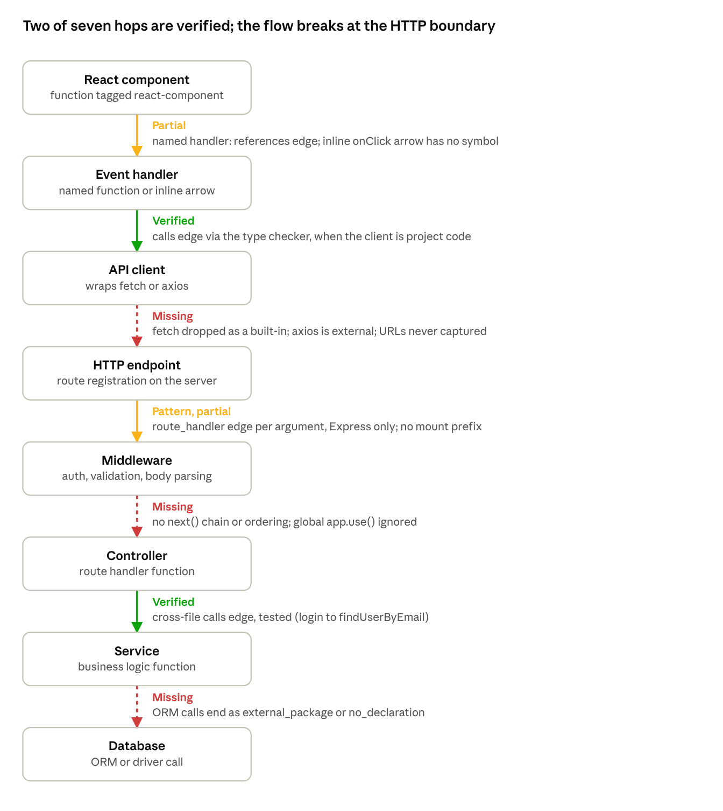

# Know Your Code — Ingestion & Static Analysis Deep Audit

*As of 2026-11-11 · branch `V1_KYC`, HEAD `b10a2f5`*

## Verdict

Ingestion is solid and should be kept. The analyser is a good compiler-backed base, but it only builds a one-hop symbol graph: it cannot yet trace an application flow from UI to database. Imports, cross-file calls through `require`/`import`, and JSX usage resolve with the TypeScript type checker. Interfaces, types, enums, properties, inheritance, HTTP client-to-endpoint links, router mount prefixes, middleware ordering and database access are not modelled.

- **Scope:** GitHub URL import only. There is **no ZIP upload path** anywhere in the code.
- **Method:** read-only review of `server/src/ingestion`, `analysis`, `index`, `jobs` and their tests. Nothing was run.
- **Evidence labels** used below:
    - **Verified (test):** asserted by a named test.
    - **Verified (code):** read in source, no test.
    - **Plausible:** inferred from code paths, not reproduced.
    - **Assumption:** depends on library behaviour that was not checked.

## 1. Ingestion pipeline

An import runs in two phases: a synchronous HTTP request that validates and probes, and a background job that streams, filters, stores and analyses. Paths below are under `server/src/`. No temporary files are written: the archive is streamed and held in memory.

| # | Step | Function (file:line) | Caller | What it does | Evidence |
| --- | --- | --- | --- | --- | --- |
| 1 | Route entry | `POST /api/v1/repositories` (`http/routes.ts:54`) | Client `api.importRepo` | Zod `ImportRequestSchema`, owner cookie, 2 rate-limit buckets | Verified (test): `api.test.ts` |
| 2 | URL validation | `parseRepoUrl` (`ingestion/url.ts:38`), `isSafeRef` (`:14`) | Route | http/https only; host must be `github.com`; no user, password, port, query or hash; owner, name and ref regexes; `..` and leading `-` refused | Verified (test): `ingestion-url.test.ts` |
| 3 | Reachability probe | `GitHubClient.probe` (`ingestion/github.ts:163`) | Route, 10 s timeout | Calls `openTarball`, then aborts at once; returns the SHA when known | Verified (test): `github.test.ts` |
| 4 | Metadata and SHA | `getMeta` (`:113`), `resolveSha` (`:141`) | `openTarball` (token mode only) | Rejects private repos and those over `MAX_REPORTED_REPO_KB` (200 MB); resolves the ref to a 40-char SHA | Verified (test) |
| 5 | Snapshot rows | `upsertRepository`, `findReusable` (`index/snapshots.ts:123`), `createSnapshot` (`:93`) | Route | Reuses a ready snapshot for the same SHA; otherwise inserts `snapshots` + `jobs` rows (two statements, no transaction) | Verified (test): race test in `api.test.ts` |
| 6 | Queue | `JobRunner.enqueue` → `pump` (`jobs/runner.ts:48`) | Route | In-memory queue, concurrency 2; `jobs.state='running'` | Verified (code) |
| 7 | Download | `openTarball` (`github.ts:174`), `request` (`:62`) | `runImport` (`jobs/importJob.ts:94`) | Host allowlist, manual redirects (max 3) re-checked against the allowlist, token dropped on redirect, `content-length` and streamed byte cap (`MAX_TARBALL_BYTES`, 50 MB) | Verified (test) |
| 8 | Hash | `Transform` in `runImport` | Step 7 stream | SHA-1 of the raw tarball, stored as `content_hash` | Verified (code) |
| 9 | Extract | `extractTarball` (`ingestion/extract.ts:74`) | `runImport` (`importJob.ts:114`) | gunzip → `CapStream` (decompressed cap: max of 6 × tarball cap and 64 MB) → `tar-stream`; entry cap 20,000 | Verified (test): `extract.test.ts` incl. decompression bomb |
| 10 | Path safety | `safeRelativePath` (`extract.ts:50`) | Step 9 | Drops the root dir; rejects `\0`, `\`, absolute paths, `.` and `..`; symlinks and hardlinks are never followed | Verified (test) |
| 11 | Filtering | `classifyPath` (`ingestion/filter.ts:117`), `isSecretFile` (`privacy/redact.ts:71`), `looksBinary` (`filter.ts:127`), `isGeneratedPath`/`isGeneratedContent` (`:133`, `:137`) | Step 9 | Excluded dirs (`node_modules`, `dist`, `build`…), lockfiles, `.min.js`, `.map`, `.d.ts`, binary extensions, NUL bytes, invalid UTF-8, secret files, `@generated` headers | Verified (test) |
| 12 | Language detection | `languageOf` (`filter.ts:108`) | Step 9 | By extension only: `js jsx mjs cjs ts tsx`; everything else stored view-only with `language=null` | Verified (code) |
| 13 | Size limits | inside `extractTarball` | Step 9 | > 1 MB skipped; > 300 KB stored but not analysable; non-JS > 300 KB skipped; total text 30 MB; > 1,500 analysable files **fails the whole import** | Verified (test) |
| 14 | Redaction | `redact` (`privacy/redact.ts:39`) | Step 9, before storage | 11 regex rules; line structure preserved | Verified (test): `redact.test.ts` |
| 15 | Language gate | `runImport` | After step 9 | No JS/TS file → `UNSUPPORTED_LANGUAGE` | Verified (test) |
| 16 | Store files | `insertFiles` (`index/files.ts:5`) | `runImport` (`importJob.ts:128`) | `unnest` batches of 200, returns path → id map | Verified (test, indirect) |
| 17 | Reload for analysis | `loadAnalysableFiles` (`files.ts:124`), `loadConfigFiles` (`:135`) | `runImport` (`:133`–`:134`) | Re-reads analysable files from Postgres; config = root `tsconfig.json`, `jsconfig.json`, `package.json` only | Verified (code) |
| 18 | Analyse | `readPathAliases`, `runAnalysis` (`analysis/runner.ts:31`) | `runImport` (`:135`–`:136`) | See sections 2–5 | Verified (test) |
| 19 | Persist graph | `persistAnalysis` (`index/symbols.ts:8`) | `runImport` (`:146`) | Batches of 500, no transaction | Verified (test, indirect) |
| 20 | Framework detection | `buildOverview` (`analysis/overview.ts:66`) | `runImport` (`:158`) | Root `package.json` dependency names matched against a 40-entry table; entry points from `main`, `module`, `bin`, start/dev/serve scripts and fixed candidates | Verified (code) |
| 21 | Finalise | `markReady` (`snapshots.ts:158`) | `runImport` (`:168`, `:185`, `:197`) | `ready`, or `ready_partial` when any `parse_error`, `analysis_failed` or `total_size_limit` skip | Verified (test) |
| 22 | Failure cleanup | `DELETE FROM files` + `markFailed` (`importJob.ts:231`–`232`) | `runImport` catch | Cascade removes symbols and edges; errors swallowed with `.catch(() => undefined)` | Verified (code) |

**Partial failure behaviour:** a file with syntax errors is stored view-only and listed as skipped (`ready_partial`). Hitting the entry cap, the analysable-file cap, the decompressed-byte cap or the timeout (`IMPORT_TIMEOUT_MS`, 120 s) fails the whole import.

## 2. AST analysis architecture

Analysis is one full-repository pass over an in-memory ts-morph `Project`, run once per import in a worker thread. There is no incremental analysis and no reuse between snapshots.

| Question | Answer | Where | Evidence |
| --- | --- | --- | --- |
| How files are loaded | `buildProject` creates `new Project({ useInMemoryFileSystem: true, skipAddingFilesFromTsConfig: true, skipFileDependencyResolution: true })`, then `createSourceFile('/repo/<path>', content)` for every analysable file | `analysis/project.ts:42`–`68` | Verified (code) |
| Compiler options | Fixed: `allowJs`, `checkJs:false`, `jsx: Preserve`, `ES2022`, `ESNext`, `moduleResolution: Bundler`, `resolveJsonModule`, `esModuleInterop`, `types: []`, `skipLibCheck` | `project.ts:47`–`63` | Verified (code) |
| tsconfig handling | Only `baseUrl` and `paths` are read, from the **root** `tsconfig.json` or else `jsconfig.json`, via `ts.parseConfigFileTextToJson` (JSONC tolerated). `extends`, `references`, nested tsconfigs, `strict`, `target` and `jsx` settings are ignored | `readPathAliases`, `project.ts:10` | Verified (test): JSONC aliases in `analyse.test.ts` |
| External packages | No `node_modules` and `types: []`, so package imports resolve to nothing and their values are untyped | `project.ts` | Verified (code) |
| Built-in lib types | `noLib: false`; calls whose declarations all live in lib files are dropped | `analyse.ts:784` | Verified (test): built-ins not reported. Assumption: ts-morph's in-memory host supplies lib files |
| Parse errors | `getSyntacticDiagnostics(sf)`; any error excludes the **whole file** from symbol and edge extraction, adds it to `ctx.broken` and records `parse_error`. Semantic and type errors are ignored | `analyse.ts:917`–`938` | Verified (test) |
| Per-file crashes | A throw while visiting a file records `analysis_failed` and continues | `analyse.ts:960`, `:979` | Verified (code) |
| JS vs TS | Same pipeline. JS gets CommonJS extras: `require` bindings as imports, `exports.x =` / `module.exports.x =` functions, `module.exports = { a, b }` export marking. TS-only constructs (interfaces, types, enums) are skipped entirely | `analyse.ts:311`, `:379`, `:411` | Verified (test) |
| Unsupported files | `.vue`, `.svelte`, `.astro`, `.json`, `.css`, Markdown and so on are stored view-only. `.json` paths count as resolvable import targets | `filter.ts:108`; `analyse.ts:543` | Verified (test) |
| Passes | Pass 1, per file: `visitChildren` builds symbols and marks CJS exports. Pass 2, per file: `handleImports`, `handleCalls`, `handleReferences` | `analyse.ts:951`–`982` | Verified (code) |
| Concurrency | `runAnalysis` starts a `Worker` with `maxOldGenerationSizeMb` (default 2048) and a wall-clock timer; it falls back to inline when no compiled worker exists (dev and tests). Inline mode yields to the event loop every 8 files | `analysis/runner.ts:31`, `worker.ts` | Verified (test): `runner.test.ts` (same output worker vs inline, timeout, responsiveness) |
| Incrementality | None. Every import builds a new Project and type checker over all analysable files | `analyse.ts:896` | Verified (code) |
| Progress | `onProgress(done, total)` posted from the worker every 8 files; `total` = 2 × file count | `analyse.ts:942` | Verified (code) |

## 3. Symbol extraction catalogue

Six symbol kinds are actually produced: `function`, `method`, `class`, `variable`, `parameter`, `import`. The `export` kind is declared in `analysis/types.ts:1` and in the DB CHECK constraint but is never emitted. All extraction happens in `visit` (`analysis/analyse.ts:238`).

**Shared rules for every symbol** (`addSymbol`, `analyse.ts:78`):

- **Run-time key:** `${path}#${start}-${end}-${kind}-${name}`, unique per declaration. It becomes a random UUID on persistence.
- **Name and identity:** `qualifiedName` = parent's `qualifiedName` + `.` + name. There is no file or module component, so identity is (file, qualified name, range).
- **Location:** file path relative to the repo root, plus `start_line`, `start_col`, `end_line`, `end_col` from the declaration node.
- **Parent-child:** `parentKey` is the enclosing symbol passed down by `visit`, stored as `symbols.parent_symbol_id`.
- **Duplicates and overloads:** no deduplication. Each overload signature, each `export default` and each same-named local becomes its own row; ranges distinguish them.
- **Signature:** the source text up to the body, whitespace collapsed, max 200 chars.

| Construct | Status | Kind and how identified | Naming and notes | Evidence |
| --- | --- | --- | --- | --- |
| Function declarations | Implemented | `function`; `FunctionDeclaration` | Name, or `default` for an anonymous default export; `exported` from `isExported()` | Verified (test) |
| Overload signatures | Implemented, noisy | One `function` row per signature and one for the body | Same name repeated | Verified (code) |
| Arrow functions / function expressions in a variable | Implemented | `function`; `VariableDeclaration` with arrow or function initializer | Variable name; signature prefixed with `const`/`let`/`var` | Verified (test) |
| Class declarations | Implemented | `class`; `ClassDeclaration` | Name, or `default` | Verified (test) |
| Class expressions | Partial, wrong name | `class` | `const Foo = class {}` is named **`default`**, because `getName()` is undefined for an anonymous class expression (`analyse.ts:257`) | Plausible |
| Methods | Implemented | `method`; class `MethodDeclaration` | `Class.method` | Verified (test): `Counter.increment` |
| Constructors | Implemented | `method`, name `constructor` | `Class.constructor` | Verified (code) |
| Getters and setters | Implemented | `method` | Getter and setter share a name; two rows | Verified (code) |
| Class properties | Partial | Only when initialised with an arrow or function: `method`-like `function` symbol. Plain properties (`private n = 0`) are **not** symbols | | Verified (code) |
| Object-literal methods | Partial, wrong identity | `function` under the owning variable | Name is `owner.prop`, then the parent prefix is added again, so `qualifiedName` becomes `api.api.get` (`analyse.ts:222`) | Plausible (code read, untested) |
| CommonJS exports | Implemented | `exports.x = fn` / `module.exports.x = fn` → `function`, `exported: true`; `module.exports = { a, b }` marks top-level `a`, `b` exported | | Verified (test) |
| Variables | Implemented | `variable` for every non-function `VariableDeclaration` **at any depth**, including locals inside functions; destructuring gives one row per binding | Large volume | Verified (code) |
| Parameters | Implemented | `parameter` per identifier or binding element | Used to label calls to callbacks as `callback_parameter` | Verified (test) |
| Imports | Implemented | `import` for default, namespace and named ES imports and for `require` bindings (tag `require`). Side-effect imports and re-exports create no symbol | Alias name is used for `import { a as b }` | Verified (test) |
| Anonymous callbacks | Partial | `function` with tag `callback` only when the function is a **call argument** and spans ≥ 3 lines, or is an Express-style route | Named `<callee> callback` (e.g. `useEffect callback`) or `GET /path` (tag `route-handler`). Shorter callbacks and JSX attribute handlers (`onClick={() => …}`) get no symbol; their calls are attributed to the enclosing function | Verified (test) |
| React components | Partial | Tag `react-component` on a function whose name starts with an uppercase letter and whose body contains JSX | `memo`, `forwardRef`, HOCs and `export default () => 
` are not tagged | Verified (test): `Cart` |
| Exported flag | Partial | `isExported()` on declarations; CJS object exports | `export { foo }` lists rely on ts-morph `isExported()` semantics | Assumption |
| Interfaces | Missing | Not visited | | Verified (code) |
| Type aliases | Missing | Not visited | | Verified (code) |
| Enums | Missing | Not visited | | Verified (code) |
| Namespaces and modules | Missing | Children visited with no namespace symbol | | Verified (code) |
| Decorators | Missing | No handling | Matters for NestJS and TypeORM | Verified (code) |
| Hooks, stores, context providers | Missing | Not distinguished from ordinary functions and variables | | Verified (code) |

## 4. Relationship extraction catalogue

Four edge types exist: `imports`, `calls`, `references` and `route_handler`. The first three are labelled `verified` and come from the TypeScript checker or module resolver. `route_handler` is a syntax heuristic labelled `pattern`. Resolution goes through `checker.getSymbolAtLocation` → `declsOf` (`analyse.ts:435`), which follows aliases, shorthand properties and `prop: identifier` up to 5 levels; `mappedSymbol` (`:578`) then maps the declaration back to an extracted symbol.

| Edge | Created by | Source | Target | Basis | Unresolved form | Evidence |
| --- | --- | --- | --- | --- | --- | --- |
| `imports` | `handleImports` (`analyse.ts:590`): `import`, `export … from`, `require('x')`, `import('x')` | Enclosing symbol, or none at top level, plus the file | **File only** (`target_file_id`); never a symbol | `ts.resolveModuleName` with aliases; fallback to known `.json` paths | `external_package` (+ package name), `no_declaration` (missing relative file), `dynamic_import` (non-literal spec), `parse_error` (target broken) | Verified (test) |
| `calls` | `handleCalls` (`:679`): every `CallExpression` and `NewExpression` except `super`, `import()`, `require` | Enclosing function or method (`enclosingSymbol`, `:568`) | `function`, `method` or `class` symbol in any file | Type checker | `computed_member` (`obj[x]()`), `callback_parameter` (calling a parameter), `parse_error`, `external_package`, `no_declaration` (untyped receiver such as `req.body.x()`). Lib built-ins are silently dropped. Max 40 unresolved per source symbol | Verified (test) |
| `references` | `handleReferences` (`:833`): an identifier whose text matches a known function, method or class name and resolves to it, but is not called, imported or declared | Enclosing symbol | `function`, `method`, `class` symbol | Lexical name filter, then the type checker | Not recorded | Verified (test): JSX `<Price/>` gives `meta.jsx` |
| `route_handler` | `handleCalls` + `routeInfo` (`:156`): `x.<verb>('/literal', …fns)` where the receiver's root value is imported or required from the `express` package | **None** (`source_symbol_id` null); file + line | Each function argument after the path (inline or by identifier) | **Pattern**: syntax plus import origin; `meta.method`, `meta.path` | Not recorded when a handler is not a function symbol | Verified (test): `POST /login` → `login` |

**Requested relationships that are not modelled:**

| Relationship | Status | Detail |
| --- | --- | --- |
| Exports | Partial | Only the `exported` flag on symbols. Re-exports (`export * from`) are file-level `imports` edges; there is no export graph |
| Inheritance (`extends`) | Missing as a type | `class A extends B` yields a generic `references` edge from wherever the clause sits, indistinguishable from other value use |
| Implementations (`implements`) | Missing | Interfaces are not symbols, so nothing can be targeted |
| React parent → child | Partial | Inbound only: JSX use is a `references` edge with `jsx: true`, but `getRelations` (`index/symbols.ts:226`) excludes `references` from outbound, so a component's children are not listed |
| React props, hooks, context, state | Missing | Hook calls are `external_package: react` |
| Express mount prefixes | Missing | `app.use('/auth', authRoutes)` creates no edge, because `authRoutes` is a variable. The fixture's handler is recorded as `/login`; the real endpoint is `/auth/login` (verified against `fixtures/express-cjs`) |
| Express middleware | Missing | `app.use(express.json())` has no path so it is ignored; per-route middleware gets the same `route_handler` edge as the final handler |
| Other frameworks | Missing | Fastify, Koa, NestJS decorators, Next.js file routes, React Router routes and GraphQL resolvers are not recognised |
| HTTP client → endpoint | Missing | `fetch` resolves to the DOM lib and is dropped; `axios.get('/api/x')` is `external_package: axios`; URL strings are never captured |
| Database access | Missing | ORM calls are `external_package` or `no_declaration`; models are not identified |
| Type references | Noise | A TS type annotation naming a class counts as a `references` edge |

**Can cross-file calls be traced reliably?** Yes for statically bound calls: named and default imports, destructured `require`, aliased paths and arrow-function exports all resolve (verified by tests). In plain JS without JSDoc, calls through `this.x`, injected dependencies, untyped parameters (`req`, `res`), objects returned from factories and anything in JS whose type the checker cannot infer fall back to `no_declaration`. Expect patchy coverage on plain-JS Express apps. That last point is plausible but has not been measured on real repositories.

## 5. Edge generation and persistence

Edges are built in memory in the worker, sent to the main thread whole, then written to Postgres in batches with no transaction around the snapshot.

1. **Pass 1, symbols** (`analyse.ts:951`): `visitChildren` per analysable, parse-clean file. It fills `ctx.symbols`, `ctx.byDecl` (declaration node → symbol) and `ctx.scopeNodes` (function node → symbol, used for enclosing-symbol lookup).
2. **Name filter** (`:967`): the set of last-segment names of all functions, methods and classes, used to prefilter identifiers in `handleReferences`.
3. **Pass 2, edges** (`:972`): per file, `handleImports` → `handleCalls` → `handleReferences`, each via `forEachDescendant`. `pushEdge` (`:559`) drops unresolved edges past 40 per source symbol. Unresolved edges with no source symbol (top-level code) are not capped.
4. **Transfer:** the worker posts `{ type: 'done', result }`; the whole `AnalysisResult` is structured-cloned to the main thread (`analysis/worker.ts`, `runner.ts`).
5. **Persist** (`persistAnalysis`, `index/symbols.ts:8`): every symbol key gets a fresh `randomUUID()`. Symbols are inserted in 500-row `unnest` batches; `parent_symbol_id` is valid because parents are pushed before children. Edges are then inserted in 500-row batches, with keys mapped to symbol UUIDs and paths mapped to file UUIDs; `meta` is stored as JSONB.
6. **Derived data:** `counts` and `topSymbols` (`symbols.ts:324`, `:353`) feed `buildOverview`.
7. **Read side:** `getRelations` (`symbols.ts:218`) runs three queries. Inbound returns `calls`, `references` and `route_handler` edges, capped at 20. Outbound returns `calls` and `route_handler`, deduplicated by target and capped at 30, plus unresolved edges capped at 30. Imports are at file level. There is no multi-hop traversal and no path query.

**Integrity notes** (Verified (code)):

- Symbols and edges are written in many statements with no transaction. A crash midway leaves a partial graph until the catch block deletes the files (cascading to symbols and edges). A process kill skips that cleanup; `recover()` then re-runs the job, and `insertFiles` hits `UNIQUE (snapshot_id, path)`. That last point is plausible, not tested.
- `edges.source_symbol_id` is null for top-level code and for every `route_handler` edge, so these edges are reachable only through files.
- Diagnostics (`result.diagnostics`) are logged in counts but never persisted; only `failedFiles` survive, as the snapshot's `skipped` list.

## 6. Known limitations and failure cases

Most limitations come from a fixed, root-only project configuration and from treating whole files as either parsed or broken.

| # | Limitation or failure | Effect | Location | Evidence |
| --- | --- | --- | --- | --- |
| 1 | Only GitHub URLs; no ZIP upload, GitLab, Bitbucket or private repos | Many student and work repos cannot be imported | `ingestion/url.ts:38` | Verified (code) |
| 2 | One syntax error drops the whole file from the graph | Callers into that file get `parse_error` edges; no symbols | `analyse.ts:919` | Verified (test) |
| 3 | Root-only tsconfig; `extends`, project references and nested configs ignored | Aliases in monorepos and workspace packages fail to resolve (`no_declaration`) | `project.ts:10` | Verified (code) |
| 4 | Framework detection reads only the root `package.json` | Monorepos and nested apps report no frameworks | `importJob.ts:155`, `overview.ts:79` | Verified (code) |
| 5 | Framework detection is a dependency-name lookup, labelled `verified` | A listed but unused dependency is shown as a fact | `overview.ts:89` | Verified (code) |
| 6 | No `node_modules` or `@types` | Calls into libraries are only named by package; library return types are unknown, so chained calls on them become `no_declaration` | `project.ts:58` | Verified (code) |
| 7 | Lib built-ins (including `fetch`, DOM, `Promise`) are dropped | HTTP calls via `fetch` leave no trace at all | `analyse.ts:784` | Verified (code) |
| 8 | Unresolved cap of 40 per source symbol | Large functions silently lose unresolved evidence | `analyse.ts:559` | Verified (code) |
| 9 | > 1,500 analysable files fails the import outright | No partial analysis for large repos | `extract.ts:157` | Verified (test) |
| 10 | Short callbacks (< 3 lines) and JSX attribute handlers have no symbol | Event handlers cannot be selected or traced on their own | `analyse.ts:364` | Verified (code) |
| 11 | `const X = class {}` named `default`; object methods get a doubled qualified name | Wrong labels in the UI and in AI prompts | `analyse.ts:222`, `:257` | Plausible |
| 12 | Route paths must be string literals starting with `/`; receiver must originate from `express` | Routes built from constants, routers passed as parameters, or `Router` from a wrapper are missed | `analyse.ts:156`, `:694` | Verified (code) |
| 13 | Route callback naming (`GET /x`, tag `route-handler`) does not check the receiver is Express | `api.get('/users', cb)` in client code is tagged as a route handler | `analyse.ts:362` | Plausible |
| 14 | `.vue`, `.svelte`, `.astro`, MDX not parsed | Script blocks in single-file components are invisible | `filter.ts:108` | Verified (code) |
| 15 | Redaction runs before analysis | Line numbers stay valid, but a redacted string literal used as a route path or import spec breaks resolution (rare) | `extract.ts:169` | Plausible |
| 16 | Non-literal, conditional or computed `require`/`import` | `dynamic_import`; target unknown | `analyse.ts:668` | Verified (test) |
| 17 | Anonymous GitHub mode has no SHA | No snapshot reuse; every import re-downloads and re-analyses | `github.ts:190` | Verified (test) |
| 18 | Failure cleanup swallows its own errors | A failed cleanup can leave stored files with a `failed` snapshot | `importJob.ts:231` | Verified (code) |

## 7. Application-flow tracing readiness

The system has a **static symbol dependency graph**, not a runtime execution graph, and it cannot trace the target flow end to end today. It can follow a call chain inside one tier: handler → client wrapper, and controller → service. It cannot cross the HTTP boundary, order middleware, or reach the database.

Each hop is judged against the edge types in section 4. "Verified" means a `calls` edge resolved by the type checker; the controller → service hop is covered by `analyse.test.ts`, while the handler → client hop is inferred from code.

**Why a symbol graph is not a flow:**

- Edges say "A's body mentions B", not "A runs before B". Conditional branches, early returns, `await` ordering and error paths are not modelled.
- `getRelations` returns one hop only; there is no stored path, no traversal query and no notion of an entry point per request.
- Uncertain links are kept apart correctly: `route_handler` is `pattern`, and unresolved edges carry a `reason`. AI must not be allowed to fill these gaps silently.

**Dynamic behaviour that static analysis will not resolve:** dependency injection containers, event emitters and pub/sub, `obj[method]()` dispatch, plugin loaders using computed `require`, React context and state updates, router tables built at runtime, and ORM methods generated from schemas.

## 8. Performance and scalability concerns

The design fits small student repos on one machine. It does not scale to large repos, many concurrent users or repeated analysis of the same code.

| # | Concern | Detail | Location | Evidence |
| --- | --- | --- | --- | --- |
| 1 | Whole repo in memory, several times | Extracted text (up to 30 MB) sits in an array, is written to Postgres, read back (`loadAnalysableFiles`), copied into the worker, parsed into ASTs plus a type checker, then results are cloned back | `importJob.ts:114`–`146` | Verified (code) |
| 2 | Memory ceiling | Worker old-space cap 2,048 MB × `IMPORT_CONCURRENCY` 2 = up to 4 GB, plus the main thread's copies | `runner.ts:39`, `config/env.ts` | Verified (code) |
| 3 | Full re-analysis per import | No incremental analysis, no cache keyed by file hash, no reuse across snapshots of the same repo | `analyse.ts:896` | Verified (code) |
| 4 | Double download in token mode | `probe` and `runImport` each call `getMeta`, `resolveSha` and open the tarball | `routes.ts`, `github.ts:163` | Verified (code) |
| 5 | Per-node checker calls | `getSymbolAtLocation` for every call, plus every identifier matching a function name; `originSpec` walks declarations recursively | `analyse.ts:747`, `:868` | Verified (code); cost unmeasured |
| 6 | Large symbol tables | Every local variable and parameter is a row; volume grows with function size, not just API surface | `analyse.ts:304`, `:169` | Verified (code) |
| 7 | Costly full-text index | `files.content` is stored with a trigram GIN index that only the follow-up lexical search (`ILIKE`) can use, yet every insert pays for it | `001_init.sql` | Verified (code) |
| 8 | Single process | In-memory queue and limiter; one Node process does both API and imports | `jobs/runner.ts` | Verified (code) |
| 9 | Measured numbers | `docs/implementation/01_Implementation_Status.md` reports 2.4–6.9 s imports for express, commander and ky on one laptop. A repo at the 1,500-file limit was never measured | docs | Not re-measured by this audit |

## 9. Security concerns

The ingestion boundary is well defended and well tested. The residual risks are leaking stored code to anyone who has a snapshot ID, regex-based secret detection, and parser resource exhaustion.

**Controls that work** (Verified (test)):

- SSRF: a strict URL grammar, a fixed host allowlist, manual redirects re-checked against the allowlist, and the token stripped on redirect (`github.ts:62`, `github.test.ts` "refuses redirects to unexpected hosts").
- Archive attacks: zip-slip, absolute paths, symlinks, hardlinks, entry-count cap, decompression-bomb cap, per-file and total size caps (`extract.test.ts`).
- Secrets: secret files never stored; 11 regex rules redact values in kept files before storage (`redact.test.ts`).
- No code execution: analysis is in-memory parsing only, with no `npm install` and no running of repository code (`project.ts:38` comment, `skipFileDependencyResolution`).

**Residual risks:**

| # | Risk | Detail | Location | Evidence |
| --- | --- | --- | --- | --- |
| 1 | Stored code readable by snapshot ID | Tree, file, resolve and relations routes do not check the owner; a leaked link exposes the code | `http/routes.ts` | Verified (code); deliberate per `03_Security_and_Privacy.md` |
| 2 | Regex-only secret detection | High-entropy strings, JWTs, DB passwords outside `secret=` patterns and custom key formats pass through, and are later sent to the LLM | `privacy/redact.ts:14` | Verified (code) |
| 3 | Parser and type-checker exhaustion | A crafted file (deeply nested expressions, huge unions) can burn CPU or memory; mitigated only by the worker memory cap and the 120 s timeout | `runner.ts:39` | Plausible |
| 4 | Inline fallback has no memory isolation | With `ANALYSIS_MODE=auto` and no compiled worker (dev, or a broken build), analysis runs on the API thread | `runner.ts:34` | Verified (test): fallback path |
| 5 | Abort is cooperative only in inline mode | `checkAbort` is not passed to the worker; the worker is only killed by its timer | `runner.ts:74` | Verified (code) |
| 6 | Prompt injection via repository content | File text, comments and README go into AI context packs; content is data, but no injection filtering exists | `retrieval/context.ts` | Plausible; outside this audit's depth |
| 7 | Public-repo only, by design | Private repos are rejected in token mode; in anonymous mode a 404 is treated the same way | `github.ts:113` | Verified (test) |

## 10. Component classification

Keep the ingestion boundary and the compiler-backed core. Extend the analyser into a framework-aware graph, and build the flow layer, since nothing like it exists today.

| Component | Files and key symbols | Classification | Reason |
| --- | --- | --- | --- |
| URL validation and GitHub client | `ingestion/url.ts` `parseRepoUrl`; `ingestion/github.ts` `GitHubClient` | **Reuse as-is** | Strict, SSRF-safe, well tested. Remove the double fetch when convenient |
| Archive extraction and filtering | `ingestion/extract.ts` `extractTarball`; `ingestion/filter.ts` | **Reuse as-is** | Streaming, capped, tested against archive attacks |
| Secret redaction | `privacy/redact.ts` | **Extend** | Add entropy checks and more formats; it gates what reaches the LLM |
| Source acquisition beyond GitHub | none | **Build from scratch** | ZIP upload, other hosts and private repos need a new source-adapter layer feeding `extractTarball`-style limits |
| Snapshot and file persistence | `index/snapshots.ts`, `index/files.ts` `insertFiles` | **Refactor** | Wrap per-snapshot writes in a transaction; make failure cleanup and job retry idempotent; reconsider storing all content in Postgres |
| Project and compiler setup | `analysis/project.ts` `buildProject`, `readPathAliases` | **Extend** | Follow `extends` and nested tsconfigs, support workspaces and monorepos, optionally load `@types` for key frameworks |
| Symbol extraction | `analysis/analyse.ts` `visit`, `addSymbol`, `makeFunctionSymbol` | **Extend** | Add interfaces, types, enums, properties and decorators; fix class-expression and object-method naming; name JSX handlers and short callbacks; add a module or file identity to `qualifiedName` |
| Call and reference edges | `handleCalls`, `handleReferences`, `declsOf`, `mappedSymbol` | **Extend** | The checker-based core is sound. Add `extends`, `implements`, `renders` and type-reference edge types instead of lumping them into `references` |
| Import edges | `handleImports`, `resolveModule` | **Extend** | Add symbol-level import and export edges and a re-export graph |
| Framework patterns | `routeInfo`, the Express branch in `handleCalls`, `overview.ts` `FRAMEWORKS` | **Replace** | A hard-coded Express check cannot grow. Replace it with a pluggable framework-adapter layer (Express mounts and middleware, Fastify, Next.js routes, React Router, HTTP clients, ORMs) that emits `pattern` edges with evidence |
| Worker orchestration | `analysis/runner.ts`, `worker.ts` | **Reuse as-is** | Works and is tested. Pass abort into the worker, and remove the inline fallback in production |
| Edge persistence and graph queries | `index/symbols.ts` `persistAnalysis`, `getRelations` | **Refactor** | Transactional writes; persist diagnostics; add multi-hop traversal and path queries; give `route_handler` a source |
| Application-flow tracing | none | **Build from scratch** | Needs client→endpoint matching, router prefix composition, middleware chains and data-access edges, each with confidence, on top of the extended graph |
| Incremental or cached analysis | none | **Build from scratch** | Needed before large repos or re-imports become common |
