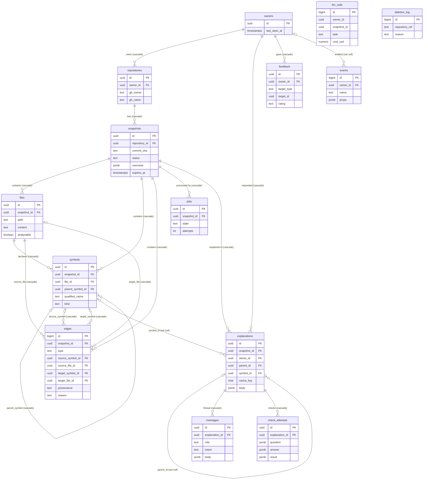
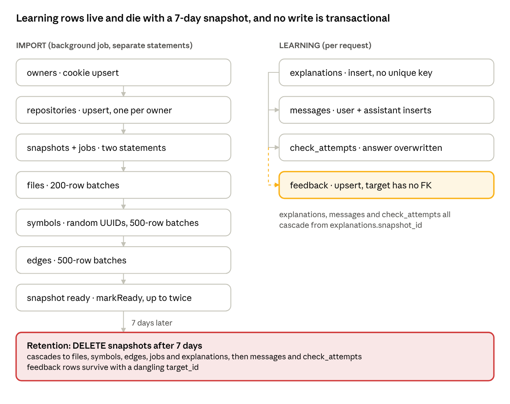

# Know Your Code — Database & Data-Model Audit

*As of 2026-11-11 · branch `V1_KYC`, HEAD `b10a2f5`*

> Point-in-time audit of `b10a2f5`. Findings resolved by Phase 1 (2026-11-12) are listed in [09_Phase_1_Completion_Report.md](09_Phase_1_Completion_Report.md); the current code is described there and in `CLAUDE.md`.

## Verdict

The schema is a sound, well-indexed store for **disposable, per-user analysis snapshots**, but it cannot hold durable learning data as it stands. Every learning-related row (explanations, threads, checks) cascades from a snapshot that is deleted after 7 days, symbol IDs are random per run, and the only identity is an anonymous cookie. Flows, learning paths, missions and progress need new entities. Analysis versioning and stable symbol identity need changes to the existing ones.

- **There is no Prisma.** The project uses raw SQL through `pg`: three forward-only SQL migrations in `server/src/db/migrations/` are applied by a custom runner (`server/src/db/migrate.ts`). Every query is hand-written SQL in `server/src/index/*`, `server/src/ai/*` and `server/src/http/*`. "Prisma" in the codebase is only a framework-detection string (`analysis/overview.ts:19`).
- **Scope:** 14 tables plus `schema_migrations`, every query that touches them, and the import, analysis, explanation and feedback write paths.
- **Method:** read-only. Nothing was modified, migrated or run.
- **Evidence labels:**
    - **Verified (schema):** read in a migration.
    - **Verified (code):** read in a query or service.
    - **Verified (test):** asserted by a named test.
    - **Plausible:** inferred from code, not reproduced.

## A. Existing ER diagram

Everything hangs from an anonymous `owners` row and a per-owner `repositories` row. All analysis and learning data then cascades from `snapshots`. Built from `001_init.sql`, `002_edge_references.sql` and `003_fk_indexes.sql`.

Not shown as relationships, because they have no foreign keys: `feedback.target_id` points polymorphically at `explanations`, `messages` or `check_attempts`; `llm_calls.owner_id` and `snapshot_id` are plain UUIDs; `deletion_log` stands alone; `schema_migrations` belongs to the migration runner.

## B. Model catalogue

All 14 tables are in `001_init.sql`. Enums are `text` columns with `CHECK` constraints, not Postgres enum types. Every primary key is a `gen_random_uuid()` UUID, except `edges`, `events`, `llm_calls` and `deletion_log`, which use `bigserial`. Indexes marked (003) were added in `003_fk_indexes.sql`.

**Structure: keys, constraints, indexes and cascades** (Verified (schema)):

| Table | Purpose | Foreign keys → on delete | Unique constraints | Indexes |
| --- | --- | --- | --- | --- |
| `owners` | Anonymous browser identity from the signed `kyc_owner` cookie | None | PK | PK |
| `repositories` | One GitHub repo **per owner** | `owner_id` → owners, cascade | `(owner_id, gh_owner, gh_name)` | `repositories_owner` (003) |
| `snapshots` | One import of a repo at a ref or commit; status, stages, overview | `repository_id` → repositories, cascade | Partial `snapshots_repo_sha (repository_id, commit_sha) WHERE commit_sha IS NOT NULL` | `snapshots_repo`, `snapshots_expires` (003) |
| `files` | Stored, redacted file text and metadata | `snapshot_id` → snapshots, cascade | `(snapshot_id, path)` | GIN trigram `files_content_trgm` (can serve the follow-up lexical search's `ILIKE` in `retrieval/context.ts`) |
| `symbols` | Extracted declarations | `snapshot_id` cascade; `file_id` → files, cascade; `parent_symbol_id` → symbols, cascade | None | `symbols_pos (snapshot_id, file_id, start_line, end_line)`, `symbols_name (snapshot_id, name)`, `symbols_parent`, `symbols_file` (003) |
| `edges` | Relationships between symbols and files | `snapshot_id` cascade; `source_symbol_id`, `target_symbol_id` → symbols, cascade; `source_file_id`, `target_file_id` → files, cascade | None | `edges_src`, `edges_tgt`, `edges_file` (composite on `snapshot_id`); single-column FK indexes (003) |
| `jobs` | Durable import job state | `snapshot_id` → snapshots, cascade | **None** (one job per snapshot is not enforced) | `jobs_state`, `jobs_snapshot` (003) |
| `explanations` | Saved AI explanation and its cache key | `snapshot_id` cascade; `owner_id` → owners, cascade; `parent_id` → explanations, set null; `symbol_id` → symbols, set null | **None** (no unique cache key) | `explanations_cache (snapshot_id, cache_key)`; `explanations_symbol`, `_owner`, `_parent` (003) |
| `messages` | Follow-up and concept thread messages | `explanation_id` → explanations, cascade | None | `messages_expl (explanation_id, created_at)` |
| `check_attempts` | AI quiz question and the learner's answer | `explanation_id` → explanations, cascade | None | `check_attempts_expl` (003) |
| `feedback` | Thumbs up/down on an explanation, message or check | `owner_id` → owners, cascade; **`target_id` has no FK** | `(owner_id, target_type, target_id)` | `feedback_owner` (003) |
| `events` | Product analytics events | `owner_id` → owners, set null | None | `events_name_time (name, created_at)` |
| `llm_calls` | Token, cost and latency ledger for the daily budget | **None** (`owner_id`, `snapshot_id` are plain UUIDs) | None | `llm_calls_day (created_at)` |
| `deletion_log` | Audit trail of deleted repositories | None | None | PK |

**Columns, enums and usage in code:**

| Table | Notable columns | Nullable | Enums (CHECK) | Where it is read and written |
| --- | --- | --- | --- | --- |
| `owners` | `created_at`, `last_seen_at` | None | None | `ensureOwner` (`index/snapshots.ts:70`) via `getOwner` (`http/owner.ts`); retention deletes idle owners (`jobs/retention.ts`) |
| `repositories` | `gh_owner`, `gh_name`, `created_at` | None | None | `upsertRepository` (`snapshots.ts:79`); delete route and `/my/snapshots` (`http/routes.ts`); `deleteExpired` cleanup |
| `snapshots` | `ref`, `commit_sha`, `content_hash`, `status`, `stages` jsonb, `overview` jsonb, `skipped` jsonb, `error_code`, `error_message`, `expires_at` | `ref`, `commit_sha`, `content_hash`, `overview`, `error_code`, `error_message` | `status`: queued, fetching, filtering, analysing, summarising, ready, ready_partial, failed, expired | `createSnapshot`, `findReusable`, `getSnapshot`, `setStatus`, `setStages`, `markReady`, `markFailed`, `deleteExpired` (`index/snapshots.ts`); `JobRunner.recover`; `AiService.summarise` and `facts` |
| `files` | `path`, `language`, `analysable`, `generated`, `size_bytes`, `line_count`, `content` | `language` | None | `insertFiles`, `listFilePaths`, `getFile`, `getFileContent`, `loadAnalysableFiles`, `loadConfigFiles` (`index/files.ts`); `buildContextPack` (`retrieval/context.ts`) |
| `symbols` | `name`, `qualified_name`, `kind`, `tags text[]`, `exported`, `signature`, four position columns | `parent_symbol_id`, `signature` | `kind`: function, method, class, variable, parameter, import, export (`export` is never written) | `persistAnalysis` (`index/symbols.ts:8`); `getSymbol`, `symbolsInFile`, `enclosingSymbol`, `topSymbols`, `counts`; `resolveSelection` (`index/resolve.ts`) |
| `edges` | `type`, `line`, `provenance`, `reason`, `target_external`, `meta` jsonb | `source_symbol_id`, `target_symbol_id`, `target_file_id`, `target_external`, `reason` | `type`: imports, calls, references, route_handler (002); `provenance`: verified, pattern. `reason` is unconstrained | `persistAnalysis`; `getRelations`, `getFileImports`, `topSymbols`, `counts` |
| `jobs` | `state`, `attempts`, `last_error`, `updated_at` | `last_error` (never written) | `state`: queued, running, done, failed | `createSnapshot`; `JobRunner.pump`, `recover` (`jobs/runner.ts`); `markReady`, `markFailed` |
| `explanations` | `cache_key char(64)`, `selection` jsonb, `kind`, `depth`, `body` jsonb, `prompt_version`, `model`, `refs_stripped` | `parent_id`, `symbol_id` | None (`kind`, `depth` unconstrained) | `AiService.streamExplain` insert (`ai/service.ts:352`) and cache lookup (`:267`); `loadExplanation` (`:430`); `GET /explanations/:id` (`http/aiRoutes.ts`); feedback ownership check |
| `messages` | `role`, `intent`, `body` jsonb | None | `role`: user, assistant; `intent`: followup, concept | `streamMessage` inserts (`service.ts:513`, `:519`, `:597`); concept cache lookup across the snapshot (`:537`); `GET /explanations/:id` |
| `check_attempts` | `question`, `answer`, `result` jsonb | `answer`, `result` | None | `createCheck` (`service.ts:635`), `answerCheck` (`:649`, `:658`) |
| `feedback` | `target_type`, `target_id`, `rating`, `reason`, `comment` (≤ 500 chars) | `reason`, `comment` | `rating`: up, down. `target_type` is unconstrained in SQL (validated by Zod) | `POST /feedback` upsert (`http/routes.ts:187`) |
| `events` | `name`, `props` jsonb | `owner_id` | None in SQL; names limited by `EVENT_NAMES` in `packages/contracts/src/schemas.ts:58` | `POST /events` (`routes.ts`); 90-day trim in retention |
| `llm_calls` | `task`, `model`, `prompt_version`, tokens, `cost_usd numeric(10,6)`, timings, `status`, `cache_hit`, `refs_stripped` | `owner_id`, `snapshot_id`, tokens, cost, timings | None | `logLlmCall`, `spentTodayUsd` (`ai/cost.ts`); `refs_stripped` patch (`service.ts:372`) |
| `deletion_log` | `repository_ref` ("owner/name"), `reason`, `deleted_at` | None | `reason`: user, retention | `deleteRepository`, `deleteExpired` (`index/snapshots.ts`); 90-day trim |

## C. Data lifecycle

No application write is transactional. The only `BEGIN`/`COMMIT` in the codebase is in the migration runner (`db/migrate.ts:31`); `withTx` (`db/pool.ts:17`) exists but has no callers. Atomicity relies on single-statement upserts, cascade deletes and one cleanup `DELETE` in the import job's catch block.

Each box is a separate write with no surrounding transaction; the table below gives the statements, files and failure behaviour for each step.

| # | Lifecycle step | Writes, in order | Transactional? | Failure and repeat behaviour | Evidence |
| --- | --- | --- | --- | --- | --- |
| 1 | User arrives | `UPDATE owners SET last_seen_at` or `INSERT owners` (`ensureOwner`, `snapshots.ts:70`) | Single statement | A lost or tampered cookie silently creates a new owner; the old owner's repos become unreachable until retention deletes them | Verified (code) |
| 2 | Import requested | `INSERT repositories … ON CONFLICT DO UPDATE` (`snapshots.ts:79`) | Single statement (idempotent) | Same repo, same owner: reused. Same repo, **different owner: a new repository row** | Verified (code) |
| 3 | Snapshot created | `INSERT snapshots` then `INSERT jobs` (`createSnapshot`, `snapshots.ts:93`) | **No**: two statements | A crash between them leaves a `queued` snapshot with no job; `recover()` marks it failed. A racing double import hits the partial unique index and reuses the snapshot. A failed or expired snapshot for the same SHA is also returned and re-enqueued (see D) | Verified (test): race; rest Plausible |
| 4 | Job starts | `UPDATE jobs SET state='running'` (`runner.ts:53`); stage updates write `snapshots.status` and `stages` | Single statements | `attempts` is only incremented by `recover()` on boot; a job that throws is marked `failed` and not retried | Verified (code) |
| 5 | Files indexed | `INSERT files` in 200-row `unnest` batches (`files.ts:5`) | **No**: many statements | On error the catch block deletes all files (cascade); if the process dies mid-batch, a re-run by `recover()` hits `UNIQUE (snapshot_id, path)` and fails | Plausible |
| 6 | Symbols persisted | `INSERT symbols` in 500-row batches with fresh `randomUUID()`s (`persistAnalysis`, `symbols.ts:8`) | **No** | Same as step 5; IDs differ on every run | Verified (code) |
| 7 | Edges persisted | `INSERT edges` in 500-row batches | **No** | Same as step 5 | Verified (code) |
| 8 | Analysis complete | `UPDATE snapshots` (status, overview, skipped, stages, SHA, hash), then `UPDATE jobs SET state='done'` (`markReady`, `snapshots.ts:158`); called twice when an AI summary runs | **No**: two statements per call | The snapshot is readable as `ready` before the summary is written. `error_code` is not cleared on a re-run | Verified (code) |
| 9 | Import failed | `DELETE FROM files` (cascade), then `markFailed` (`importJob.ts:231`) | **No**; both `.catch(() => undefined)` | Cleanup errors are swallowed; a failed snapshot can keep its files | Verified (code) |
| 10 | Explanation saved | One `INSERT llm_calls` per model attempt (`cost.ts:53`, errors swallowed), then `INSERT explanations` (`service.ts:352`), then optionally `UPDATE llm_calls … WHERE id = max(id) for this owner` (`:372`) | **No** | No unique cache key: concurrent identical requests store duplicate explanations. The `max(id)` patch can hit the wrong ledger row under concurrency. Budget check (`assertBudget`) is read-then-act, so parallel calls can overshoot the cap | Plausible |
| 11 | Follow-up and concept | `INSERT messages` user, then assistant (`service.ts:513`, `:519`); concept answers cached across the whole snapshot (`:537`) | **No** | A failure between the two inserts leaves a question with no answer | Verified (code) |
| 12 | Check answered | `INSERT check_attempts` (`:635`); later `UPDATE … SET answer, result` (`:658`) | Single statements | Re-answering overwrites the previous answer; there is no attempt history | Verified (code) |
| 13 | Feedback recorded | `INSERT feedback … ON CONFLICT (owner_id, target_type, target_id) DO UPDATE` (`routes.ts:187`) after an ownership `SELECT` | Single statement (idempotent) | One vote per target per owner; the latest vote wins | Verified (test): `ai.test.ts` |
| 14 | Retention | Per expired snapshot: `DELETE snapshots` + `INSERT deletion_log`; then empty repos, 90-day trims of `llm_calls`, `events`, `deletion_log`; idle owners (`retention.ts`, `snapshots.ts:219`) | **No** | Explanations, messages and checks are destroyed with the snapshot after 7 days. `feedback` rows survive with dangling `target_id`s | Verified (code) |

## D. Strengths, weaknesses and architectural answers

The schema is clean and well indexed for a single-tenant, short-lived cache of analysis results. Its weaknesses all come from that framing: identity, durability and versioning were never in scope.

**Strengths:**

- Every snapshot-scoped table carries `snapshot_id`, so isolation and deletion are a single cascade (`DELETE repositories` takes 149 ms per `01_Implementation_Status.md`, after `003_fk_indexes.sql`).
- Uncertainty is first-class: `edges.provenance` and `edges.reason` keep `pattern` and unresolved relationships apart from verified ones.
- `explanations` record `prompt_version`, `model` and `refs_stripped`, so AI output is auditable.
- Forward-only, advisory-locked migrations are safe for one or several app instances booting at once (`migrate.ts`).
- Bulk `unnest` inserts keep persistence fast.

**Weaknesses:**

| # | Weakness | Consequence | Evidence |
| --- | --- | --- | --- |
| 1 | Learning data cascades from disposable snapshots | All explanations, threads and checks vanish after `RETENTION_DAYS` (7) | Verified (schema): `explanations.snapshot_id` cascade |
| 2 | Symbol IDs are random per analysis run | No stable identity across re-imports; nothing durable can point at code | Verified (code): `randomUUID()` in `persistAnalysis` |
| 3 | No transactions on multi-statement writes | Partial graphs, orphan jobs, double-run failures | Verified (code) |
| 4 | Repositories are per owner | Two users importing the same commit store and analyse it twice; no shared, canonical snapshot | Verified (schema): unique `(owner_id, gh_owner, gh_name)` |
| 5 | Anonymous cookie identity | No accounts, no cross-device resume, no way to merge owners | Verified (code): `http/owner.ts` |
| 6 | Polymorphic `feedback.target_id` with no FK | Orphans after retention; no integrity | Verified (schema) |
| 7 | Missing uniqueness | Duplicate `jobs` per snapshot possible; duplicate explanations per cache key | Verified (schema) |
| 8 | Critical structures as JSONB | `snapshots.overview`, `stages`, `skipped` and `explanations.body` mirror TS types in `packages/contracts`, unversioned and unqueryable | Verified (code) |
| 9 | Analysis diagnostics not stored | Only `skipped` survives; per-file diagnostics are lost | Verified (code) |
| 10 | Reuse edge case | `createSnapshot` returns an existing failed or expired snapshot for the same SHA and re-runs it without clearing `error_code` or extending `expires_at` | Plausible |

**Architectural questions:**

| Question | Answer |
| --- | --- |
| Is the schema coupled to the frontend? | **Partly.** Relational tables are neutral, but `snapshots.overview` and `explanations.body` store exactly the JSON the UI renders (`Overview`, `ExplanationBody` in `packages/contracts`); changing the UI shape means migrating JSONB. |
| Is business logic embedded in queries? | **Some.** There is no ORM. Starting-point ranking, test-path exclusion (regex in SQL), unresolved counting (`topSymbols`, `counts` in `index/symbols.ts`), cross-snapshot concept caching and the budget sum all live in SQL strings. |
| Can analysis run without the database? | **Yes.** `analyse()` (`analysis/analyse.ts:896`) is pure: files in, `AnalysisResult` out. Only the orchestrator (`runImport`) round-trips files through Postgres before analysing. |
| Are snapshots isolated? | **Yes.** Every derived row carries `snapshot_id`, and all reads filter on it. Isolation between users is by ownership of `repositories`, but snapshot reads do not check the owner. |
| Can multiple users work safely? | **Yes, by duplication.** Each owner gets separate rows. That is safe but wasteful, and it blocks shared or classroom use. |
| Duplicate or inconsistent records? | **Yes, several risks:** no transactions, no unique cache key, no unique job per snapshot, dangling feedback, the stale `error_code` on re-runs. |
| Suitable for background processing? | **For one process.** `jobs` gives durable state, but there is no lease, worker ID, heartbeat or `SELECT … FOR UPDATE SKIP LOCKED`. Two app instances would both run `recover()` and both process the same job. |

## E. Future requirement-to-schema mapping

Five of the eleven requirements can be met by extending current tables, six need new entities, and none can be met as-is. Two prerequisites unlock most of the rest: a stable code identity that outlives snapshots, and a durable learner identity.

| # | Requirement | Fit | Reuses | Needs |
| --- | --- | --- | --- | --- |
| 1 | Multiple snapshots and versions | Extend | `snapshots` (already many per repo, keyed by SHA) | Retention policy that keeps referenced versions; an `analysis_runs` record (analyser version, options, timings, diagnostics) so one commit can be analysed more than once |
| 2 | Re-analysis of a repository | Extend | `snapshots`, `jobs` | Today the unique `(repository_id, commit_sha)` allows exactly one analysis per commit. Separating "commit snapshot" from "analysis run", plus idempotent, transactional job writes |
| 3 | Stable symbol identity across runs | New | `symbols.qualified_name`, `files.path` | A deterministic **symbol key** (for example repo + path + qualified name + kind + disambiguator) stored on `symbols`, and a repo-level identity table that runs map onto. Random UUIDs cannot serve |
| 4 | Application flows with ordered steps | New | `edges` as evidence | `flows` and `flow_steps` (ordered, each with provenance and confidence) per analysis run |
| 5 | Flows linked to code symbols | New | `symbols`, `edges` | Steps referencing the stable symbol key and optionally the edge that justifies them, so flows survive re-analysis |
| 6 | Learning paths and lessons | New | None | Content entities independent of any snapshot, attached to code by stable keys or by repository |
| 7 | Missions tied to actual code | New | `symbols`, `files` | Mission entity plus code anchors (stable symbol keys, path and line ranges, commit) with re-anchoring rules when code moves |
| 8 | User-specific progress | New | `owners` (weak) | Real user accounts or a claimable owner; progress records keyed to user + learning item, **not** cascading from snapshots |
| 9 | Assessment attempts and results | Extend | `check_attempts` | Attempts history (today one row is overwritten), scoring, owner link, and decoupling from `explanations` so missions and lessons can assess too |
| 10 | Resuming learning sessions | Extend | `explanations.parent_id`, `messages`, `events` | A durable session or trail record (current position, open explanation, breadcrumb). The UI trail lives only in browser memory today |
| 11 | Untimed, non-rigid exploration tracking | Extend | `events` (owner, name, JSONB props), `explanations` | Typed exploration records (visited symbol or file, by stable key) and bookmarks; `events` alone is analytics, trimmed after 90 days |

## F. Recommended schema changes

Split the schema into two lifetimes: a **code layer** (repository, commit, analysis run, symbols, edges) that can expire or be recomputed, and a **learning layer** (users, progress, flows, missions, attempts) that must survive it. The learning layer points at code through stable keys, never through cascading foreign keys. Nothing here is implemented; the order is by dependency.

| Priority | Change | Touches | Why |
| --- | --- | --- | --- |
| 1 | Wrap each snapshot's writes (files, symbols, edges, `markReady`) in one transaction via the existing `withTx`, and make `createSnapshot` insert both rows atomically | `index/files.ts`, `index/symbols.ts`, `index/snapshots.ts` | Removes partial graphs and orphan jobs; makes re-runs safe |
| 2 | Add `UNIQUE (snapshot_id)` on `jobs`, plus lease columns (`locked_by`, `locked_until`) and claim with `FOR UPDATE SKIP LOCKED` | `jobs`, `jobs/runner.ts` | Safe background processing across more than one process |
| 3 | Add a deterministic `symbol_key` column on `symbols` (indexed per repository), computed in the analyser | `symbols`, `analysis/analyse.ts`, `persistAnalysis` | Foundation for stable identity, flows, missions, bookmarks and progress |
| 4 | Introduce an analysis-run record separate from the commit snapshot (analyser version, options, diagnostics) | New table; `snapshots` | Re-analysis and version comparison without breaking the one-per-SHA rule |
| 5 | Decide repository ownership: a shared canonical repository and commit snapshot, with per-user access rows | `repositories`, `snapshots` | Stops duplicate analysis; enables classes and teams |
| 6 | Real user identity that an anonymous owner can be upgraded into | `owners` (or a new users table) | Durable progress and resume across devices |
| 7 | Move learner-owned rows off the snapshot cascade: explanations, threads and attempts reference stable keys plus the run they were made on, with `ON DELETE SET NULL` | `explanations`, `messages`, `check_attempts` | Learning history outlives the 7-day retention |
| 8 | Replace polymorphic `feedback.target_id` with nullable typed FKs, or one FK per target table | `feedback` | Integrity; no orphans |
| 9 | Add `UNIQUE (snapshot_id, owner_id, cache_key)` on `explanations` and use `ON CONFLICT` | `explanations` | No duplicate cached explanations |
| 10 | Store `llm_calls` with the explanation ID it produced instead of patching `max(id)` | `llm_calls`, `ai/service.ts:372` | Correct cost attribution |
| 11 | Add new entities only when the feature is built: flows and flow steps, learning items (paths, lessons, missions), progress, attempts, bookmarks, sessions | New | Each keyed to user + stable code key; not designed further here, as requested |
| 12 | Version the JSONB payloads (`schema_version` inside `overview` and `body`) | `snapshots`, `explanations` | Lets the UI shape evolve without breaking stored rows |
| 13 | Keep the trigram index on `files.content` only while follow-up lexical search uses it (`ILIKE`, `retrieval/context.ts:328`); drop the unused `export` symbol kind and `jobs.last_error`, or start writing them | `001_init.sql` artefacts | Removes dead schema |

## G. Migration and backward-compatibility risks

The migration risk is low in volume but high in mechanics. Stored data expires within 7 days, so little needs carrying forward. However, the runner has no down-migrations and runs each file in one transaction at boot.

| # | Risk | Detail | Mitigation direction |
| --- | --- | --- | --- |
| 1 | Forward-only migrations | `migrate.ts` has no rollback; a bad migration needs a new corrective file | Test each migration against a copy of production data |
| 2 | Migrations run at app start under an advisory lock | Long `ALTER TABLE` or index builds block startup; `CREATE INDEX CONCURRENTLY` cannot run inside the runner's transaction | Run heavy changes as separate, non-transactional steps |
| 3 | Unique constraints on dirty data | Adding `UNIQUE` to `jobs.snapshot_id` or to explanation cache keys fails if duplicates already exist | Deduplicate in the same migration first |
| 4 | Changing `symbols.id` semantics | Explanations reference `symbol_id` with `SET NULL`; a symbol-key backfill cannot be computed for existing rows without re-analysing | Let old snapshots expire; compute keys only for new runs |
| 5 | Moving learner rows off the snapshot cascade | Changing `ON DELETE CASCADE` to `SET NULL` changes retention semantics and privacy promises (`docs/implementation/03_Security_and_Privacy.md` promises deletion of derived data) | Update the privacy statement; keep user-initiated deletes cascading to what the user asked to delete |
| 6 | Splitting repositories into shared plus per-user access | Every query filtering on `repositories.owner_id` (delete route, `/my/snapshots`, ownership checks in `aiRoutes.ts`) changes meaning | Migrate behind an access table; keep `owner_id` until all reads move |
| 7 | JSONB shape changes | `overview` and `explanation.body` are read directly by the client through `packages/contracts` types; older rows break new UI code | Version payloads and read through an upcaster |
| 8 | Anonymous owners to real users | Cookie-only owners cannot be matched to accounts later unless a claim flow exists before accounts launch | Add the claim step at sign-up time |
| 9 | Test database coupling | Integration tests run all migrations on a shared Postgres (`tests/global-setup.ts`); new constraints can break fixtures | Update fixtures alongside each migration |

## H. Classification

Most code-layer tables can be extended in place. The ownership model, the job store and the persistence services need refactoring, and the whole learning layer must be built.

| Model or component | Classification | Reason |
| --- | --- | --- |
| `files` | **Reuse as-is** | Snapshot-scoped, unique per path, redacted; its trigram index serves only the follow-up lexical search |
| `edges` | **Reuse as-is** | Provenance and unresolved reasons already model uncertainty; new edge types fit the CHECK list |
| `deletion_log`, `events` | **Reuse as-is** | Fit for audit and analytics; not a substitute for progress tracking |
| `symbols` | **Extend** | Add a stable `symbol_key`; keep per-run UUIDs for joins |
| `snapshots` | **Extend** | Add an analysis-run concept, versioned JSONB, and correct reuse of failed or expired rows |
| `check_attempts` | **Extend** | Keep answer history, add scoring and an owner, decouple from explanations |
| `llm_calls` | **Extend** | Link to the explanation it produced; keep as the budget ledger |
| `jobs` | **Refactor** | One job per snapshot, leases, retry counting, `last_error` written |
| `explanations`, `messages` | **Refactor** | Move off the snapshot cascade, anchor to stable keys, unique cache key |
| `feedback` | **Refactor** | Replace the polymorphic target with real foreign keys |
| `repositories` | **Refactor** | Shared canonical repository plus per-user access |
| `owners` | **Replace** | Anonymous cookie identity cannot carry durable progress; replace with users that anonymous owners can be upgraded into |
| Migration runner (`db/migrate.ts`) | **Reuse as-is** | Simple and safe; add a convention for non-transactional steps |
| Data access (`index/snapshots.ts`, `index/files.ts`, `index/symbols.ts`) | **Refactor** | Add transactions; move ranking and filtering rules out of SQL strings where they are product logic |
| `persistAnalysis` | **Refactor** | Transactional, idempotent, and writes `symbol_key` and diagnostics |
| AI persistence (`ai/service.ts`, `ai/cost.ts`) | **Refactor** | Atomic insert-or-reuse for explanations, correct ledger linkage, budget check that cannot overshoot |
| Flows, learning paths, lessons, missions, progress, assessments, bookmarks, sessions | **Build from scratch** | No existing table can hold them without overloading `events` or `explanations` |
