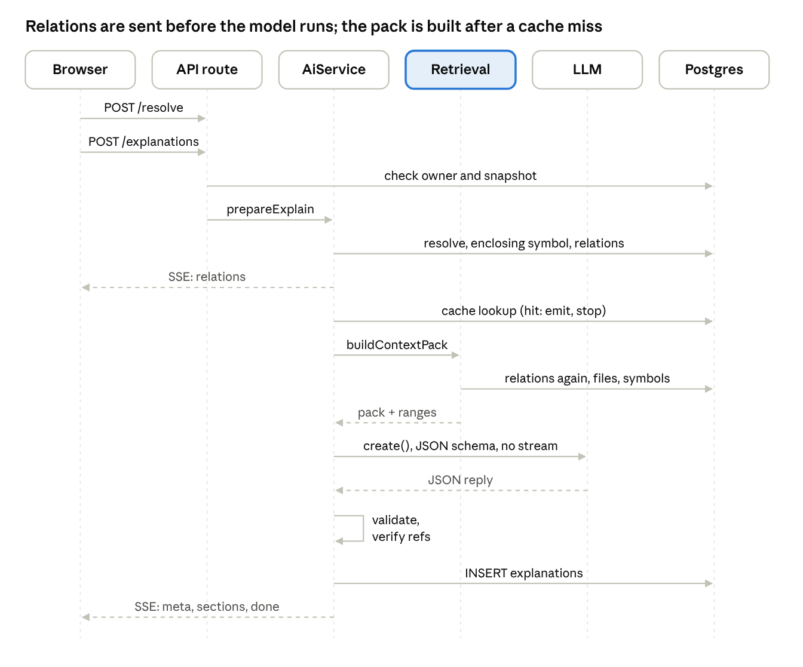

# Know Your Code — Context Retrieval Engine Audit

*As of 2026-11-11 · branch `V1_KYC`, HEAD `b10a2f5`*

> Point-in-time audit of `b10a2f5`. Findings resolved since then are listed in the completion reports for Phase 1 ([09](09_Phase_1_Completion_Report.md)), Phase 2 ([10](10_Phase_2_Completion_Report.md)) and Phase 3 ([11](11_Phase_3_Completion_Report.md)); the current code is described there and in `CLAUDE.md`.

## Verdict

Retrieval is a fixed, single-hop recipe, not a search or ranking engine. For any selection it sends the selected lines, the enclosing function, its one-hop relations, up to 5 callee definitions and 3 call sites, the file's imports and project facts, within a 6,000-token budget (8,000 for follow-ups). It never sends the whole repository. That makes it good at explaining one function in place and weak at anything spanning a flow, a component's wider connections or a concept across the codebase.

- **What works well:** every snippet carries real line numbers, every model citation is checked against exactly the lines that were sent, and unresolved relationships are passed to the model as explicit unknowns.
- **Main gaps:** no multi-hop traversal and no relevance ranking beyond fixed slot order and directory proximity. Lexical search exists for follow-ups only. No streaming of model output. The selected identifier's own definition is not fetched directly.
- **Scope:** the explain, follow-up, concept and check paths in `server/src/retrieval/context.ts`, `server/src/ai/*`, `server/src/index/*`, `server/src/http/aiRoutes.ts` and the client in `client/src/hooks/useWorkspace.ts`, `client/src/api/client.ts` and `client/src/components/ExplanationPanel.tsx`.
- **Method:** read-only; nothing was run, and no live model was called.
- **Evidence labels:** **Verified (code)** = read in source. **Verified (test)** = asserted by a named test (with the fake model). **Plausible** = inferred, not reproduced.

## A. End-to-end request lifecycle

An explanation takes two HTTP calls from the browser and five database round-trip groups on the server, then one non-streaming model call. Relations reach the browser before the model is called, so they show even when the AI fails.



Retrieval runs only on a cache miss, and repeats the relations query already made in `prepareExplain`; the table gives the file and line for each step.

| # | Stage | Function (file:line) | What happens | Evidence |
| --- | --- | --- | --- | --- |
| 1 | Frontend action | `CodeViewer` selection → "Explain" button or `E` key; `explain` (`client/src/hooks/useWorkspace.ts:283`) | Selection in API coordinates `{path, startLine, startCol, endLine, endCol}` | Verified (code) |
| 2 | Pre-flight resolve | `api.resolve` → `POST /snapshots/:id/resolve` (`server/src/http/routes.ts`) | Classifies the selection for the panel label; rejects blank selections | Verified (test): `api.test.ts` |
| 3 | Explain request | `api.explain` → `streamSse('/api/v1/explanations')` (`client/src/api/client.ts:190`, `:75`) | `POST` with `{snapshotId, selection, depth}`; response read as Server-Sent Events | Verified (code) |
| 4 | API route and validation | `POST /api/v1/explanations` (`server/src/http/aiRoutes.ts:24`) | Zod `ExplainRequestSchema`, owner cookie, rate limit (60/h), `loadUsableSnapshot` (`:28`), owner must match the snapshot | Verified (test): `ai.test.ts` |
| 5 | Symbol identification | `AiService.prepareExplain` (`server/src/ai/service.ts:196`) → `resolveSelection` (`server/src/index/resolve.ts:14`) → `classifySelection` (`server/src/analysis/resolve.ts:78`) + `enclosingSymbol` (`server/src/index/symbols.ts:148`) | Re-parses the file text to get the selection kind; finds the **smallest function, method or class** containing the range | Verified (test): `resolve.test.ts` |
| 6 | Relationship lookup | `getRelations` (`symbols.ts:218`), called from `prepareExplain` (`service.ts:199`) | One-hop inbound and outbound edges, unresolved edges, file imports | Verified (test) |
| 7 | Stream opens | `openSse` (`server/src/http/sse.ts:13`) from `aiRoutes.ts:41` | Errors before this point are normal HTTP errors | Verified (code) |
| 8 | Relations emitted | `streamExplain` (`service.ts:260`) emits `relations` | Shown before any model work | Verified (test) |
| 9 | Cache lookup | `cacheKey` (`service.ts:204`), query at `:267` | SHA-256 of snapshot, path, exact range, kind, depth, prompt version, model; scoped to the owner | Verified (test) |
| 10 | Context build | `buildContextPack` (`server/src/retrieval/context.ts:204`); project facts from `facts` (`service.ts:221`) | Calls `getRelations` **again** (`context.ts:239`), then fetches files and symbols slot by slot (section B) | Verified (code) |
| 11 | Token limit | `Pack` (`context.ts:71`), `estimateTokens` (`:9`) | 6,000-token budget, chars ÷ 3.5 | Verified (code) |
| 12 | Prompt assembly | `userMessage` (`server/src/ai/prompts.ts:67`), `SYSTEM_RULES` (`:7`), `explainTask` (`:49`) | Task, JSON input, pack inside `<repository_content trust="untrusted">` | Verified (code) |
| 13 | AI invocation | `generate` (`service.ts:96`) → `assertBudget` → `AnthropicLlm.complete` (`server/src/ai/llm.ts:85`) | `messages.create` **non-streaming**, `output_config.format = json_schema`, 1,400 max tokens, 30 s timeout, one retry inside `complete` on timeout, 429 or 5xx (SDK retries disabled) | Verified (test): wire-shape only (`anthropic-llm.test.ts`) |
| 14 | Response validation | `normaliseExplanation` (`server/src/ai/schemas.ts:181`) | Zod schema; on failure, one retry with the error appended; then a plain-text fallback | Verified (test): `ai-units.test.ts` |
| 15 | Reference verification | `verifyExplanation` (`service.ts:229`) → `verifyRefs`, `verifyLines` (`server/src/ai/verify.ts:21`, `:38`) | Strips refs outside the sent line ranges; if > 30 % stripped, regenerates once on the strong tier (`service.ts:334`) | Verified (test) |
| 16 | Persist | `INSERT explanations` (`service.ts:352`) | Body, cache key, model, `refs_stripped` | Verified (test) |
| 17 | Emit | `emitExplanation` (`service.ts:382`) | Events `meta`, one `section` per section, `done` (concepts, explore-next, tryIt, uncertainty, refsStripped) | Verified (code) |
| 18 | Frontend render | `handleEvent` (`useWorkspace.ts:204`), `ExplanationPanel` (`client/src/components/ExplanationPanel.tsx:156`) | Sections with clickable `TextWithRefs` chips; a notice when refs were removed (`:343`); labels Verified vs Explained | Verified (test): E2E `journey.spec.ts` |

## B. Retrieval algorithm

`buildContextPack` (`server/src/retrieval/context.ts:204`) fills up to nine fixed slots in a fixed order, each with its own token cap. There is no query planner, no embedding search and no traversal beyond one hop. The same function serves explain, follow-up, concept and check requests; only follow-ups pass a `question`, which enables slot 9.

| Slot | Strategy | Implementation (context.ts) | Cap | Data source |
| --- | --- | --- | --- | --- |
| 1 `SELECTED_CODE` | Selection ± 5 lines | `:211` | 1,200 tokens | `getFileContent` (`index/files.ts:112`) |
| 2 `ENCLOSING_SYMBOL` | Enclosing symbol retrieval: whole body of the smallest containing function, method or class, unless slot 1 already covers it | `:222`–`235` | 1,500 | `resolved.symbol` from `enclosingSymbol` |
| 3 `VERIFIED_RELATIONS` | Relationship lookup, as text: callers (≤ 8), callees (≤ 10), unresolved (≤ 10), file imports (≤ 12), each with path, line, provenance and via | `relationsText` `:148`, call at `:241` | 400, or 600 with a symbol | `getRelations`, else `getFileImports` |
| 4 `DEFINITION` | Definition lookup: first 15 lines of up to 5 distinct callees | `:244`–`270` | 400 each, 1,500 total | `getSymbol` + `getFileContent` per callee |
| 5 `CALL_SITE` | Call-site lookup: ± 3 lines around up to 3 callers (calls, value references and route registrations) | `:273`–`288` | 300 each, 800 total | `rel.calledBy` |
| 6 `CALLEE_SIGNATURES` | Signature list for up to 6 callees | `:291`–`297` | 400 | `getSymbol` |
| 7 `FILE_HEADER` | Import lookup by **regex** over the first 60 lines (`import`, `require(`) | `:301`–`309` | 300 | Selected file text |
| 8 `PROJECT_FACTS` | Project metadata: frameworks and language counts | `:312`–`318` | 150 | `snapshots.overview.facts` |
| 9 `LEXICAL_HIT` | Lexical search (follow-ups only): up to 6 identifiers from the question; `ILIKE '%word%'` over analysable files, 2 files per word, first matching line ± 3 | `keywords` `:194`, loop `:321`–`347` | 300 each, 900 total, max 3 hits | `files.content` |

After assembly the whole pack is passed through `redact()` again (`:349`).

**Strategy checklist:**

| Strategy | Present? | Notes |
| --- | --- | --- |
| Symbol-based retrieval | Yes | Only for the enclosing symbol and its direct relations |
| Graph traversal | One hop | No second hop, no path finding |
| Lexical search | Follow-ups only | Case-insensitive substring; the `pg_trgm` GIN index on `files.content` can serve this `ILIKE` (this corrects the earlier audits, which called that index unused) |
| Text matching | Yes | Slot 7 regex; slot 9 first-occurrence match |
| Call-site lookup | Yes | Slot 5 |
| Definition lookup | Partial | Callees of the enclosing symbol only. The **selected identifier's or call's own definition is not fetched directly**, even though the `call` and `reference` prompts (`prompts.ts:42`, `:45`) ask the model to cite it |
| Import lookup | Partial | File-level list plus header lines; the imported module's content is never fetched |
| Enclosing symbol | Yes | Slot 2 |
| Project metadata | Yes | Slot 8; README and module summary are used only by the project-summary path (`service.ts:668`) |
| Conversation context | Follow-ups and concepts | Last 4 messages, each ≤ 600 chars, plus a ≤ 1,700-char summary of the original explanation (`service.ts:467`–`478`); not part of the pack budget |

## C. Ranking and selection logic

Selection is decided by slot order and hard caps, not by relevance scores. The only real ranking is caller proximity by directory; callee order is whatever Postgres returns.

| Question | Answer | Where | Evidence |
| --- | --- | --- | --- |
| How are relevant symbols ranked? | Callers: same file first, then longest shared directory prefix, then line (`rank`). Callees: **no `ORDER BY`** on the outbound query, so which 5 get definitions is arbitrary. A comment promises "top 8 by proximity … verified before pattern", but no code implements it | `index/symbols.ts:235`–`240`, `:226`, comment `:279` | Verified (code) |
| Do direct dependencies get priority? | Yes, by slot order: selection → enclosing body → relations → callee definitions → call sites → signatures → imports → facts | `context.ts:211`–`318` | Verified (code) |
| Are callers and callees both retrieved? | Yes: ≤ 5 callee definitions (15 lines each) and ≤ 3 call sites (± 3 lines); the rest appear only as one-line relation entries | `:244`, `:273` | Verified (code) |
| Is context deduplicated? | Partly. Callee IDs are deduplicated in slot 4, and lexical hits skip already-covered lines. Not deduplicated: a same-file callee's definition can repeat lines from slots 1–2; slot 6 repeats signatures already in slot 4; a recursive call site repeats the enclosing body | `:246`, `:337` | Verified (code) |
| Do snippets keep line numbers? | Yes. Every line is sent as `n| text` with a header `file: path lines a-b`; lines over 300 chars are cut with `…`. Redaction keeps line structure | `:110`–`124`, `privacy/redact.ts:34` | Verified (code) |
| How is size limited? | Global budget (6,000 or 8,000 tokens) plus a per-slot cap; a slot stops adding lines when either runs out | `Pack.snippet` `:90` | Verified (code) |
| What if the selection has many dependencies? | Fixed caps apply: 5 definitions, 3 call sites, 6 signatures, 8 callers and 10 callees in text, 10 unresolved. Everything else is silently dropped. `pack.truncated` is set but **never read** by any caller, so neither the model nor the user is told | `:104`, `:116`; no consumers of `truncated`, `items` or `tokens` | Verified (code) |
| Can retrieval cross files? | Yes, one hop: callee definitions, caller sites and lexical hits can come from any file | `:256`, `:275`, `:327` | Verified (code) |
| How are unresolved edges handled? | Listed in `VERIFIED_RELATIONS` under `UNRESOLVED` with the reason (`external_package:x`, `no_declaration`, `dynamic_import`…); the system prompt tells the model to put them in `uncertainty` | `:172`; `prompts.ts:14` | Verified (code) |
| Can stale data enter? | Unlikely. Snapshots are immutable, and every query is scoped by `snapshot_id`. The cache key includes snapshot, exact range, kind, depth, prompt version and model. The one source of staleness is by design: a user viewing an old snapshot sees that commit's code | `service.ts:204` | Verified (code) |

## D. Example context pack

This is the pack for selecting the whole `login` function (lines 3–7) in the repo's own test fixture `server/tests/fixtures/express-cjs`. It was **reconstructed by hand** by following `buildContextPack` and the analyser over the fixture, not captured from a run. The fixture holds no secrets, so nothing needed removing. Order within the relation lists may differ in a real run, because the outbound query has no `ORDER BY`.

```text
[SELECTED_CODE] file: src/controllers/authController.js lines 1-9 (selected lines 3-7)
1| const { findUserByEmail } = require('../services/userService');
2| 
3| async function login(req, res) {
4|   const user = await findUserByEmail(req.body.email);
5|   if (!user) return res.status(401).json({ error: 'Invalid' });
6|   res.json({ id: user.id });
7| }
8| 
9| module.exports = { login };

[VERIFIED_RELATIONS]
Enclosing symbol: login (function) defined at src/controllers/authController.js:3
CALLED_BY / USED_BY:
- used as a value in src/controllers/authController.js (top level) at src/controllers/authController.js:9 [verified; reference]
- POST /login route registration at src/routes/auth.js:4 [pattern; route]
- used as a value in src/routes/auth.js (top level) at src/routes/auth.js:4 [verified; reference]
CALLS:
- findUserByEmail at src/services/userService.js:7 [verified; call]
UNRESOLVED (could not be followed statically):
- res.status(401).json at src/controllers/authController.js:5 (reason: no_declaration)
- res.status at src/controllers/authController.js:5 (reason: no_declaration)
- res.json at src/controllers/authController.js:6 (reason: no_declaration)
FILE_IMPORTS:
- ../services/userService -> src/services/userService.js (line 1)

[DEFINITION] file: src/services/userService.js lines 7-9 (definition of findUserByEmail)
7| async function findUserByEmail(email) {
8|   return User.findOne({ email: normalise(email) });
9| }

[CALL_SITE] file: src/controllers/authController.js lines 6-9 (used as a value in src/controllers/authController.js (top level) -> login)
6|   res.json({ id: user.id });
7| }
8| 
9| module.exports = { login };

[CALL_SITE] file: src/routes/auth.js lines 1-6 (POST /login route registration -> login)
1| const router = require('express').Router();
2| const { login } = require('../controllers/authController');
3| 
4| router.post('/login', login);
5| 
6| module.exports = router;

[CALL_SITE] file: src/routes/auth.js lines 1-6 (used as a value in src/routes/auth.js (top level) -> login)
1| const router = require('express').Router();
2| const { login } = require('../controllers/authController');
3| 
4| router.post('/login', login);
5| 
6| module.exports = router;

[CALLEE_SIGNATURES]
- findUserByEmail: async function findUserByEmail(email) (src/services/userService.js:7)

[FILE_HEADER] file: src/controllers/authController.js lines 1-1 (imports)
1| const { findUserByEmail } = require('../services/userService');

[PROJECT_FACTS]
frameworks: express, mongoose; languages (file counts): {"js":5}
```

What the example shows:

- **Duplication:** the same 6 lines of `routes/auth.js` are sent twice (route registration and value reference at the same line), line 1 of the controller is sent twice (slots 1 and 7), and the callee signature repeats the definition header.
- **Missing context:** `ENCLOSING_SYMBOL` is skipped because the selection already covers it. The body of `normalise` and the `User` model are not fetched, because they are two hops away. The route's real path `/auth/login` is never visible, because `app.use('/auth', …)` in `app.js` is not an edge.
- **Cost:** roughly 650 tokens. Small functions use a tenth of the 6,000-token budget, and the rest stays unused rather than going to second-hop context.

## E. Token and context-size management

Size control is simple and safe against overflow, but it is an estimate and is under-used. Nothing measures the real prompt size before sending.

| Aspect | Current behaviour | Where | Assessment |
| --- | --- | --- | --- |
| Estimator | `Math.ceil(chars / 3.5)`; +20 tokens per snippet header, +1 per line, +5 per text block | `context.ts:9`, `:108`, `:143` | Rough. Code tokenises denser than prose, so real counts can exceed the estimate. No tokenizer or `count_tokens` call |
| Pack budgets | Explain, concept and check: 6,000. Follow-up: 8,000 | `service.ts:70`–`71` | Fine for one function; far below what a flow or component explanation needs |
| Unbudgeted additions | System rules (~25 lines), task text, JSON `task_input` with up to 4 history messages × 600 chars and a 1,700-char summary | `service.ts:467`–`478`, `prompts.ts:67` | Up to ~1,200 extra tokens on follow-ups, outside the budget |
| Output caps | `max_tokens`: explain 1,400, follow-up 900, concept 900, check 700, overview 900 | `service.ts:63` | Truncation (`stop_reason = max_tokens`) is only logged as a warning (`:162`); a cut-off JSON reply then fails validation and is retried once |
| Long lines | Cut at 300 chars | `context.ts:33` | Protects against minified code; may hide the relevant tail of a long line |
| Overflow | Each slot stops at its cap; later slots are skipped once the global budget is spent | `Pack.snippet`, `Pack.text` | Never overflows; silently drops context. `truncated` is never surfaced |
| Unused budget | Small selections use a fraction of the budget (about 650 tokens in example D) | n/a | Unused space could carry second-hop definitions or examples |
| Cost control | `assertBudget` checks today's spend against `DAILY_SPEND_CAP_USD` (default $5) before each call | `ai/cost.ts:33` | Read-then-act, so parallel requests can overshoot slightly |
| Prompt caching | Not used: the identical `SYSTEM_RULES` block is re-sent on every call without a cache marker | `llm.ts:85` | Cheap latency and cost win left on the table |
| Streaming | Model output is not streamed; SSE delivers sections only after the full reply arrives | `llm.ts:85`, `service.ts:382` | First-token latency target (NFR-PERF-02) is unmet by design |

## F. Evidence and source-reference validation

Citation checking is the strongest part of the engine: a reference survives only if its file and line were in the numbered snippets sent to the model. It does not check that the cited line actually supports the claim, and several fields carry claims with no references at all.

**How it works** (`server/src/ai/verify.ts`): `Pack.snippet` records each sent range in `ranges: Map<path, [start, end][]>` (`context.ts:83`, `:127`). `verifyRefs` (`:21`) keeps a `{path, line}` only if `isAllowed` finds it inside a sent range, and deduplicates. `verifyLines` (`:38`) does the same for step line numbers against the first path in the pack. Stripped counts are stored as `refs_stripped` and shown to the user (`ExplanationPanel.tsx:343`).

| Output field | Validated? | Evidence |
| --- | --- | --- |
| `what`, `why`, `inputs`, `effects`, `edgeCases[].refs` | Yes, against sent ranges | `service.ts:239`–`252`; Verified (test) |
| `steps[].lines` | Yes, but only against the **first** file in the pack (the selected file) | `service.ts:235`, `:243` |
| `dependsOn` | **No refs field at all**: free text, not checked | `packages/contracts/src/schemas.ts:100`; `service.ts:247` |
| `concepts`, `exploreNext`, `tryIt`, `uncertainty` | Not checked: unreferenced text | `schemas.ts` |
| Follow-up `refs` | Yes | `service.ts:512` |
| Concept `inYourCode` | Yes; unverified examples are dropped | `service.ts:586`–`595` |
| Check `answerRefs` | Yes, and the whole check is **discarded** if none survive | `service.ts:631`–`634` |
| Project summary `refs`, `modules[].paths` | Path must exist in the snapshot; line must be ≥ 1 but is not checked against the file or the sent excerpt | `service.ts:723`–`727` |
| Prose claims ("this is called by X") | Not checked; relies on `SYSTEM_RULES` telling the model to use only `VERIFIED_RELATIONS` | `prompts.ts:12` |
| Line numbers mentioned inside prose text | Not checked | n/a |

**Fallbacks that weaken evidence:**

- On two schema failures, a plain-text fallback is stored with no refs and an `uncertainty` note (`service.ts:315`). That is honest, but unverifiable.
- If more than 30 % of refs are stripped, the strong tier regenerates once, and the result with fewer stripped refs wins (`:334`). Good, but nothing records that the first attempt was rejected.

**Provenance labels:** relations carry `verified` or `pattern`; AI text is always labelled `Explained` in the UI (`docs/implementation/01_Implementation_Status.md`, FR-EXP-04). Verified (test) via E2E.

## G. Retrieval failure cases

Most failures are silent: the pack is built, the model answers, and nobody is told what context was missing.

| # | Situation | What happens | Where | Evidence |
| --- | --- | --- | --- | --- |
| 1 | Selection is a call or reference to something defined in another file | No direct definition lookup for the selected identifier. The definition appears only if it is one of the enclosing function's first 5 callees in arbitrary DB order | `context.ts:244`; `symbols.ts:226` | Verified (code) |
| 2 | Selection is an import line | The imported module is listed but its content is never fetched | `context.ts:181` | Verified (code) |
| 3 | Selection at top level (outside any function) | No enclosing symbol, so no relations; only the file import list and the selected lines | `context.ts:154`, `:240` | Verified (code) |
| 4 | View-only file (`.json`, `.vue`, > 300 KB, generated) | No symbols; the pack says "not analysed" | `index/resolve.ts:23`; `context.ts:157` | Verified (code) |
| 5 | File with a syntax error | Stored but not analysed, so it behaves like case 4 | `analysis/analyse.ts:919` | Verified (test) |
| 6 | Large enclosing function (for example a 400-line React component) | Slot 2 is capped at 1,500 tokens; the body is cut part-way, so later lines and their calls are missing | `context.ts:232` | Verified (code) |
| 7 | Function with more than 5 callees | Only 5 definitions, chosen arbitrarily; others appear as one-line relations | `context.ts:248` | Verified (code) |
| 8 | Popular function with many callers | Only 3 call sites, ranked by directory proximity; tests and fixtures are not excluded here (unlike `topSymbols`) | `context.ts:274`; `symbols.ts:240` | Verified (code) |
| 9 | Follow-up using a natural-language term ("login flow") | Lexical search matches substrings anywhere (`ILIKE '%login%'`), takes the first 2 files alphabetically and the first matching line, which may be a comment or import | `context.ts:328`–`334` | Verified (code) |
| 10 | Follow-up keyword under 3 chars, or a stop word | Ignored by `keywords` | `context.ts:195` | Verified (code) |
| 11 | Explain or concept request (not a follow-up) mentioning other code | No lexical search runs, so nothing outside one hop can be found | `context.ts:321` | Verified (code) |
| 12 | Unresolved calls (`req`, `res`, external packages) | Listed as unknown; definitions never fetched, even when an external package's types would explain them | `context.ts:172` | Verified (code) |
| 13 | Line over 300 chars | Cut; refs to the hidden part still verify, because the range is per line | `context.ts:112` | Verified (code) |
| 14 | Model returns non-JSON twice | Plain-text fallback with no refs is stored and cached like a normal explanation | `service.ts:315` | Verified (code); untested |
| 15 | Cached explanation for the same exact range | Returned instantly, even if it was a degraded fallback | `service.ts:267` | Plausible |
| 16 | Concept cache across the snapshot | A concept explained for symbol X is reused for any later explanation on X, regardless of selection or depth | `service.ts:537` | Verified (code) |
| 17 | Retrieval does redundant work | `resolveSelection` runs twice (client pre-flight and server) and `getRelations` twice per explain (`service.ts:199`, `context.ts:239`); each callee triggers its own `getSymbol` and `getFileContent` | Several | Verified (code) |

## Product readiness

One of the seven capabilities works today, four work in part, and two are missing. Everything that needs more than one hop, or a view wider than one function, is limited by retrieval rather than by the model.

| # | Capability | Status | Why |
| --- | --- | --- | --- |
| 1 | Explain selected code | **Possible** | Selection, enclosing body, one-hop relations and verified refs are all in place. Verified (test) with the fake model; real-model quality unmeasured |
| 2 | Explain a function using its dependencies | **Partial** | Up to 5 callee definitions (first 15 lines each) and 3 callers. No second hop, arbitrary callee choice, and no external-package knowledge |
| 3 | Explain how a component connects to the rest of the app | **Partial** | Inbound JSX use and callers appear; outbound child components are excluded from `getRelations` outbound (`symbols.ts:227`); no props, state, context or route wiring; no module-level view |
| 4 | Explain an application flow across multiple files | **Missing** | No traversal, no flow model, no client→endpoint or middleware edges; the budget caps context at about one function's worth |
| 5 | Teach a concept with relevant project examples | **Partial** | Concept answers cite only lines already in the selection's pack (`service.ts:561`). There is no search for other instances of the concept across the repo, and the concept vocabulary is fixed (`CONCEPT_VOCAB`) |
| 6 | Answer follow-ups with conversation context | **Partial** | Last 4 messages + original summary + lexical hits. No retrieval based on what earlier turns cited; threads are not restored after reload in the UI |
| 7 | Generate learning material grounded in evidence | **Missing** | Only per-selection checks (one multiple-choice question). No lessons, paths or missions, and no retrieval mode that gathers evidence across files for a topic |

## H. Improvements needed for the learning-first product

The retrieval layer should become a planner that picks evidence for a learning goal (a function, a component, a flow, a concept), not one fixed recipe. These are directions, not designs; nothing is implemented.

1. **Intent-specific retrieval plans.** Separate strategies for *selection*, *component*, *flow*, *concept* and *follow-up*, each choosing which edges to walk and how deep. Today all four request types call the same `buildContextPack`.
2. **Multi-hop graph traversal with a scored frontier.** Walk callees and callers 2–3 hops, score by edge provenance (verified > pattern), distance, fan-in, and same-module bonus, and stop at the budget. It depends on the graph work in the analysis audit (flow edges, mount prefixes).
3. **Direct target lookup for the selection.** For `call`, `reference` and `import` kinds, resolve the selected identifier to its definition, or the imported module's export, and always include it. This fixes failure cases 1 and 2.
4. **Deterministic ordering.** Add `ORDER BY` to the outbound relations query and rank callees by relevance, so the same selection always yields the same pack and the same cache entry.
5. **Deduplicate by line range.** Merge overlapping ranges per file before rendering; drop signature lines already shown in full.
6. **Use the whole budget.** When early slots leave room, fill it with second-hop definitions, the module's README section, or representative call sites, instead of sending 650 of 6,000 tokens.
7. **Concept retrieval across the repo.** Find other instances of a concept via symbol tags and AST patterns (async functions, closures, hooks), so lessons can show two or three real examples instead of only the current selection.
8. **Surface truncation and coverage.** Pass `truncated` and the list of dropped items into the prompt's `uncertainty` guidance and the UI, so learners know what was not shown.
9. **Better lexical search.** Rank by identifier and symbol-name matches (the `symbols_name` index exists), and use the trigram index for fuzzy matching; return the best match per file, not the first line.
10. **Accurate token accounting.** Use the provider's token counter, or a calibrated per-language ratio, and budget history and task text too.
11. **Streaming and prompt caching.** Stream sections as they arrive, and cache the static system block to cut latency and cost.
12. **Stronger evidence checks.** Add refs to `dependsOn`, verify `steps` lines against any shown file, check summary refs against excerpt ranges, and record when a stronger-tier regeneration replaced a first answer.
13. **Retrieval observability and evaluation.** Persist the pack manifest (`items`, ranges, token count) with each explanation, and build a fixture-based retrieval test set. `buildContextPack` has no direct unit test today.

## I. Component classification

Keep the evidence boundary (numbered snippets, range verification, untrusted-content framing) and replace the fixed slot recipe with a planner.

| Component | Files and key symbols | Classification | Reason |
| --- | --- | --- | --- |
| Request route and SSE | `http/aiRoutes.ts:24`, `http/sse.ts:13` | **Reuse as-is** | Validation, ownership, early errors and disconnect abort are sound |
| Client streaming and rendering | `client/src/api/client.ts:75` `streamSse`; `ExplanationPanel.tsx` | **Extend** | Ready for token streaming; add coverage and truncation notices |
| Selection resolution | `index/resolve.ts:14` `resolveSelection`; `analysis/resolve.ts:78` `classifySelection` | **Extend** | Add a resolved target symbol for call, reference and import selections; avoid the duplicate client pre-flight |
| Enclosing-symbol lookup | `index/symbols.ts:148` `enclosingSymbol` | **Reuse as-is** | Correct smallest-container query |
| Relations query | `index/symbols.ts:218` `getRelations` | **Refactor** | Deterministic ordering, outbound `references` (rendered children), reusable by retrieval without a second call; multi-hop variant |
| Context pack builder | `retrieval/context.ts:204` `buildContextPack`, slot logic | **Replace** | A fixed nine-slot recipe cannot serve component, flow or concept goals. Rebuild as intent-specific plans over a traversal API |
| Pack renderer and budgeter | `retrieval/context.ts:71` `Pack` | **Extend** | Keep the numbered-line format and range tracking; add range merging, real token counts and an exported manifest |
| Lexical search | `context.ts:194` `keywords`, `:321` loop | **Replace** | First-line substring matching; replace with symbol-name and trigram-ranked search |
| Prompt framing | `ai/prompts.ts` `SYSTEM_RULES`, `userMessage` | **Reuse as-is** | Clear grounding, untrusted-content and uncertainty rules; add prompt caching |
| Model call | `ai/llm.ts:85` `AnthropicLlm.complete`, `ai/service.ts:96` `generate` | **Extend** | Add streaming, caching, truncation handling and accurate token counts |
| Output validation | `ai/schemas.ts` normalisers | **Reuse as-is** | Zod plus one corrective retry works |
| Reference verification | `ai/verify.ts` `verifyRefs`, `verifyLines` | **Extend** | Keep it; cover `dependsOn`, multi-file steps and summary lines |
| Explanation cache | `service.ts:204` `cacheKey`, `:267` | **Refactor** | Exclude degraded fallbacks; key on a pack manifest so equivalent selections share; add a unique constraint |
| Flow, component and concept retrieval | none | **Build from scratch** | Needs graph traversal, framework edges and concept detection that do not exist yet |
| Retrieval evaluation harness | none | **Build from scratch** | No direct tests of `buildContextPack`; needed before changing retrieval |
