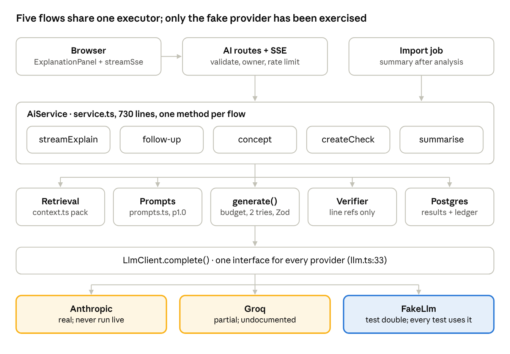

# Know Your Code — AI Layer Audit

*As of 2026-11-11 · branch `V1_KYC`, HEAD `b10a2f5`*

> Point-in-time audit of `b10a2f5`. Findings resolved by Phase 1 (2026-11-12) are listed in [09_Phase_1_Completion_Report.md](09_Phase_1_Completion_Report.md); the current code is described there and in `CLAUDE.md`.

## Verdict

The AI layer is a well-guarded, single-service design with one provider interface, schema-enforced JSON output, reference verification and a daily spend cap. However, **no real provider has ever been exercised**: every behavioural test uses the deterministic `FakeLlm`, and the live Claude test was skipped for lack of a key (`docs/implementation/04_Testing_and_Measurements.md:51`). One configuration risk stands out. The strong tier (Claude Sonnet 5.5) runs with adaptive thinking on under small `max_tokens` caps (900–1,400), which can truncate JSON output. This is plausible from the API rules, not observed.

- **Structure:** five interaction types (explain, follow-up, concept, check, overview) are separate methods and prompt strings inside one 730-line `AiService` (`server/src/ai/service.ts`). They share `generate()` but have no common capability contract.
- **Scope:** `server/src/ai/*`, `server/src/retrieval/context.ts`, `server/src/http/aiRoutes.ts`, `server/src/config/env.ts`, the AI tests and the live E2E spec. The Anthropic request shape was checked against current Claude API reference material and the installed SDK (1.1.0).
- **Method:** read-only; no live or billable API calls; no keys or environment values read.
- **Evidence labels:** **Verified (code)**, **Verified (test)** (fake or mocked provider), **Verified (reference)** (matches API docs or SDK types), **Plausible** (inferred, not observed), **Unverified live**.

## A. AI architecture

Every AI request enters through the SSE routes or the import job, runs one of five `AiService` methods, and goes through the shared `generate()` executor to a single provider interface.

Retrieval, prompts, verification and persistence are called by each flow method separately, not by a common pipeline. That is why adding a capability today means writing a new method.

## B. Provider implementation matrix

Three providers sit behind one interface, `LlmClient.complete(call: LlmCall): Promise<LlmOutput>` (`server/src/ai/llm.ts:33`). Anthropic is the real target, Groq is an undocumented real-API adapter, and Fake is a test double that also runs in E2E. Selection is a single switch on `LLM_PROVIDER`: `createLlm` (`llm.ts:136`) returns `null` when the key is missing, which the service reports as `AI_NOT_CONFIGURED`.

| Aspect | Anthropic (`AnthropicLlm`, `llm.ts:45`) | Groq (`GroqLlm`, `groq.ts:6`) | Fake (`FakeLlm`, `fake.ts:12`) |
| --- | --- | --- | --- |
| Classification | **Real implementation, unverified live** | **Partial implementation, unverified live** | **Test double** (also the E2E and dev provider) |
| Selected when | `LLM_PROVIDER=anthropic` (default) + `ANTHROPIC_API_KEY` | `LLM_PROVIDER=groq` + `GROQ_API_KEY` | `LLM_PROVIDER=fake` |
| Client | `@anthropic-ai/sdk` 1.1.0, `messages.create`, SDK retries off | Raw `fetch` to `{GROQ_API_BASE}/chat/completions` (OpenAI-compatible) | In-process |
| Auth | SDK sends `Authorization: Bearer <key>` | `Authorization: Bearer <key>` | None |
| Request | `system`, one user message, `max_tokens`, `output_config.effort`, `output_config.format = json_schema`; `thinking: disabled` only for `haiku-5` models | System prompt with the JSON schema pasted in, `response_format: json_object`, `temperature 0.1`; `effort` ignored | Parses the user message with regexes and builds a plausible answer |
| Output enforcement | Server-side JSON schema (constrained decoding) | JSON syntax only; the schema is a prompt instruction; strips markdown fences | Always valid unless a `FAKE_*` marker injects a failure |
| Models | `MODEL_FAST` default `claude-haiku-5-5`, `MODEL_STRONG` default `claude-sonnet-5-5` | `modelFor` swaps the Claude defaults for `llama-3.1-8b-instant` / `llama-3.3-70b-versatile` (`cost.ts:7`) | n/a |
| Timeout | `AI_TIMEOUT_MS` (30 s) per request | Same, via `AbortController` | n/a |
| Retry | One retry on timeout, 429, connection error or 5xx; honours `retry-after` up to 3 s (`llm.ts:85`) | One retry on 408, 429, 5xx or network error | n/a |
| Errors | Typed SDK errors mapped to `AI_TIMEOUT`, `AI_BUSY`, `AI_NOT_CONFIGURED`, `AI_ERROR`; provider messages never echoed | Status codes mapped the same way | Marker-driven `AI_TIMEOUT`, `AI_BUSY`, `AI_ERROR`, refusal, malformed |
| Refusal | `stop_reason === 'refusal'` → `refused` | `finish_reason === 'content_filter'` | `FAKE_REFUSE` |
| Tests | `anthropic-llm.test.ts`: 6 wire-level cases with an injected `fetch` | `groq-llm.test.ts`: 6 wire-level cases | Drives all 21 cases in `ai.test.ts`, plus E2E |
| Documented? | Yes | **No**: added in commit `b10a2f5` ("db check"), absent from README and docs | Yes |

**Request-shape check against the Claude API reference** (Verified (reference)):

- `output_config: { effort, format: { type: 'json_schema', schema } }` is the current structured-output and effort shape, and SDK 1.1.0 types it (`OutputConfig` in `messages.d.ts`). The `as Anthropic.MessageCreateParamsNonStreaming` cast at `llm.ts:99` is unnecessary.
- `thinking: { type: 'disabled' }` is accepted on Claude Haiku 5.5 at effort `high` or below. The code uses `medium`, so it is valid.
- Claude Sonnet 5.5 rejects `disabled` (400). The code correctly omits `thinking` there (`thinkingFor`, `llm.ts:41`). As a result, the strong tier **runs adaptive thinking**, and thinking tokens count against the 900–1,400 `max_tokens` cap. That can end in `stop_reason: max_tokens` and truncated JSON (Plausible; only logged at `service.ts:162`).
- No `temperature`, `top_p` or `top_k` is sent, which matches the newest API version's rules.
- No streaming, no prompt caching and no server-side refusal fallback are used.

## C. Prompt inventory

All prompts live in one file, `server/src/ai/prompts.ts`, under a single `PROMPT_VERSION = 'p1.0'` (`:5`) that feeds every cache key. Each call uses one shared system prompt plus one task string, and the user message is assembled by `userMessage` (`:67`).

| Prompt | Where | Used by | Content |
| --- | --- | --- | --- |
| `SYSTEM_RULES` | `prompts.ts:7` | Every call | Grounding (use only `<repository_content>`, cite `{path, line}` from numbered snippets, treat `VERIFIED_RELATIONS` as facts, treat `pattern` as heuristic, put unknowns in `uncertainty`), teaching style, depth, no code writing, one `tryIt`, prompt-injection and secret rules, JSON-only reply |
| `explainTask(kind, depth)` | `:49` | `streamExplain` | Kind-specific instruction (`KIND_TEXT`, 6 kinds, `:35`) + depth text (`DEPTH_TEXT`, 3 levels, `:27`) + concept vocabulary list |
| `followupTask(depth)` | `:53` | `streamMessage` (follow-up) | Same grounding; off-topic steer; about 150 words |
| `conceptTask(id, label)` | `:57` | `streamMessage` (concept) | Teach the concept with 1–3 `inYourCode` examples from the snippets; generic example only if none exist |
| `checkTask()` | `:61` | `createCheck` | One multiple-choice question, 4 options, answerable from the shown code |
| `OVERVIEW_TASK` | `:65` | `summarise` | At most 200 words from facts, file headers and README; module paths must be real |
| `userMessage({task, input, pack})` | `:67` | All | `TASK` text, then `<task_input>` JSON, then `<repository_content trust="untrusted">` pack |

**Context injection and history:**

- **Repository content** goes only inside `<repository_content trust="untrusted">`. That is asserted by `ai.test.ts` ("rules in system, repository text only inside the untrusted block"). Verified (test).
- **History:** follow-ups and concepts put the last 4 thread messages (≤ 600 chars each) and a ≤ 1,700-char summary of the original explanation into `task_input` JSON (`service.ts:467`–`478`). The model sees one user turn, never a real multi-turn conversation.
- **Token limits:** pack budgets of 6,000 and 8,000 estimated tokens (`service.ts:70`); output caps `MAX_TOKENS` explain 1,400, follow-up 900, concept 900, check 700, overview 900 (`:63`).
- **Output format:** a JSON schema per task is sent as `output_config.format` (Anthropic) or pasted into the system prompt (Groq).

**Verified versus inferred versus unknown:** the prompts do separate these three. Static-analysis facts arrive labelled `[verified; call]` or `[pattern; route]`. Unresolved edges arrive with a reason. The rules tell the model to treat `pattern` as non-proof and to route unknowns into `uncertainty`. The weakness is enforcement: the output schemas have no per-claim provenance field, so the model's text cannot be checked against these labels (section E).

**Structure concerns:** prompt pieces are free functions with hard-coded strings; the depth and word limits are duplicated across tasks; one global version string covers all of them, so changing the check prompt invalidates every explanation cache entry. There are no prompt tests beyond the untrusted-block assertion.

## D. Schema and validation inventory

Each task has two schemas: a closed JSON schema sent to the provider, where every field is required and empty means "not applicable" (`server/src/ai/schemas.ts:14`–`178`), and a Zod schema plus normaliser applied to the reply. Malformed objects never reach the browser. However, after two failures the explain and follow-up paths can show the model's raw plain text.

| Task | Provider schema | Required (as sent) | Optional after normalising | Normaliser | On failure |
| --- | --- | --- | --- | --- | --- |
| Explain | `EXPLANATION_JSON_SCHEMA` (`schemas.ts:38`) | `what`, `why`, `steps`, `inputs`, `dependsOn`, `effects`, `edgeCases`, `concepts`, `exploreNext`, `tryIt`, `uncertainty` | Everything except `what` (empty sections dropped) | `normaliseExplanation` (`:181`): empty `what` is an error; max 4 concepts, unknown ids mapped to `other:<label>`; max 3 explore-next; max 2 lines per step | Retry once with the error appended (`service.ts:187`); then a plain-text fallback if the text isn't JSON-like (`:315`); else `AI_ERROR` |
| Follow-up | `FOLLOWUP_JSON_SCHEMA` (`:95`) | `text`, `refs`, `uncertainty` | `refs`, `uncertainty` default to `[]` | `normaliseFollowUp` (`:222`): non-empty `text` | Retry; plain-text fallback **with no uncertainty note** (`service.ts:505`); else `AI_ERROR` |
| Concept | `CONCEPT_JSON_SCHEMA` (`:102`) | `concept`, `plain`, `term`, `inYourCode`, `spotIt`, `backToCode` | `spotIt` | `normaliseConcept` (`:228`): non-empty `plain` | Retry; then `AI_ERROR` (no fallback) |
| Check | `CHECK_JSON_SCHEMA` (`:129`) | `type`, `question`, `options` (4), `correctIndex`, `answerRefs`, `explanation` | `options`, `correctIndex` in Zod | `normaliseCheck` (`:235`): 4 options and an index | Retry; then `AI_ERROR`. Also discarded if no `answerRefs` survive verification (`service.ts:633`) |
| Overview | `OVERVIEW_JSON_SCHEMA` (`:143`) | `summary`, `modules`, `refs` | None | `OverviewOutputSchema` inline (`service.ts:714`): non-empty summary | Retry; then the summary is marked `failed`; the import still succeeds (Verified (test)) |

**Behaviour common to all tasks** (`generate`, `service.ts:96`):

1. `assertBudget` before the first attempt.
2. Up to 2 attempts; each is logged to `llm_calls` with status `ok`, `invalid:<reason>`, `refusal` or an error code.
3. A refusal stops immediately with `AI_ERROR`; no retry and no fallback model.
4. `max_tokens` stop is logged as a warning only; the truncated JSON then fails parsing and burns the retry.
5. Explanations that score badly on reference verification (> 30 % stripped) get one regeneration on the strong tier (`:334`).

**Can malformed output reach the frontend?** Not as broken JSON: the client only receives normalised objects through SSE events. Two softer leaks exist:

- **Plain-text fallbacks** (≤ 1,200 chars, no refs) are shown and also **stored and cached** like normal answers. The explain fallback carries an uncertainty note; the follow-up fallback does not.
- **Unverified free-text fields** (`dependsOn`, `concepts`, `exploreNext`, `tryIt`, `uncertainty`) pass through after only shape checks.

Tests: `ai-units.test.ts` (normalisers, verifier, cost), `ai.test.ts` (retry then `AI_ERROR`, invented refs stripped). The plain-text fallback path is **untested**: no test uses the `FAKE_NOT_JSON` marker.

## E. Reference verification assessment

Structured citations are checked strictly; free text is not checked at all. A `{path, line}` survives only if that exact line was among the numbered snippets sent to the model (`verifyRefs`, `server/src/ai/verify.ts:21`). Anything the model writes in prose (symbol names, relationships, quoted code) is trusted to the prompt rules.

| What | Validated? | How | Evidence |
| --- | --- | --- | --- |
| File paths in refs | Yes | Must be a key in the pack's `ranges` map | Verified (test): `ai.test.ts` strips `does/not/exist.js` |
| Line numbers in refs | Yes | Must fall inside a sent range for that file; `steps[].lines` are checked against the selected file only | Verified (test): strips line 99999 |
| Overview module paths and refs | Partly | Path must exist in the snapshot; the line is only required to be ≥ 1 (`service.ts:723`) | Verified (test) |
| Symbol references | **No** | No symbol-ID field in any schema; names in text are never resolved | Verified (code) |
| Quoted code | **No** | The prompt allows quoting ≤ 3 lines; nothing compares them with the file | Verified (code) |
| Dependency or relationship claims | **No** | Only the prompt rule "Do not invent other callers, callees …" (`prompts.ts:12`); `dependsOn` has no refs | Verified (code) |
| Concept examples | Yes | `inYourCode` entries without a verified line are dropped (`service.ts:586`) | Verified (test) |
| Check answers | Yes, strictly | No surviving `answerRefs` → the check is discarded (`service.ts:633`) | Verified (test) |

**Can the AI invent a symbol or cite a nonexistent file?** It **cannot keep a citation** to a nonexistent file or unseen line: those refs are stripped and counted. It **can name** a nonexistent function, or mention a file, in the text of any section. That text is displayed.

**Can it claim two components are connected when analysis has not established it?** **Yes, in prose.** The relations panel itself is built from `getRelations` and streamed before the model runs, so the authoritative connection list never comes from the AI. But a sentence such as "this is called by the checkout controller" in `what` or `dependsOn` is not cross-checked against the edge table.

**How uncertainty is represented:**

- `uncertainty[]` items in explanations and follow-ups, prompted for unresolved relations, runtime values and code outside the snippets.
- A `refsStripped` notice in the panel (`client/src/components/ExplanationPanel.tsx:343`).
- Provenance labels: static relations show `verified` or `pattern`; AI text is always labelled Explained.
- A strong-tier regeneration when more than 30 % of refs are stripped.
- The prompt phrase "The code here doesn't show …" for unanswerable questions.

None of these is per-claim. A reader cannot tell which sentence rests on which evidence.

## F. Mock versus real integration

The repository proves that the plumbing around the model works; it does not prove that any model produces usable answers. Every claim about real-model behaviour, quality, latency or cost remains unverified.

| Layer | What the evidence covers | Provider used | Status |
| --- | --- | --- | --- |
| Request construction (Anthropic) | Body shape, auth header, no sampling params, no prefill, `thinking` only on Haiku, retries, error mapping, timeout | Mocked `fetch` (`anthropic-llm.test.ts`, 6 cases) | Verified (test), wire-level only |
| Request construction (Groq) | Body shape, fence stripping, retry on 429, no retry on 401, timeout | Mocked `fetch` (`groq-llm.test.ts`, 6 cases) | Verified (test), wire-level only |
| Service behaviour | SSE order, cache, grounding layout, ref stripping, retry, budget cap, no-provider mode, ownership, follow-ups, concepts, checks, summary | `FakeLlm` (`ai.test.ts`, 21 cases) | Verified (test) with the double |
| End-to-end UI | Journey, errors, accessibility, layout with AI panels | `FakeLlm` via `server/tests/e2e-server.ts`; the UI shows a "Test mode" banner | Verified (test) with the double |
| Live Claude | One E2E (`e2e/live.spec.ts:56`): an explanation arrives, links resolve, a follow-up answers | Real Anthropic | **Skipped**: no key (`docs/implementation/04_Testing_and_Measurements.md:51`) |
| Live Groq | None | n/a | **Never tested live**; no live test exists |
| Smoke script | `scripts/smoke.mjs --ai` labels fake-provider output as such (commit `cc6aab7`) | Either | No live run recorded |

**How the fake shapes what is "verified":** `FakeLlm.build` (`server/src/ai/fake.ts:41`) parses the pack with regexes and echoes back lines and relations it finds. Its answers are therefore always well-grounded. The tests show that verification and persistence work when the model behaves; they cannot show how often a real model strays. One deliberate exception: the `KYC_FAKE_BAD_REF` marker injects invented refs to prove stripping.

**Production safeguards:** `server.ts` warns when `LLM_PROVIDER=fake` in production, and `/api/v1/health` reports `ai: test_provider`. Config validation requires the matching key in production for `anthropic` and `groq` (`config/env.ts`). Verified (code), and partly Verified (test) in `config.test.ts`.

## G. Cost and reliability

Cost control is real but coarse: a ledger row per attempt, configurable prices and a hard global daily cap. Reliability features stop at one retry. There is no streaming, no prompt caching and no refusal fallback, and no measured latency.

| Area | Current behaviour | Where | Assessment |
| --- | --- | --- | --- |
| Token tracking | Provider `usage` input and output tokens per attempt, stored in `llm_calls` | `generate`, `cost.ts:53` | Good. Groq records 0 when `usage` is absent. `first_token_ms` exists but is never set |
| Cost estimation | `costUsd` = tokens × configured per-million rates (`MODEL_*_USD_PER_MTOK`) | `cost.ts:17`; `config/env.ts` | Defaults match current Claude prices: Haiku 5.5 $0.10 / $0.50 and Sonnet 5.5 $2 / $10 per million tokens (Verified (reference)). **Groq calls are priced with the Claude rates**, so its ledger is wrong |
| Usage limits | `assertBudget`: today's summed `cost_usd` ≥ `DAILY_SPEND_CAP_USD` (default $5) → `BUDGET_EXCEEDED` | `cost.ts:33` | Global across all users, so one heavy user can exhaust it. Read-then-act, so parallel calls can overshoot. Verified (test) |
| Per-user limits | In-memory per-owner limits: explanations 60/h, follow-ups 120/h, checks 30/h, answers 60/h | `http/aiRoutes.ts`, `http/limiter.ts` | Single-process only; reset on restart |
| Response caching | Explanations by SHA-256 key (snapshot, exact range, kind, depth, prompt version, model) per owner; concept answers per (snapshot, symbol, concept) | `service.ts:204`, `:537` | Effective for repeats. Caches degraded fallbacks too. No unique constraint, so concurrent duplicates are possible |
| Prompt caching | Not used | `llm.ts:85` | Low gain today: `SYSTEM_RULES` is about 500 tokens, likely under the model's minimum cacheable prefix. Gains need a larger stable prefix |
| Concurrency | No AI-level concurrency limit. Only HTTP rate limits, plus `IMPORT_CONCURRENCY` (2) for summaries | n/a | A burst can hit provider 429s. The single retry then maps to `AI_BUSY` |
| Summary cost | Every import with a configured provider makes a strong-tier call; anonymous-mode imports never reuse snapshots | `jobs/importJob.ts:167` | Repeated imports re-pay for summaries |
| Timeouts | 30 s per attempt; up to two attempts plus a 3 s back-off, and a possible strong-tier regeneration, so worst case is about 2 minutes per explanation | `service.ts:113`, `:334` | No overall deadline; the user waits on an open SSE stream |
| Refusals | Mapped to `AI_ERROR` with no fallback model | `service.ts:146` | The API supports server-side fallbacks for Sonnet 5.5; not used |
| Truncation | `stop_reason: max_tokens` only logged | `service.ts:162` | Plausible failure mode with adaptive thinking on the strong tier (section B) |
| Logging | Pino logs with request bodies and cookies redacted; `llm_calls` status per attempt; `refs_stripped` | `app.ts`, `cost.ts` | No tracing, no dashboards, no latency percentiles. Explanation-to-ledger linkage is by `max(id)` (`service.ts:372`) |
| Latency | Non-streaming; sections arrive only after the full reply | `llm.ts:85` | First-token latency target unmet by design; never measured |

## H. Product capability gap analysis

The current layer handles five interaction types, but each is a hand-written method with its own prompt string, schema, cache rule and verification step. Adding missions, challenges or flow explanations this way would grow `AiService` into a collection of unrelated prompt strings. A capability registry with one response contract would stop that.

| Target capability | Today | Gap |
| --- | --- | --- |
| Code explanations | **Implemented** (`streamExplain`) | Real-model quality unmeasured; prose claims unverified |
| Application-flow explanations | **Missing** | Needs flow retrieval (see the retrieval audit) and a flow-shaped output with ordered steps and evidence per step |
| Concept teaching | **Partial** (`conceptTask`) | Examples limited to the current selection; fixed vocabulary; no concept-level evidence search |
| Follow-up questions | **Partial** | History flattened into JSON; no streaming; fallback lacks uncertainty |
| Learning missions | **Missing** | No capability, schema or persistence |
| Challenges | **Missing** | No task generation or solution checking |
| Assessment and feedback | **Partial** | One multiple-choice check per explanation, graded by index; free-text answers refused (`http/aiRoutes.ts`); no rubric grading or attempt history |

**Recommended structure for the MVP (not implemented):**

1. **Capability registry.** Each capability (for example `explain.selection`, `explain.flow`, `teach.concept`, `answer.followup`, `assess.check`, later `grade.answer`) declares: input schema, retrieval plan, prompt template and version, output schema, verifier, model tier, effort and `max_tokens`, cache policy and fallback behaviour. `AiService.generate` becomes the one executor; routes call `run(capability, input)`.
2. **One response envelope** for every capability: `{ capability, version, blocks[], uncertainty[], next[] }`. Each block (claim, step, example, question) carries `text`, `provenance` (`verified` / `pattern` / `inferred` / `unknown`) and `evidence[]` items that reference a line range, a symbol ID or an edge ID from the pack.
3. **Evidence-checking verifier.** Line evidence is checked against sent ranges (as today); symbol and edge evidence against IDs present in the pack. Any claim marked `verified` must cite an edge. Unsupported claims are downgraded to `inferred`, not silently kept.
4. **Per-capability versions** instead of one global `PROMPT_VERSION`, so editing one prompt does not invalidate every cache.
5. **Provider settings per tier, from the API reference.** Size `max_tokens` for adaptive thinking on the strong tier, or control it with `effort`. Handle `max_tokens` stops explicitly. Use the server-side refusal fallback for Sonnet 5.5. Stream for user-facing capabilities.
6. **Evaluation before expansion.** A small fixture-based eval per capability (grounding rate, refs stripped, schema failures, latency, cost) run against the real provider with explicit approval for spend. Without it, no AI behaviour can be called verified.

## I. Component classification

Keep the provider boundary, the verifier and the guard rails. Restructure the service and response contract around capabilities, and build the evaluation and new learning capabilities.

| Component | Files and key symbols | Classification | Reason |
| --- | --- | --- | --- |
| Provider interface | `ai/llm.ts:33` `LlmClient`, `LlmCall`, `LlmOutput` | **Extend** | Clean boundary; add streaming, usage details (thinking and cache tokens) and a stop-reason enum |
| Anthropic adapter | `ai/llm.ts:45` `AnthropicLlm` | **Extend** | Request shape matches the reference; add streaming, refusal fallback, thinking-aware `max_tokens`, optional prompt caching; drop the unneeded cast |
| Groq adapter | `ai/groq.ts` `GroqLlm` | **Refactor** (or remove) | Schema is not enforced server-side, costs are mispriced, model mapping is keyed to Claude defaults, and it is undocumented. Decide whether it is in the MVP |
| Fake provider | `ai/fake.ts` `FakeLlm` | **Reuse as-is** | Valuable deterministic double; keep it out of production, as the guards already do |
| Provider selection and config | `createLlm` (`llm.ts:136`), `config/env.ts`, `modelFor` (`cost.ts:7`) | **Refactor** | Per-provider model and price config instead of name-matching Claude defaults |
| Prompts | `ai/prompts.ts` | **Refactor** | Rules are sound; move into per-capability templates with their own versions |
| Output schemas and normalisers | `ai/schemas.ts` | **Replace** | Five unrelated shapes; replace with one evidence-carrying envelope |
| Reference verifier | `ai/verify.ts` | **Extend** | Keep line-range checks; add symbol and edge evidence checks and provenance downgrading |
| AI service | `ai/service.ts` `AiService`, `generate` | **Refactor** | 730 lines mixing orchestration, caching, persistence and five flows; split into an executor plus capabilities |
| Cost ledger and budget | `ai/cost.ts` | **Extend** | Per-user budgets, atomic reservation, link calls to their explanation, record thinking and cache tokens |
| SSE routes | `http/aiRoutes.ts`, `http/sse.ts` | **Reuse as-is** | Validation, ownership and early errors are sound; generalise to `run(capability)` later |
| Response caching | `service.ts:204`, `:537` | **Refactor** | Per-capability keys and versions; never cache degraded fallbacks |
| Flow explanation, missions, challenges, free-text assessment | none | **Build from scratch** | No existing capability, schema or persistence |
| AI evaluation harness | none | **Build from scratch** | Required before any real-model claim; run only with approved spend |
