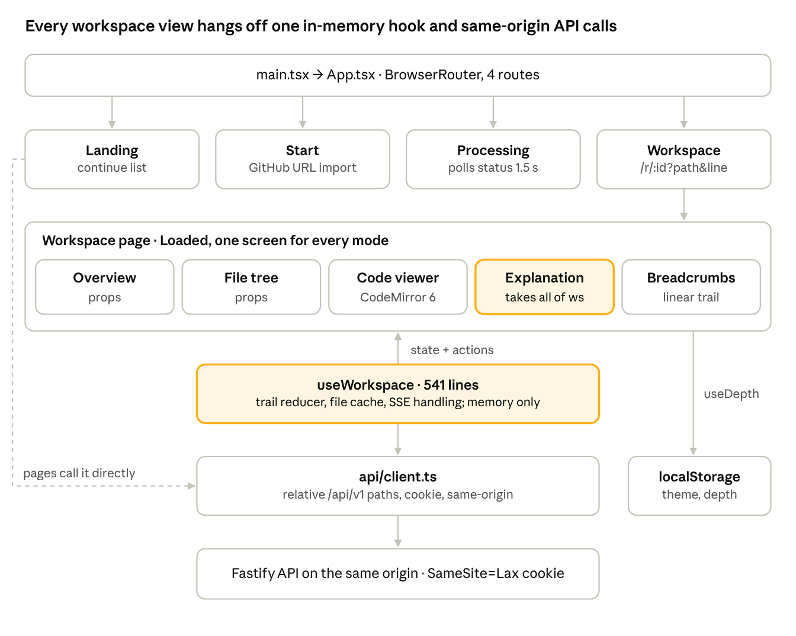

# Know Your Code — Frontend & Product Experience Audit

*As of 2026-11-11 · branch `V1_KYC`, HEAD `b10a2f5`*

> Point-in-time audit of `b10a2f5`. Findings resolved since then are listed in the completion reports for Phase 1 ([09](09_Phase_1_Completion_Report.md)), Phase 2 ([10](10_Phase_2_Completion_Report.md)) and Phase 3 ([11](11_Phase_3_Completion_Report.md)); the current code is described there and in `CLAUDE.md`.

## Verdict

The frontend is a small, clean React 19 single-page app built around one screen: select code, read an explanation. Its leaf components (code viewer, file tree, relation list, UI primitives) are reusable. Its state model is the main blocker: the whole learning session is one in-memory history stack, which is lost on reload, and any new navigation after going back wipes the forward trail. That works against "exploration must not reset learning progress". Desktop packaging is feasible but needs real changes, because every API call is a same-origin relative URL authenticated by a `SameSite=Lax` cookie.

- **Size:** 34 files under `client/src`, about 4,100 lines including about 1,000 lines of CSS. No UI library, no state library, no data-fetching library.
- **Scope:** `client/` (entry, routes, pages, hooks, API client, components, styles), plus the server's cookie and origin checks that bind the client to it.
- **Method:** read-only; nothing was run or rendered.
- **Evidence labels:** **Verified (code)**, **Verified (test)** (client unit tests or Playwright E2E), **Plausible** (inferred, not run).

## A. Frontend architecture map

The client is React 19 + react-router-dom 7, built by Vite 8 (`client/package.json`, `client/vite.config.ts`). It has four routes, and one screen holds all post-import work. That screen depends on a single 541-line hook that owns all state and API calls. Highlighted boxes mark the two pieces that block the new product.

| Layer | What is used | Where |
| --- | --- | --- |
| Framework and build | React 19, Vite 8 with `@vitejs/plugin-react`; `tsc --noEmit` before build; source maps on | `client/package.json`, `vite.config.ts` |
| Entry | `index.html` → `main.tsx` (`createRoot`, `StrictMode`, CSS tokens) → `App` | `client/index.html`, `src/main.tsx` |
| Routing | `BrowserRouter`; `/`, `/start`, `/r/:id/processing`, `/r/:id` (lazy-loaded `Workspace` with CodeMirror), `*` | `src/App.tsx` |
| State | Local `useState`, one `useReducer` trail in `useWorkspace`, refs; no store or context | `src/hooks/useWorkspace.ts` |
| API | One module of `fetch` wrappers plus a POST-SSE parser; types from `@kyc/contracts` | `src/api/client.ts` |
| Styling | Plain CSS: design tokens (light and dark, WCAG AA per comment) and one 947-line stylesheet; no CSS framework or component library | `src/styles/tokens.css`, `base.css` |
| Code display | CodeMirror 6 with `@codemirror/lang-javascript` only | `src/components/CodeViewer.tsx` |
| Tests | Vitest + Testing Library (4 files) and Playwright E2E with axe accessibility checks | `src/**/*.test.tsx`, `e2e/` |

## B. Screen and component inventory

There are four routes and 13 components. Everything after import lives on one screen, `Workspace`, where the overview, file tree, code viewer and explanation panel share a single hook. Paths are under `client/src/`.

**Screens:**

| Screen | Route | Responsibility | API | State | Limitations for the new product |
| --- | --- | --- | --- | --- | --- |
| `Landing` (`pages/Landing.tsx`, 87 lines) | `/` | Marketing copy, CTA, "Continue" list of the user's snapshots | `mySnapshots`, `event`, `health` | Local `useState` | Continue list jumps to the overview only; no progress or resume point |
| `Start` (`pages/Start.tsx`, 100) | `/start` | Paste a GitHub URL or pick a sample; import | `importRepo`, `event`, `health` | Local | GitHub URLs only; no ZIP or local folder (needed for desktop) |
| `Processing` (`pages/Processing.tsx`, 103) | `/r/:id/processing` | Poll status every 1.5 s, show stages, cancel by deleting | `snapshot`, `deleteRepo` | Local + polling `setTimeout` | Polling only; no queue position or estimate |
| `Workspace` (`pages/Workspace.tsx`, 332) | `/r/:id?path&line` | Loads the snapshot, then `Loaded` lays out tree, viewer, panel and breadcrumbs; keyboard shortcuts; floating Explain button | `snapshot` + everything in `useWorkspace` | `useWorkspace`, `useDepth`, URL params (`path`, `line`) | One screen for all modes. The overview is just "no file open" (index −1), not a place |
| `NotFound` (in `App.tsx`) | `*` | 404 | None | None | n/a |

**Components:**

| Component | Responsibility | Inputs → outputs | API | State | Limitations |
| --- | --- | --- | --- | --- | --- |
| `Overview` (`components/Overview.tsx`, 149) | Facts, frameworks, entry points, starting points, AI summary, skipped files | `data: Overview`, `onOpen(path, line)` | None | Local toggle | Text and lists only; no architecture or module map |
| `FileTree` (`FileTree.tsx`, 166) | Accessible tree (`role=tree`), filter, `/` shortcut | `root: TreeNode`, `activePath`, `onOpen(path)` | None | Local open set, filter, focus | No badges for progress, lessons or bookmarks |
| `CodeViewer` (`CodeViewer.tsx`, 192) | Read-only CodeMirror 6, JS/TS highlighting, target-line flash, persistent mark range, selection reporting | `path`, `content`, `language`, `targetLine`, `markRange`, `scrollKey`, `onSelect`, `onExplainKey`; imperative `getSelection()`, `focus()` | None | CodeMirror state | Only one mark range; no gutter annotations, step markers or multi-file views |
| `ExplanationPanel` (`ExplanationPanel.tsx`, 452) | Explanation sections, depth control, relations, concepts, explore-next, follow-up thread, checks, feedback | **The whole `ws: Workspace` object**, `depth`, `onDepth`, `onOpenRef` | Indirect via `ws` | Reads `ws.entry.expl` | Monolithic; tied to one explanation per trail stop; hard to reuse in lessons |
| `RelationList` (`RelationList.tsx`, 148) | Called-by, calls, imports, unresolved, with provenance and reasons | `relations: Relations`, `onNavigate(path, line, label, symbolId)` | None | Local toggles | List only; one hop |
| `Breadcrumbs` (`Breadcrumbs.tsx`, 57) | Trail of visited stops; back, forward, jump | `entries`, `index`, `onJump`, `onBack`, `onForward` | None | None | Linear trail; branching discards history |
| `CheckCard` (`CheckCard.tsx`, 69) | One multiple-choice question and its result | Question, result, callbacks | None (via `ws`) | Local selection | Single question type |
| `FeedbackBar` (`FeedbackBar.tsx`, 81) | Thumbs up/down + reason | `targetType`, `targetId` | `feedback` | Local | Fine as is |
| `RepoMenu` (`RepoMenu.tsx`, 65) | Delete repository | `repositoryId`, `onDeleted` | `deleteRepo`, `event` | Local confirm | Fine as is |
| `RepoUrlInput` (`RepoUrlInput.tsx`, 59) | URL field with instant validation (`lib/repoUrl.ts`) | `value`, `onChange`, `onSubmit`, `submitting`, `error` | None | None | GitHub-only grammar |
| `StageProgress` (`StageProgress.tsx`, 45) | Import stage list with progress | `stages: StageInfo[]` | None | None | Fine as is |
| `Shell` (`Shell.tsx`, 67) | `Header`, `ThemeToggle`, `AiStatusBanner`, `useHealth` | `children`; `health` | `health` | Theme pref | Web-style header; no app navigation |
| `ui.tsx` (171) | `ProvenanceTag`, `LineRefChip`, `ConceptChip`, `DepthControl`, `ErrorState`, `Banner`, `Skeleton`, `TextWithRefs` | Small props | None | None | Good primitives; no design-system package |

**Supporting modules:** `hooks/useWorkspace.ts` (541 lines, all workspace state and actions), `hooks/usePrefs.ts` (`useTheme`, `useDepth` via guarded `localStorage`), `lib/expl.ts` (explanation and trail types, `newExpl`, `selectionLabel`), `lib/inline.tsx` (renders `**bold**` and code spans), `lib/skip.ts` (skip-reason copy), `lib/repoUrl.ts` (client URL check and `SAMPLE_REPOS`), `api/client.ts` (197 lines, all HTTP and SSE).

## C. Component reuse matrix

Presentational components that take plain props reuse well. Coupling is concentrated in `ExplanationPanel` (takes the whole workspace object) and `useWorkspace` (owns all API calls and all state).

| Component | Reusable logic | Coupling to the current backend | Reusable for |
| --- | --- | --- | --- |
| `CodeViewer` | CodeMirror setup, token highlight, line flash, persistent mark, selection in API coordinates | Low: takes text; uses the `Selection` type from `@kyc/contracts` | Code-linked explanations, lessons, mission steps, flow step views, simulation highlighting |
| `FileTree` | Flattening, filter, keyboard tree navigation, `role=tree` | Low: `TreeNode` type | Free exploration; a lesson-scoped file list; progress badges (needs a slot) |
| `RelationList` | Provenance and unresolved-reason rendering | Medium: shaped exactly like the `Relations` API response | Relationship explorer, flow step evidence |
| `ui.tsx` primitives | `ProvenanceTag`, `LineRefChip`, `TextWithRefs`, `ErrorState`, `Skeleton`, `DepthControl`, `ConceptChip` | Low: `ErrorState` reads the shared `ERROR_MESSAGES` | Every future screen |
| `Breadcrumbs` | Trail rendering, back and forward | Low | "Return to learning" navigation, if fed a richer model |
| `Overview` | Facts and starting-point rendering | Medium: renders the `Overview` JSON exactly | Project-understanding entry; superseded by an architecture map |
| `ExplanationPanel` | Section rendering, thread UI, concept and check cards | **High**: reads `ws.entry.expl`, calls `ws.*` actions, assumes one explanation per trail stop | AI teaching assistant and lessons only after splitting it into presentational parts |
| `CheckCard` | Multiple-choice question and answer UI | Medium: `CheckQuestion` / `CheckResult` shapes | Knowledge validation, as one question type among several |
| `FeedbackBar`, `RepoMenu`, `StageProgress`, `RepoUrlInput` | Self-contained | Low to medium | Same roles in the new product |
| `useWorkspace` | Trail reducer, file cache, SSE event handling, abort logic | **High**: calls 10 API functions directly (including analytics events) and mixes server data with UI state | Pieces only: the SSE event handling and file cache are worth extracting |
| `api/client.ts` | `ApiError`, error mapping, POST + SSE parser `streamSse` | **High**: hard-coded relative `/api/v1/*` URLs, `credentials: 'same-origin'` | Keep the error and SSE code; the base URL and auth must become configurable |
| `Shell` | Theme toggle, AI status banner | Low | App chrome |

## D. State and API dependency analysis

State is local React state plus one reducer. Only the theme, the depth preference and the current file and line survive a reload; the learning trail, open explanations and threads do not.

| Concern | Implementation | Where | Consequence |
| --- | --- | --- | --- |
| Global state | None: no store, no context. `useWorkspace` returns a large object that `Loaded` passes down as props | `hooks/useWorkspace.ts:77` | Every new feature would grow this hook or invent its own state |
| Learning trail | `useReducer` history `{entries, index}`; each entry holds path, line, label, relations and the whole explanation state | `useWorkspace.ts:17`–`40` | In memory only. A **push after going back drops the forward trail** (`:31`), so exploring destroys earlier steps |
| URL state | `?path=&line=` only | `pages/Workspace.tsx:85`, `:132` | A reload reopens the file but loses the explanation, trail and thread |
| Persisted prefs | `kyc.theme`, `kyc.depth` in guarded `localStorage` | `lib/storage.ts`, `hooks/usePrefs.ts` | Fine; per device |
| Thread restore | `api.explanation(id)` exists to reload an explanation and its thread, but **nothing calls it** | `api/client.ts:177` | Dead client code; the server endpoint is unused by the UI |
| Data fetching | Hand-written `fetch` + `AbortController`; tree and overview on mount; files cached in a per-session `Map` | `useWorkspace.ts:101`–`172` | No shared cache, dedupe, retry or background refresh; no offline story |
| Streaming | POST + SSE parsed by `streamSse`; events `relations`, `meta`, `section`, `done`, `message`, `error` patch the active trail entry | `api/client.ts:75`; `useWorkspace.ts:204` | Works, but event names and shapes are hard-coded in the hook |
| Polling | `Processing` polls `GET /snapshots/:id` every 1.5 s | `pages/Processing.tsx:9` | Fine for the MVP |
| Errors | `ApiError` with code, message, `retryable`, status; `ErrorState` renders shared copy and a recovery action | `api/client.ts:16`; `components/ui.tsx:99` | Consistent and reusable |
| Loading | `Skeleton` placeholders; panel progress per section | `ui.tsx:144` | Consistent |
| Auth and session | No login. The server sets a signed, `httpOnly`, `SameSite=Lax` cookie (`kyc_owner`) on first API call; the client sends `credentials: 'same-origin'` | `server/src/http/owner.ts:27`; `api/client.ts:55` | Identity is one browser profile; no cross-device resume; ties the client to the server's origin |
| Analytics | `api.event(name, props)` fire-and-forget at 11 call sites | `api/client.ts:175` | Fine; event names are not typed against the server's `EVENT_NAMES` |

**API dependency map** (all through `api` in `api/client.ts`):

| Caller | Endpoints |
| --- | --- |
| `Landing` | `GET /my/snapshots`, `POST /events`, `GET /health` |
| `Start` | `POST /repositories`, `POST /events`, `GET /health` |
| `Processing` | `GET /snapshots/:id`, `DELETE /repositories/:id` |
| `Workspace` | `GET /snapshots/:id`, `GET /health` |
| `useWorkspace` | `GET /snapshots/:id/tree`, `/overview`, `/file`; `POST /snapshots/:id/resolve`; `GET /symbols/:id/relations`; `POST /explanations` (SSE); `POST /explanations/:id/messages` (SSE); `POST /explanations/:id/checks`; `POST /checks/:id/answer`; `POST /events` |
| `FeedbackBar` | `POST /feedback` |
| `RepoMenu` | `DELETE /repositories/:id`, `POST /events` |

## E. Product experience gap analysis

Today's UI covers guided reading of one selection at a time. Most of the intended experience needs new screens built on new backend data, but several can reuse the viewer, tree and primitives. The hardest gap is not a screen but the state model: there is no durable notion of "where the learner is" to return to.

| Future experience | Feasibility on the current frontend | Reusable pieces | Missing |
| --- | --- | --- | --- |
| Project architecture map | New view; feasible | `Overview` facts, `ProvenanceTag` | Graph rendering library, module data from the backend |
| Interactive application map | New view; feasible | `RelationList` semantics, `LineRefChip` | Graph layout with pan, zoom and select; multi-hop graph API |
| Application-flow exploration | New view; moderate | `CodeViewer` for each step, `TextWithRefs` | Step list and timeline UI, flow data (does not exist server-side) |
| Learning path navigation | New shell and routes | `Breadcrumbs` idea | Path and lesson data model, persistent progress, a navigation frame around the workspace |
| Lessons | New screen | `CodeViewer`, `TextWithRefs`, `ConceptChip`, `CheckCard` | Lesson content renderer; split `ExplanationPanel` into reusable parts |
| Learning missions | New screen | Viewer, tree, checks | Mission state machine, goals, hints, completion criteria |
| Code-linked explanations | **Exists** | `ExplanationPanel`, `CodeViewer` mark range | Multiple marks, gutter annotations, links between steps |
| AI teaching assistant | Partial | Follow-up thread in `ExplanationPanel` | Free-standing assistant not tied to one selection; restored threads (`api.explanation` unused) |
| Interactive simulations | Hard | `CodeViewer` line flash | Step-through engine, variable or state display, playback controls; backend support is absent |
| Knowledge validation | Partial | `CheckCard` | More question types, free-text answers, attempt history, results view |
| Learning progress | Missing | None | Persistent per-user progress store, progress UI in tree and paths |
| Free exploration with return-to-learning | **Blocked by the state model** | `Breadcrumbs`, URL `path`/`line` | A durable "learning position" separate from the exploration trail; a trail that branches instead of truncating; reload-safe state |

**What makes "return to learning" hard today** (Verified (code)):

1. The only notion of position is the history index in `useWorkspace`, held in memory.
2. Pushing a new stop after going back deletes every later stop (`useWorkspace.ts:31`).
3. Explanations live inside trail entries, so leaving a stop is the only way to "keep" an explanation.
4. The URL carries only file and line, so a reload or a shared link drops everything else.

## F. Desktop packaging readiness

Wrapping the built SPA in Tauri or Electron is straightforward: it is a static Vite build with no Node or exotic browser APIs. Making it **talk to the cloud backend** from inside a desktop shell is the real work, because the client and server assume they share one web origin and a cookie.

| Question | Finding | Evidence | Effort |
| --- | --- | --- | --- |
| Can it be packaged? | Yes. `vite build` emits static `client/dist` | `client/vite.config.ts` | Low |
| Browser-only APIs? | Only standard ones: `localStorage` (guarded), `document`, `window` key listeners, `fetch` with streaming bodies. No service worker, clipboard, file-system or Node APIs | `lib/storage.ts`, `pages/Workspace.tsx:169`, `api/client.ts:83` | None. Streaming `fetch` is assumed to work in WebView2 and WKWebView (Plausible) |
| Routing | `BrowserRouter` with path routes such as `/r/:id` | `App.tsx` | Low: a desktop shell serves from a custom origin, where `HashRouter` or `MemoryRouter` avoids reload and deep-link 404s |
| Backend URL configurable? | **No.** Every call uses a relative `/api/v1/...` path; there is no `import.meta.env` use anywhere in `client/src`; only the Vite dev proxy knows the API host | `api/client.ts:154`–`196`; `vite.config.ts` (`VITE_API_TARGET` is dev-only) | Low on the client: add a configurable base URL |
| Authentication configurable? | **No.** Identity is the server-set `SameSite=Lax`, `httpOnly` cookie, sent with `credentials: 'same-origin'` | `server/src/http/owner.ts:27`; `api/client.ts:55` | **Medium to high**: a desktop origin calling a cloud API is cross-site, so the cookie is not sent. Needs token auth (stored in the OS keychain) or a deliberate `SameSite=None; Secure` cookie flow |
| Cross-origin readiness (server) | No CORS headers at all, and `registerSecurity` rejects state-changing requests marked `cross-site` or from a foreign `Origin` | `server/src/http/security.ts:25`; no CORS plugin | **Server changes required**: CORS with an allowlist for the desktop origin, and an origin check that accepts it |
| CSP | The server's CSP applies to the web build only; a desktop shell needs its own CSP with `connect-src` for the API host | `server/src/http/security.ts:5` | Low |
| Coupling to backend details | Shared request and response types from `@kyc/contracts` (good). Endpoint paths, SSE event names and the cookie model are hard-coded in `api/client.ts` and `useWorkspace` | n/a | Medium: isolate behind a client interface |
| Desktop-native features | None yet: no local-folder import, file watching, deep links, auto-update or offline mode. Import is GitHub-URL only | `pages/Start.tsx` | Build from scratch when needed; the future local runtime would also slot in behind the same client interface |

**Overall:** the UI layer is about one or two small client changes away from a desktop shell (base URL and router). The session model needs a coordinated client and server change (auth, CORS, origin policy) before a desktop build can work against the cloud MVP.

## G. Recommended frontend restructuring

Restructure around three ideas: a transport-agnostic API layer, a durable learner state separate from the exploration trail, and feature modules that reuse the existing code primitives. These are directions, not screen designs; nothing is implemented.

1. **API layer behind an interface.** Turn `api/client.ts` into a client with a configurable base URL and auth strategy (cookie for web, bearer token for desktop), with SSE kept as a stream helper. This is the seam for a future local runtime too.
2. **Server-state library.** Move fetching (tree, overview, files, relations, explanations) to a query cache such as TanStack Query, so screens share cached data and get dedupe, retries and invalidation for free. That replaces the per-hook `Map` and hand-written abort logic.
3. **Split `useWorkspace`.** Separate it into: (a) an exploration trail that **branches instead of truncating**; (b) an explanation and thread store keyed by explanation ID, restorable with the existing `GET /explanations/:id`; (c) viewer selection state.
4. **Durable learner state.** A small store for "current lesson or mission step", bookmarks and progress, persisted to the server (and locally on desktop). The UI can then always offer **Return to learning**, whatever the user explored.
5. **App shell with modes.** A persistent frame with Project, Learn, Explore and Validate areas, routing by `/r/:id/<mode>/...`. Use `HashRouter` or `MemoryRouter` for the desktop build.
6. **Split `ExplanationPanel`** into presentational pieces (sections, thread, concept card, check card, relations) that take data props, so lessons, missions and the assistant can compose them.
7. **Extend `CodeViewer`** with multiple marks, gutter annotations and step markers. It is the core primitive for lessons, flows and simulations.
8. **New visual modules** for the architecture and application maps and flow timelines, using a graph library. They depend on new backend graph and flow APIs.
9. **Typed events and contracts.** Generate the SSE event and analytics event types from `@kyc/contracts`, so client and server cannot drift.
10. **Tests where the logic moves.** Today `useWorkspace` and `ExplanationPanel` are only covered by E2E; add unit tests as they are split.

## H. Component classification

Most leaf components survive. The workspace hook and the API client need restructuring, and the learning-first screens are new.

| Component | Path | Classification | Reason |
| --- | --- | --- | --- |
| UI primitives | `components/ui.tsx` | **Reuse as-is** | Small, prop-driven, accessible; the basis of a design system |
| `StageProgress`, `FeedbackBar`, `RepoMenu` | `components/` | **Reuse as-is** | Self-contained and fit for purpose |
| Styles and tokens | `styles/tokens.css`, `styles/base.css` | **Extend** | Tokens with light and dark themes; add layout and graph tokens; consider splitting `base.css` (947 lines) |
| `CodeViewer` | `components/CodeViewer.tsx` | **Extend** | Multiple marks, gutter annotations, step markers; more languages later |
| `FileTree` | `components/FileTree.tsx` | **Extend** | Badge and status slots for progress, bookmarks, lesson scope |
| `RelationList` | `components/RelationList.tsx` | **Extend** | Keep it as the text view beside a graph; decouple from the exact API shape |
| `Breadcrumbs` | `components/Breadcrumbs.tsx` | **Extend** | Render a branching trail and a "return to learning" anchor |
| `CheckCard` | `components/CheckCard.tsx` | **Extend** | One question type of a validation module |
| `RepoUrlInput`, `Start` | `components/RepoUrlInput.tsx`, `pages/Start.tsx` | **Extend** | Add local-folder or ZIP import for desktop |
| `Shell` | `components/Shell.tsx` | **Refactor** | Becomes the app frame with learning modes |
| `ExplanationPanel` | `components/ExplanationPanel.tsx` | **Refactor** | Split into presentational parts; remove the dependency on the whole `ws` object |
| `Workspace` page | `pages/Workspace.tsx` | **Refactor** | Becomes the Explore mode inside the new shell |
| `useWorkspace` | `hooks/useWorkspace.ts` | **Replace** | Split into a query cache, explanation store, branching trail and selection state |
| API client | `api/client.ts` | **Refactor** | Keep `ApiError` and `streamSse`; add a configurable base URL, auth strategy and typed events; remove or use `api.explanation` |
| `Overview` | `components/Overview.tsx` | **Refactor** | Becomes one panel of a project-understanding screen next to an architecture map |
| `Landing`, `Processing` | `pages/` | **Reuse as-is** for the MVP web build | Replace the landing page for desktop with a project library |
| Routing | `App.tsx` | **Refactor** | Mode-based routes; a desktop-safe router |
| Architecture map, application map, flow explorer, lessons, missions, assistant, simulations, progress, learner state store | none | **Build from scratch** | No existing code or data |
