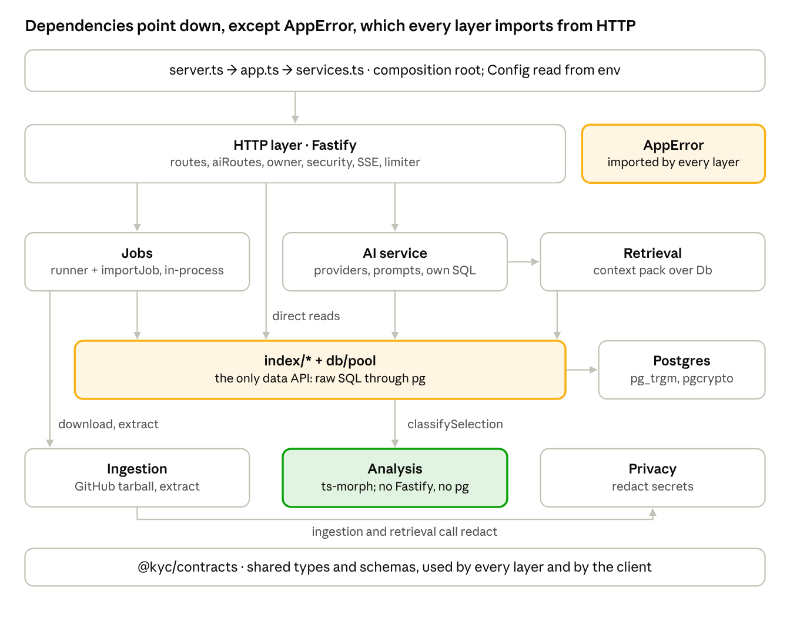

# Know Your Code — Architecture, Security & Cloud-Readiness Audit

*As of 2026-11-11 · branch `V1_KYC`, HEAD `b10a2f5`*

> Point-in-time audit of `b10a2f5`. Findings resolved since then are listed in the completion reports for Phase 1 ([09](09_Phase_1_Completion_Report.md)), Phase 2 ([10](10_Phase_2_Completion_Report.md)) and Phase 3 ([11](11_Phase_3_Completion_Report.md)); the current code is described there and in `CLAUDE.md`.

## Verdict

Know Your Code is a single-process modular monolith, and that is the right shape for the cloud MVP. No microservice split is justified by anything in the code. The analysis engine is already close to runtime-independent: it never touches Fastify or Postgres. Retrieval, AI and jobs, however, are written directly against `pg`. The ingestion boundary is well defended, and imported code is **never executed**. The main security and privacy gaps are access control on stored code (snapshot UUID as the only key), anonymous cookie identity, regex-only secret redaction before code is sent to the AI provider, and an unsafe default of `NODE_ENV=development`.

- **Scope:** `server/src` import graph, configuration, jobs, ingestion, persistence, AI, HTTP security; `client/src` API coupling; deployment docs and manifests.
- **Method:** read-only. No code, configuration or infrastructure was changed; nothing was deployed; no external calls were made; only environment variable **names** were read.
- **Evidence labels:** **Verified (code)**, **Verified (test)**, **Plausible** (inferred, not reproduced), **Documented** (from repository docs, not checked).

## A. Actual architecture and dependencies

The deployable is one Node process: Fastify serves the API and the built SPA, runs import jobs in an in-process queue with analysis in worker threads, and talks to one Postgres and two external services (GitHub, the AI provider). The diagram is drawn from each module's `import` lines in `server/src`. The green box can already stand alone; the amber boxes are the coupling points.

Dependency direction is top-down with three exceptions. All of them are verified in code:

- `AppError` (`http/errors.ts`) is imported by `analysis`, `ingestion`, `index`, `ai` and `jobs`, so the domain depends on the HTTP layer.
- Routes in `http/routes.ts` bypass services and call `index/*` directly for reads.
- `index/resolve.ts` calls `analysis/resolve.ts`, and `index/files.ts` imports a type from `ingestion/extract.ts`.

External services: `codeload.github.com` and `api.github.com` (`ingestion/github.ts`); `api.anthropic.com` or the Groq API (`ai/llm.ts`, `ai/groq.ts`); PostgreSQL (`db/pool.ts`).

## B. Module coupling assessment

Dependencies mostly point the right way: HTTP → services → domain. Two cross-cutting leaks run backwards. Every layer imports `AppError` from `http/errors.ts`, and the persistence functions in `index/*` are called directly by retrieval, AI and jobs, so Postgres is the de facto shared core. Evidence comes from each module's `import` lines under `server/src`.

| Question | Answer | Evidence |
| --- | --- | --- |
| Does analysis depend on Fastify? | **No.** `analysis/*` imports only `ts-morph`, `node:path`, `node:fs`, `node:url`, `node:worker_threads` and its own types | `analysis/analyse.ts:1`–`3`, `project.ts:1`, `runner.ts:1`–`7` |
| Is DB access embedded in analysis? | **No.** `analyse()` takes `{path, content}[]` and returns `AnalysisResult`; `persistAnalysis` lives in `index/symbols.ts` | `analysis/types.ts`; `index/symbols.ts:8` |
| Upward dependencies from analysis | Yes, a small one: `analysis/resolve.ts` and `analysis/runner.ts` import `AppError` from `http/errors.ts` | import lines of both files |
| Is AI provider logic coupled to routes? | **No.** Routes call `AiService`; providers sit behind `LlmClient` in `ai/llm.ts`. But `AiService` issues its own SQL and imports `retrieval`, `index/*` and `db/pool` | `ai/service.ts:15`–`21` |
| Is job execution coupled to HTTP requests? | **Partly.** Jobs run outside the request (`JobRunner.pump`), but they are enqueued in-process by the import route and share the process, memory and logger with the API | `http/routes.ts:54`; `jobs/runner.ts:48` |
| Is filesystem use tied to one runtime? | **Little filesystem use.** Archives are streamed in memory; ts-morph uses an in-memory file system. Disk is only read for `.env`, migrations, the static client and the worker script. Runtime-specific: Node `worker_threads`, `process.loadEnvFile` | `config/dotenv.ts`; `db/migrate.ts`; `analysis/runner.ts:19` |
| Do configuration and environment leak? | **Mostly contained.** `process.env` is read only in `config/env.ts`, plus one fallback in `analysis/runner.ts:22` (`ANALYSIS_WORKER_PATH`). The whole `Config` object is passed into `GitHubClient`, `AiService`, `cost.ts` and `createLlm` | `grep process.env` |
| Logger coupling | `FastifyBaseLogger` type is imported by `ai/service.ts`, `jobs/*` and `services.ts` | import lines |
| Persistence coupling | `index/*` functions are the only DB API, but they return contract-shaped objects (`toView`, `getRelations`) and are called from routes, AI, retrieval and jobs alike | `index/snapshots.ts:183`; `index/symbols.ts:218` |
| Does the frontend depend on DB-specific formats? | **No direct DB shapes.** The client uses `@kyc/contracts` types. Two JSONB columns (`snapshots.overview`, `explanations.body`) are stored exactly in the contract shape, so the DB and UI change together | `client/src/api/client.ts:1`–`14`; `jobs/importJob.ts:158` |
| Cross-layer type sharing | `index/files.ts` imports `ExtractedFile` from `ingestion/extract.ts`; `retrieval/context.ts` imports `AllowedRanges` from `ai/verify.ts` | import lines |

## C. Shared core extraction assessment

The analysis engine can move into a shared package with almost no change. The symbol graph and retrieval need a storage interface first, and learning logic does not exist yet. Today the only shared package is `packages/contracts` (types, Zod schemas, error copy).

| Candidate | Current home | Readiness | Dependencies to remove or abstract |
| --- | --- | --- | --- |
| Analysis engine | `analysis/analyse.ts`, `project.ts`, `types.ts`, `resolve.ts` (`classifySelection`) | **High** | Replace `AppError` from `http/errors.ts` with a core error type. Keep `ts-morph` (pure JS, runs anywhere Node runs). `runner.ts` stays in the runtime because `worker_threads` and `process.env` are Node-host concerns |
| Relationship extraction | Inside `analyse.ts` (`handleImports`, `handleCalls`, `handleReferences`) | **High** | Same as above; output `EdgeRow[]` is already storage-free |
| Overview facts | `analysis/overview.ts` `buildOverview` | **High** | Pure function over file list, `package.json` text and counts |
| Symbol graph (query side) | `index/symbols.ts` (`getRelations`, `enclosingSymbol`, `topSymbols`, `counts`) | **Low** | All SQL against `pg`, with ranking rules in SQL strings. Needs a `GraphStore` interface (get symbol, enclosing symbol, in and out edges, file content) with a Postgres implementation in the cloud and an embedded one (for example SQLite) locally |
| Context retrieval | `retrieval/context.ts` `buildContextPack` | **Medium** | Pure logic except the `db` argument and calls to `index/*`; the lexical search is raw `ILIKE` SQL. Abstract behind the same store interface; move `AllowedRanges` into contracts |
| Selection resolution | `index/resolve.ts` | **Medium** | Reads file and symbols via `index/*`; logic is in `analysis/resolve.ts` already |
| Redaction | `privacy/redact.ts` | **High** | No dependencies |
| Ingestion filters | `ingestion/filter.ts`, `extract.ts` | **Medium** | `extractTarball` is Node-stream and tar.gz-specific; filters are pure. A local runtime would read a folder instead, so split "classify and limit files" from "read an archive" |
| AI contracts | `ai/schemas.ts`, `ai/prompts.ts`, `ai/verify.ts`, `packages/contracts` | **Medium** | Schemas, prompts and verifier are pure, but scattered between `server` and `contracts`, and `AiService` mixes them with SQL, caching and budget. Move schemas, prompt templates and the verifier into the core; keep providers, budget and persistence in the runtime |
| Learning logic | none (only concept vocabulary in `packages/contracts/src/schemas.ts` and check grading in `AiService.answerCheck`) | **Not started** | Design it storage-agnostic from the start (progress, paths, missions as pure state transitions plus a store interface) |

The shared core can stay a TypeScript workspace package (like `@kyc/contracts`) consumed by the cloud server now, and by a local runtime later. No new service is needed.

## D. Cloud job processing assessment

The in-process queue with job rows in Postgres is **sufficient for a single-instance MVP** at the documented scale (about 20 concurrent users, about 200 imports a week). It needs hardening, not replacement. Redis, BullMQ or a separate worker service are not justified yet; the concrete trigger is running a second app instance, because `recover()` and the in-memory queue are not multi-instance safe.

| Area | Current behaviour | Evidence | MVP verdict |
| --- | --- | --- | --- |
| Job execution | `JobRunner`: in-memory FIFO, `pump()` runs up to `IMPORT_CONCURRENCY` (default 2, max 8) jobs; each calls `runImport` | `jobs/runner.ts:9`, `:48` | OK for one instance |
| Worker threads | Analysis runs in a `Worker` with an old-space cap (`ANALYSIS_MAX_MEMORY_MB`, default 2,048) and a wall-clock timer; inline fallback when no compiled worker exists | `analysis/runner.ts:31`–`80` | OK; make the fallback impossible in production (`ANALYSIS_MODE=worker`) |
| Job state | `jobs.state` queued → running → done or failed; `snapshots.status` and `stages` updated per stage | `jobs/runner.ts:53`; `index/snapshots.ts:136`–`181` | OK; writes are not transactional (see the data-model audit) |
| Repository isolation | Each import has its own snapshot ID; files, symbols and edges are scoped by `snapshot_id`; no shared disk | `001_init.sql` | Good |
| Concurrent imports | 2 at a time per process; per-owner 5/h and per-IP 20/h import limits; a race on the same SHA is caught by a unique index | `config/env.ts`; `http/routes.ts:58`–`59` | OK |
| Memory | Whole repo text (≤ 30 MB) held as JS strings, written to DB, re-read, copied into the worker, parsed, results cloned back; up to 2 workers × 2 GB cap | `jobs/importJob.ts:114`–`146` | Plan ≥ 2 GB per docs; measured peaks 0.4–0.75 GB RSS (Documented) |
| Large repositories | Rejected early: > 200 MB reported size (token mode), > 50 MB tarball, > 20,000 entries, > 1,500 analysable files, > 30 MB total text | `ingestion/github.ts`, `ingestion/extract.ts` | Safe; no partial analysis of large repos |
| Timeouts | `IMPORT_TIMEOUT_MS` 120 s across download and analysis; worker terminated on timeout | `importJob.ts:83`; `runner.ts:52` | OK |
| Cleanup | No temp files exist (streamed in memory); failed imports delete stored files (cascade); retention deletes expired snapshots hourly | `importJob.ts:231`; `jobs/retention.ts` | OK; cleanup errors are swallowed |
| Retry | No automatic retry of a failed job. `attempts` increments only in `recover()` at boot; a job is marked failed after 3 boots | `jobs/runner.ts:32`–`46` | Acceptable for the MVP; a user can re-import |
| Failure recovery | On boot, queued and running jobs are re-queued; orphan non-terminal snapshots are marked failed. Shutdown waits up to 10 s, then exits | `runner.ts:32`; `server.ts:45` | Untested; a re-run can hit `UNIQUE (snapshot_id, path)` after a partial insert (Plausible) |
| API isolation from jobs | Jobs share the API's process, DB pool (`max: 10`) and event loop; heavy work is in workers, but DB writes are not | `db/pool.ts:8` | A big import can slow API queries; acceptable at MVP scale |

**Hardening needed for the MVP:** wrap per-snapshot writes in a transaction; make re-runs idempotent (delete prior rows first); force worker mode in production; record `last_error`; and add a test for `recover()`.

## E. Security and privacy findings, ranked by severity

There is one high-severity configuration risk and no critical code flaw. Imported repository code is never executed: there is no `child_process`, `eval`, `new Function`, `vm` or dynamic `require` of repository code, and ts-morph only parses text in an in-memory file system (`analysis/project.ts:38`). No temporary files are written. Severity reflects the current public-repositories-only MVP.

| # | Severity | Finding | Evidence | Status |
| --- | --- | --- | --- | --- |
| 1 | **High** | **Unsafe default environment.** `NODE_ENV` defaults to `development`. If a deploy omits it, the cookie secret falls back to a fixed, public dev string, so owner cookies become forgeable; cookies are also sent without `Secure`, HSTS is off, and AI keys stop being required | `config/env.ts:8`, `:112`; `http/owner.ts:28`; `http/security.ts:61` | Verified (code) |
| 2 | Medium | **Stored code readable by snapshot ID alone.** Snapshot, overview, tree, file, resolve and relations routes do not check the owner; the ID appears in the workspace URL (`/r/:id`). Acceptable for public repos; blocking for private repos or classes | `http/routes.ts` (only delete, my-snapshots, feedback and events call `getOwner`) | Verified (code); deliberate per `docs/implementation/03_Security_and_Privacy.md` |
| 3 | Medium | **Regex-only secret redaction before storage and AI transfer.** 11 patterns plus secret-file names; high-entropy tokens, JWTs and custom formats pass through to Postgres and to the AI provider | `privacy/redact.ts:14`; `retrieval/context.ts:349` | Verified (code), patterns tested |
| 4 | Medium | **Privacy notice names only Anthropic,** but `LLM_PROVIDER=groq` sends code snippets to Groq | `client/src/pages/Landing.tsx:78`; `server/src/ai/groq.ts` | Verified (code) |
| 5 | Medium | **Anonymous bearer identity.** A 30-day signed `httpOnly` cookie is the only credential; anyone holding it acts as that owner (delete repos, read explanations); no accounts, revocation or multi-device | `http/owner.ts` | Verified (code) |
| 6 | Low | **Parser and type-checker resource use.** A crafted file can use up to 120 s of CPU per import, with 2 concurrent imports; memory is capped per worker; inline mode has no cap | `analysis/runner.ts:34`, `:52` | Plausible |
| 7 | Low | **Prompt injection from repository text.** Mitigated: content is wrapped as untrusted, rules forbid following it, and the model has no tools; output is display-only text | `ai/prompts.ts:10`, `:23` | Verified (code) |
| 8 | Low | **Rate limits are in memory,** reset on restart and per instance | `http/limiter.ts` | Verified (code) |
| 9 | Low | **`.env` is loaded from the working directory or its parent,** so a stray parent `.env` can configure production | `config/dotenv.ts:9` | Verified (code) |
| 10 | Low | **Health endpoint is public** and reveals provider mode, token presence, queue depth and version | `app.ts:90`–`111` | Verified (code) |
| 11 | Info (good) | **SSRF:** host-only GitHub URL grammar; outbound requests only to the configured API and codeload hosts; redirects re-checked; token stripped on redirect | `ingestion/url.ts:38`; `ingestion/github.ts:62` | Verified (test) |
| 12 | Info (good) | **Archive safety:** traversal, absolute paths, NUL, symlinks and hardlinks rejected; caps on entries (20,000), decompressed bytes, file size (1 MB view, 300 KB analyse) and total text (30 MB). Tar.gz only; no ZIP path exists | `ingestion/extract.ts:50`, `:74` | Verified (test) incl. bomb |
| 13 | Info (good) | **Cross-site requests:** `Sec-Fetch-Site` and `Origin` checks on state-changing requests, plus `SameSite=Lax`, CSP, `X-Frame-Options: DENY`, `no-referrer` | `http/security.ts` | Verified (test) |
| 14 | Info (good) | **Cross-user isolation for learning data:** explanations, threads, checks, feedback and deletion are owner-checked | `http/aiRoutes.ts`; `ai/service.ts:419` | Verified (test) |
| 15 | Info (good) | **API keys:** read only from the environment, never logged; provider error messages not echoed; GitHub token never forwarded across hosts | `config/env.ts`; `ai/llm.ts:62`; `github.ts:88` | Verified (test) |
| 16 | Info (good) | **Logging:** request bodies and headers are never logged, and query strings are stripped, so file paths and questions stay out of logs; no source code is logged | `app.ts:36`–`42` | Verified (code) |
| 17 | Info | **Retention:** source code, symbols, edges and explanations are deleted 7 days after import or on user request (cascade); cost and event rows kept 90 days without code; feedback rows can outlive their target | `jobs/retention.ts`; `index/snapshots.ts:199` | Verified (code) |
| 18 | Info | **AI data transfer:** only the context pack (about 6–8k tokens of numbered, re-redacted snippets) leaves the server, never the whole repo; the project summary sends file names, file headers and a README excerpt | `retrieval/context.ts`; `ai/service.ts:668` | Verified (code) |

## F. Deployment readiness checklist

The app is buildable and documented for a single Node host plus managed Postgres. It has never been deployed. There is no Dockerfile or platform config, and no monitoring beyond the health endpoint. Ticked items exist in code or docs; unticked items do not exist.

**Runtime and services**

- [x] Node ≥ 20.12 (`engines` in root `package.json`; uses `process.loadEnvFile`, `worker_threads`, global `fetch`)
- [x] PostgreSQL ≥ 14 with `pg_trgm` and `pgcrypto`; the DB role must be allowed to create extensions, or an admin creates them once (`001_init.sql`; `docs/implementation/02_Deployment_and_Operations.md`)
- [x] Outbound HTTPS to `codeload.github.com`, `api.github.com` (with a token) and the AI provider (`api.anthropic.com`, or Groq)
- [x] Memory: at least 2 GB per instance (Documented)

**Build and start**

- [x] `npm ci && npm run build`: builds `client/dist`, then `server/dist` (`server.js`, `analysis/worker.js`, `db/migrate-cli.js`, migrations copied) (`server/tsup.config.ts`)
- [x] `npm start` → `node server/dist/server.js`: runs migrations under an advisory lock, re-queues jobs, schedules retention, listens (`server/src/server.ts`)
- [x] Run from the repository root, or set `STATIC_DIR`, so the SPA is served (`app.ts`)
- [ ] Container image or platform manifest: none (no Dockerfile, Procfile or platform config); the planned Replit Reserved VM steps are documented but "not exercised"

**Environment variables (names only)**

- [x] Required in production: `NODE_ENV` (must be set to `production` explicitly), `DATABASE_URL`, `COOKIE_SECRET`, `ANTHROPIC_API_KEY` (or `GROQ_API_KEY` with `LLM_PROVIDER=groq`)
- [x] Strongly recommended: `APP_BASE_URL`, `TRUST_PROXY`, `GITHUB_TOKEN`, `DAILY_SPEND_CAP_USD`, `MODEL_FAST`, `MODEL_STRONG`, `MODEL_*_USD_PER_MTOK`
- [x] Optional with defaults: `PORT`, `HOST`, `LOG_LEVEL`, `COOKIE_SECURE`, `LLM_PROVIDER`, `GROQ_API_BASE`, `AI_TIMEOUT_MS`, `GITHUB_API_BASE`, `GITHUB_CODELOAD_BASE`, `RETENTION_DAYS`, `MAX_TARBALL_BYTES`, `MAX_REPORTED_REPO_KB`, `MAX_ANALYSABLE_FILES`, `MAX_ANALYSABLE_FILE_BYTES`, `MAX_VIEWABLE_FILE_BYTES`, `MAX_TOTAL_TEXT_BYTES`, `MAX_TOTAL_ENTRIES`, `IMPORT_TIMEOUT_MS`, `IMPORT_CONCURRENCY`, `ANALYSIS_MODE`, `ANALYSIS_WORKER_PATH`, `ANALYSIS_MAX_MEMORY_MB`, `RATE_LIMIT_DISABLED`, `RATE_IMPORTS_PER_HOUR`, `RATE_EXPLANATIONS_PER_HOUR`, `RATE_FOLLOWUPS_PER_HOUR`, `STATIC_DIR`, `APP_VERSION` (`config/env.ts`)
- [ ] `.env.example` omits 13 optional variables: `GROQ_API_BASE`, `GITHUB_API_BASE`, `GITHUB_CODELOAD_BASE`, `MAX_REPORTED_REPO_KB`, `MAX_VIEWABLE_FILE_BYTES`, `MAX_TOTAL_TEXT_BYTES`, `MAX_TOTAL_ENTRIES`, `ANALYSIS_MODE`, `ANALYSIS_WORKER_PATH`, `ANALYSIS_MAX_MEMORY_MB`, `RATE_LIMIT_DISABLED`, `STATIC_DIR`, `APP_VERSION`

**Health and operations**

- [x] `GET /api/v1/health`: 503 when the DB is down; `degraded` when the AI provider is missing; reports queue depth (`app.ts:90`)
- [x] Smoke test `npm run smoke` (`scripts/smoke.mjs`) and graceful shutdown on `SIGTERM` (10 s)
- [x] Hourly retention job; forward-only migrations
- [ ] Error tracking, metrics, alerting and log shipping: none (docs mention Sentry as optional)
- [ ] Backups and restore drill for Postgres: not described beyond the platform default
- [ ] TLS termination and the reverse proxy are assumed to come from the platform
- [ ] A real-provider run of the live E2E has never passed (skipped for lack of a key)

**Deployment assumptions and operational risks**

- Exactly **one instance**: the queue, rate limiter and `recover()` are in-process. Autoscale or two replicas would double-run jobs and split rate limits.
- The same process serves the API, the SPA and imports; a heavy import competes with API traffic for the DB pool (`max: 10`).
- Migrations run on every boot; a slow migration delays startup.
- The global AI spend cap ($5/day by default) can be exhausted by one user.

## G. Recommended target architecture for the MVP

Keep one deployable modular monolith with one Postgres. Re-cut it into three workspace packages with one-way dependencies, and harden the security defaults. Nothing here adds a queue service, cache or microservice.

**Package layout** (TypeScript workspaces, like today's `@kyc/contracts`):

| Package | Contains | May depend on | Must not depend on |
| --- | --- | --- | --- |
| `@kyc/contracts` | API and SSE types, Zod schemas, error codes, AI response envelope | `zod` | Anything else |
| `@kyc/core` (new) | Analysis (`analyse`, `classifySelection`, `buildOverview`), file classification and limits, redaction, retrieval planning over a `GraphStore` interface, AI prompt templates, schemas and verifier, learning-state logic | `contracts`, `ts-morph` | Fastify, `pg`, `process.env`, HTTP errors |
| `server` (cloud runtime) | Fastify routes, auth, `PgGraphStore`, ingestion from GitHub, job runner and worker host, AI providers, budget, retention, config | `core`, `contracts` | n/a |
| `client` (web, later desktop) | UI | `contracts` (types only) and an API client interface | `core` internals, server modules |

**Concrete changes, in dependency order:**

1. Move `AppError` out of `http/` into a core error module; HTTP maps it to status codes.
2. Introduce `GraphStore` and `FileStore` interfaces; reimplement `index/*` behind them; make `retrieval/context.ts` and `AiService` use them instead of `Db`.
3. Pass explicit options instead of the whole `Config` into services; remove `process.env` from `analysis/runner.ts`.
4. Split `runImport` into a runtime-free pipeline (classify → analyse → build overview) and a cloud orchestrator (download, persist, status), with transactional persistence.
5. Security defaults: fail startup when `NODE_ENV` is unset in a deployed environment, or default to production-safe behaviour; enforce worker mode in production; add owner checks (or signed share tokens) on snapshot reads before private repositories.
6. Authentication: add real accounts or a claimable anonymous owner with token auth, which the desktop client also needs (see the frontend audit).
7. Operations: a Dockerfile or platform manifest, error tracking, Postgres backups, and a documented single-instance constraint enforced by the deploy config.

**When to revisit the job design:** only when a second app instance is needed. The smallest step then is Postgres-based job claiming (`SELECT … FOR UPDATE SKIP LOCKED` with leases) and a separate worker process from the same codebase, still without Redis.

## H. Future local runtime compatibility

A local runtime is realistic if the shared core (section G) is extracted first. Analysis already runs offline on plain text. The blockers are the hard-wired Postgres queries, the GitHub-tarball-only ingestion, and the cookie-based API client.

| Concern | Today | Local-runtime implication | Effort |
| --- | --- | --- | --- |
| Analysis engine | Pure TypeScript over `{path, content}[]`; ts-morph in-memory | Runs unchanged inside a desktop sidecar (Node) | Low |
| Worker isolation | Node `worker_threads` with a memory cap | Works in a Node sidecar; a Rust-only Tauri backend would need a Node sidecar or a separate process | Low to medium |
| Source acquisition | GitHub tarball streamed through `extractTarball` | Needs a folder reader that applies the same filters, limits and redaction (`ingestion/filter.ts`, `privacy/redact.ts` reusable); file watching for incremental updates | Medium |
| Storage | Postgres-only SQL in `index/*`, `retrieval`, `ai/service.ts`, `jobs/*`; `pg_trgm` for lexical search | Needs the `GraphStore` interface with an embedded store (for example SQLite) and a different lexical search | **High** (main blocker) |
| Incrementality | Full re-analysis per import, random symbol IDs | Local editing needs incremental analysis and stable symbol keys (data-model audit) | High |
| AI | Server-side provider keys, global budget | Either call the cloud AI service from the desktop (keys stay server-side, recommended) or use local keys (key storage, budget per user) | Medium |
| API client | Relative URLs, same-origin cookie | A transport interface: HTTP to the cloud or in-process or IPC to the local runtime | Medium |
| Privacy | Code leaves the machine for analysis and AI | Local analysis keeps code on the device; only AI context packs would leave it | Positive |
| Config | `Config` from `process.env`, `.env` loader | Desktop settings store; per-user config | Low |

Nothing in the current code rules out a local runtime. The design decisions above (core package, store interface, transport-agnostic client) are needed for the cloud MVP's own health anyway, so they are not speculative work.

## I. Component classification

Most modules survive in place. The persistence layer, job pipeline and identity model need refactoring, and the core package, operations tooling and real authentication need building.

| Component | Paths | Classification | Reason |
| --- | --- | --- | --- |
| Shared contracts | `packages/contracts` | **Extend** | Add the AI response envelope and store-neutral types such as `AllowedRanges` |
| Analysis engine | `server/src/analysis/analyse.ts`, `project.ts`, `types.ts`, `resolve.ts`, `overview.ts` | **Extend** (and move to `@kyc/core`) | Already runtime-free; only the `AppError` import ties it to HTTP |
| Analysis worker host | `analysis/runner.ts`, `worker.ts` | **Reuse as-is** | Tested isolation; force worker mode in production |
| Ingestion | `ingestion/url.ts`, `github.ts`, `extract.ts`, `filter.ts` | **Reuse as-is** | Strong SSRF and archive defences; split filters from tar reading only when local import arrives |
| Redaction | `privacy/redact.ts` | **Extend** | Entropy-based detection; it gates what reaches storage and the AI provider |
| Persistence layer | `index/snapshots.ts`, `files.ts`, `symbols.ts`, `resolve.ts` | **Refactor** | Put behind store interfaces; transactional writes |
| Retrieval | `retrieval/context.ts` | **Refactor** | Depend on the store interface, not `Db` |
| AI service | `ai/service.ts` | **Refactor** | Separate the pure parts (prompts, schemas, verifier) from runtime concerns (providers, budget, SQL) |
| AI providers and cost | `ai/llm.ts`, `groq.ts`, `fake.ts`, `cost.ts` | **Extend** | Keep the provider boundary; fix the Groq cost and privacy notice |
| Job runner and import pipeline | `jobs/runner.ts`, `importJob.ts`, `retention.ts` | **Refactor** | Split into a pipeline and an orchestrator; idempotent, transactional re-runs; keep in-process for the MVP |
| HTTP layer | `http/routes.ts`, `aiRoutes.ts`, `sse.ts`, `limiter.ts`, `errors.ts` | **Extend** | Add owner checks or share tokens on snapshot reads; token auth for desktop; CORS allowlist |
| HTTP security | `http/security.ts` | **Reuse as-is** | Sound headers and cross-site checks; extend to allow a desktop origin |
| Identity | `http/owner.ts`, `owners` table | **Replace** | An anonymous cookie cannot carry desktop clients, durable progress or private repositories |
| Configuration | `config/env.ts`, `config/dotenv.ts` | **Refactor** | Production-safe defaults; complete `.env.example`; per-service option objects |
| Migrations and DB pool | `db/migrate.ts`, `pool.ts`, migrations | **Reuse as-is** | Simple, locked, forward-only |
| Composition root | `server.ts`, `app.ts`, `services.ts` | **Extend** | Wire stores and the core package; single-instance guard |
| Shared core package | none | **Build from scratch** | `@kyc/core` as in section G |
| Deployment and operations | none | **Build from scratch** | Container or platform manifest, error tracking, metrics, backups |
